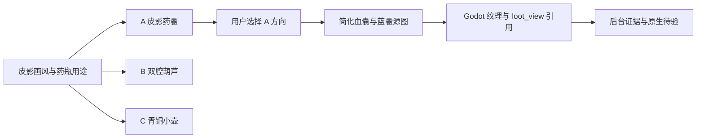

# 血瓶／蓝瓶 · 皮影药囊 v1

2026-10-23。用户查看三组美术原型后选择 A 皮影药囊，随后制作本目录的简化静态源图并接入默认第一关。血瓶为朱砂宽圆囊与六芒日纹，蓝瓶为靛蓝棱肩囊与单水滴纹；符号仅区分用途，不定义新叙事阵营。

源图由内置 `image_gen` 以 A 候选为编辑参考制作，`art_source=host_image`；具体模型与费用未披露。源 PNG、完整提示词、区域与 SHA-256 见 [asset-record.json](asset-record.json)，[原型计划](../../../docs/art/血瓶与蓝瓶_美术原型与接入计划_v0.1.md)保留取舍。

## 参考、候选与交付

2026-10-23 任务标识 `POTION-PAIR`。以下索引整理已有来源与决策；原始制作和检查明细仍以链接文件为准。



| 关系 | 对象与依据 | 决策／交付边界 |
| --- | --- | --- |
| 需求／文字参考 → 三组候选 | [美术计划](../../../docs/art/血瓶与蓝瓶_美术原型与接入计划_v0.1.md)、[A／B／C 原型和提示词](../../../output/art/POTION-PAIR/2026-10-23-style-prototype-v1/README.md)、[来源记录](../../../output/art/POTION-PAIR/2026-10-23-style-prototype-v1/provenance.json) | 首轮仅使用画风上下文，生成未附参考图片；不能把文字参考写成实际图像输入 |
| B 原图 → 透明边修订 | [B 原图](../../../output/art/POTION-PAIR/2026-10-23-style-prototype-v1/B-pair.png)、[修订](../../../output/art/POTION-PAIR/2026-10-23-style-prototype-v1/B-alpha-edit-not-adopted.png) | 未采用：暖雾未完全消除且主体比例改变；原图与修订均保留 |
| 三组候选 → A 方向 | [选择与比较记录](../../../docs/art/血瓶与蓝瓶_美术原型与接入计划_v0.1.md#三组可选原型) | 用户于 2026-10-23 选择 A。AI 原型比较依据为皮影材质、宽圆／棱肩轮廓区分；B／C 为未选方案，不推测用户未陈述的选择理由 |
| A 图像参考 → 简化源图 | [A 原图](../../../output/art/POTION-PAIR/2026-10-23-style-prototype-v1/A-pair.png)、[血囊提示词](../../../output/art/POTION-PAIR/2026-10-23-production-v1/health-prompt.txt)、[蓝囊提示词](../../../output/art/POTION-PAIR/2026-10-23-production-v1/mana-prompt.txt)、[health.png](health.png)、[mana.png](mana.png) | 本轮才以 A 作为编辑图像参考，缩短挂件、减少细纹；源文件校验与工具记录见 [asset-record.json](asset-record.json) |
| 源图 → 运行资源与使用点 | [血囊资源](../../../godot/assets/loot/health.tres)、[蓝囊资源](../../../godot/assets/loot/mana.tres)、[loot_view.gd](../../../godot/scripts/presentation/loot_view.gd)、[房间呈现](../../../godot/scripts/presentation/room_journey_scene.gd)、[首关入口](../../../godot/scenes/tanggu_first_level.tscn) | 源 PNG 与运行 PNG 逐字节一致；AtlasTexture 裁取主体，`POTIONS` 按 `health`／`mana` 创建 Bottle Sprite2D；首关加载房间呈现，再实例化并更新 loot_view；具体尺寸／锚点见下方资源合同 |
| 接入 → 验证与待验 | [源文件清单](../../../output/art/POTION-PAIR/2026-10-23-production-v1/source-manifest.json)、[验证记录](../../../output/art/POTION-PAIR/2026-10-23-production-v1/verification.json) | 选中方向及后台接入已有依据；最终原生画面、最小尺寸可读性和手感仍待验 |

## 正式资源合同

- `health.png`、`mana.png` 均为 1254×1254 原始 RGBA，未重绘、抠色、缩放或覆盖接受版本；运行目录 `godot/assets/loot/` 的 PNG 与源文件逐字节一致。
- 由各自 `AtlasTexture` 选择主体区域：血瓶 `[284,245,686,782]`、蓝瓶 `[307,163,642,927]`。区域根据 alpha≥128 主体包围盒各留 3 px，排除远处零星低 alpha 噪点；未修改原 PNG。左右居中、底边为锚点，运行统一显示高 28 世界单位、距地 2 单位。
- 彩绘皮影材质采用线性过滤、无损压缩、无 mipmap；不是严格像素网格，不强制 nearest。阴影为独立地面节点，浮动只移动药囊本体，峰峰值 2 单位、周期 2.7 秒。
- 规则当前 F 目标用淡金地环；满资源时药囊保持可见，提示由现有 HUD 绘制；不再用瓶上“血／蓝”灰盒字。Boss 未入库奖励仍保持原有占位及标签。
- 同一 `runId` 内公开地面实例移除即消费，触发 0.24 秒、上收 12 单位的淡出；不读取可被其他输入覆盖的提示文案。换房／R 的运行标识改变先清空旧药囊和消失表现。暂停／阅读／失焦和失败冻结表现时间。动画不发资源、不决定消耗。

## 验证与边界

### 分类证据索引

按[项目证据指南](../../../docs/guides/验证证据与资产追溯.md#验证证据)整理 2026-10-23 已有检查，**本次补索引没有重跑历史游戏检查**。基线为当时未提交的混合工作树，版本身份以[源文件清单](../../../output/art/POTION-PAIR/2026-10-23-production-v1/source-manifest.json)和[包校验记录](../../../output/art/POTION-PAIR/2026-10-23-production-v1/packages.json)为准，同名新包不能继承旧结论。

| 类别 | 当时结论与范围 | 证据／待验 |
| --- | --- | --- |
| 构建／导入 | 干净导入、Mac／Windows 导出与包核验通过 | [clean.json](../../../output/art/POTION-PAIR/2026-10-23-production-v1/clean.json)、[packages.json](../../../output/art/POTION-PAIR/2026-10-23-production-v1/packages.json)；Windows 实机另列 |
| 逻辑／回归 | 规则、实际首关流程和药瓶呈现结构检查通过 | [verification.json](../../../output/art/POTION-PAIR/2026-10-23-production-v1/verification.json)；纹理和浮动断言不代表视觉认可 |
| 运行／加载 | Mac 包后台默认／专项加载通过；Windows 运行未验证 | [packages.json](../../../output/art/POTION-PAIR/2026-10-23-production-v1/packages.json)；无窗口模式，非前台试玩 |
| 交互／流程 | 自动化流程通过；最终美术版原生输入与拾取手感未验证 | [验证 README](../../../output/art/POTION-PAIR/2026-10-23-production-v1/README.md)；此前掉落机制确认不扩大为最终美术版试玩通过 |
| 视觉／表现 | 浏览器源图比例预览已检查；原生画面与用户最终确认未验证 | [preview.html](../../../output/art/POTION-PAIR/2026-10-23-production-v1/preview.html)、[图像 QA 与警告](../../../output/art/POTION-PAIR/2026-10-23-production-v1/asset-qa.json)；不是 Godot 截图 |
| 性能／稳定性 | 未验证 | 实际画面／性能等待用户安排，Windows 实机暂缓；后台和构建结果不推导性能 |

药瓶实际场景呈现检查 21 项已通过：两种纹理与尺寸、轮廓区别、无灰盒文字、满值留地、只读状态、浮动／暂停、拾取淡出／释放、同帧提示覆盖、换房／R 清理及 Boss 占位。公开规则 168 项（55 例／4250 冻结快照）、实际首关流程 22 项及全量后台检查通过；无缓存副本导入与药瓶／Boss 场景通过，Mac Universal／Windows x64 导出和压缩包核验通过，Mac 包签名／双架构／默认与专项资源加载通过。两轴审查均无开放问题，详见[验证记录](../../../output/art/POTION-PAIR/2026-10-23-production-v1/README.md)。

[最终源图比例预览](../../../output/art/POTION-PAIR/2026-10-23-production-v1/preview.html)可直接打开，提供 14／28／42 px、深浅与棋盘格、灰度和状态示意；属于浏览器渲染，非 Godot 截图。720p Boss 房适配倍率约 0.5，药囊仅约 14 屏幕像素，可读性及遮挡仍需实际前台复核。当前仅后台检查，Windows 实机未执行。

源码工程直接使用原有命令：

```sh
./play --test drops --health 60 --mana 40
```

无需启用新的环境或药瓶美术开关。原始三方向、未采用的 B 透明边修订与工具检查保留在 `output/art/POTION-PAIR/2026-10-23-style-prototype-v1/`，不是运行资源。
