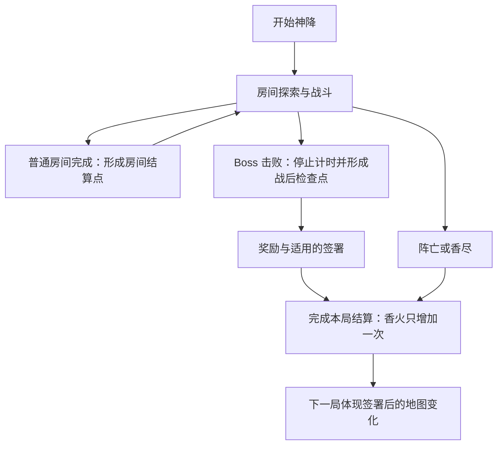

# 九鼎：架构选型结论

2026-10-26 首关扩展候选：本集成分支已进入十三主线＋三支路实现，实际代码、构建和待验项以[扩展实施记录](../mvp/汤谷首关扩展_实施记录_2026-10-26.md)为准。下文七房／八房及旧包哈希属于对应日期的历史证据，原生完整试玩、时长、内容审核与正式采用另行验收，迁移T15—T18和Windows实机状态不因此关闭。

**Boss灰盒整合（2026-10-22）：** 用户确认索尔独立灰盒测试通过并要求集成。当前默认流程在第三庭与原出口之间新增索尔雷庭，共八房；击败Boss开放两侧门，到原出口才完成首关，跨房保留生命、能量、冷却，往返不刷新，R重开整段。正式美术、叙事出场档位、签署及存档仍另行制作，详见[Boss实施记录](../mvp/首关Boss_索尔_实施记录_2026-10-22.md)。下文迁移阶段“Boss未实现”描述其历史范围，不否认当前灰盒接入。

**房间地图方向更新（2026-10-21）：** 用户确认地图改为独立房间，过门切换场景；完成本房间任务后开放通往后续房间的入口，保留当前画风。此决定替代连续大地图的组织方式，七房间互通流程、任务封门与 F 过门已确认并接入默认入口；已完成房间可往返且不刷新，随机组合后续再接。见 [ADR-0013](../adr/0013-independent-room-map-progression.md)。

当前基线（2026-10-20）：主工程为 **Godot原生2D＋带类型GDScript**，完整汤谷战斗与探索已迁移，开发、运行、测试与导出见 [Godot README](../../godot/README.md)。动态小样已获用户确认；完整候选的双平台原生功能、前台性能、稳定性与最终画面／手感仍按 [候选验收记录](../migration/Godot候选_验收记录.md)独立跟踪。正式存档、剧情、Boss与神降／签署闭环尚未实现。

主 IP 为「九鼎」，副 IP 为「十日」；组合发行名未定。历史文件名保留，当前术语与规则以本文、[术语表](../../GLOSSARY.md)和[确认记录](../product/十日_玩法与运行规则.md)为准。

Godot当前决定见 [ADR-0010](../adr/0010-godot-migration-direction.md)，迁移范围与后续商业版预案见 [迁移方案](九鼎_Godot架构评估与迁移落地方案_2026-10-19.md)。Electron／Phaser仅保留作旧版参照，原技术验证选型见 [ADR-0006](../adr/0006-validation-toolchain.md)；2026-10-16的初始化与以下MVP访谈为历史范围记录，具体交付不再以初始化时的状态为准。

**近期目标更新（2026-10-16）：** 用户随后将最先开展的目标缩小为单房间跑动与攻击MVP，当前已整理[《MVP-01 跑动与射箭需求》](../mvp/九鼎_MVP01_跑动与射箭需求_v0.1.md)及最小资产清单，仍处于需求阶段。本文第5节的Boss、借眼、签署与恢复闭环保留为后续验证范围；不能将其视为MVP-01本次必做内容，也不能将简化MVP通过视为完整闭环通过。本文已确认的整体技术与玩法基线继续有效。

该MVP第一轮访谈已确认先占位功能、再代表素材动态画风两阶段验收；普通攻击支持短按与按住连射，人物动作先做少量样例，地面先用单张底图。用户明确要求本MVP同时确保macOS与Windows，两端实际运行和验收证据均为完成条件，不能将Windows后置；尚未执行这些验证。

第二轮已收束：MVP-01覆盖Apple Silicon Mac与Windows x64各至少一台实机，分别交付可解压运行的ZIP。两端1080p输出、预热后连续跑射60秒，平均帧率至少58 FPS、至少95%的帧间隔不超过20毫秒，并另做5分钟稳定性检查；该门槛仅对记录中的测试设备与小场景成立。连射松手、鼠标出画面与失焦的取消规则已回写需求。具体制作与实测仍未开始；不将这些需求决定写成已通过结果。

## 1. 已确认的基线

**MVP-02 更新（2026-10-17）：** 用户已确认更大连续汤谷地图、固定等距角度的跟随镜头、默认最大化与可切换全屏、任意比例铺满、四向精修动画、固定弓箭技能组和三组影偶战斗。完整规则、19 个资产管理组及双平台验收见 [MVP-02 Spec](../mvp/九鼎_MVP02_Spec.md)，已发布为 [GitHub Spec #2](https://github.com/Bacsonlx/NineTripodCauldrons/issues/2)；镜头决定见 [ADR-0009](../adr/0009-mvp02-follow-camera-world-space.md)。这替代 MVP-01 的单屏练习范围，不改变二维平面与离线图集基线；MVP-02 功能代码与代表素材已进入接入验收，实际实现、产物及未验项目见 [MVP-02 实现记录](../mvp/MVP02_实现与验收记录.md)；不能以代码或构建通过认定双平台完成，MVP-01 的未完成验收保持独立。

**MVP-03 更新（2026-10-18）：** 用户已确认现有尺寸内重做汤谷主路、两条可选支路及回程捷径，精修现有四种操作的特效，并加入安全状态下的 F 键残碑阅读、一次性回血祭坛与内侧开门；探索状态随 R 重置。先确认真实动态小样，再铺满全图。完整范围、14 组资产和验收边界见 [MVP-03 Spec](../mvp/九鼎_MVP03_Spec.md)，已发布为 [GitHub Spec #17](https://github.com/Bacsonlx/NineTripodCauldrons/issues/17)。当前已实现 T01—T06 的灰盒通路、局部环境与四种特效，T07 动态小样 0.3.0-sample.1 已获用户明确通过，残碑短文 v0.1 另获批准；后续 0.3.0 已接入 F 残碑／祭坛／内侧栅门及全图环境。规则和渲染整合已验证，Mac 原生完整玩法及 Windows 实机仍待验；当前交付与边界见 [完整探索实现记录](../mvp/MVP03_完整探索_实现与验收记录.md)。不自行重启用户已叫停的反复长时采样，也不改写旧规格的历史未验状态。

| 项目 | 决定 |
| --- | --- |
| 平台与运行范围 | Windows x64／Apple Silicon Mac，Godot原生单机离线；其他平台与实时联机另行评估 |
| 游戏框架与语言 | Godot原生2D＋带类型GDScript；Compatibility渲染器，Windows兼容仍待实机验收 |
| 构建与打包 | 锁定官方Godot与导出模板；Python制作／验证工具；Mac Universal 2及Windows x64 ZIP |
| 存档 | 当前汤谷不持久化；版本化JSON、提交与恢复协议属于后续正式存档设计 |
| 空间与镜头 | 固定等距俯视、二维战斗平面，分层与光效形成 2.5D 观感；首版不要求镜头旋转或立体高低差交战 |
| 美术与动画 | 皮影为主、像素质感为辅；动画离线制作，以序列帧与图集交付，运行时按需分层；首个版本不接专用骨骼动画运行时 |
| 操作 | 当前完整支持键鼠WASD＋鼠标，移动与瞄准分离；手柄进入后续商业闭环 |
| 性能目标 | 指定双平台实机1080p跑射60秒平均≥58FPS、至少95%帧间隔≤20ms，另做5分钟稳定性；仍待最终原生验收 |

## 2. 游戏与状态边界

- 玩家是封神榜空位，以同一个孩子保持身体连续性；各局改变的是所请之神。后羿可以走完关键剧情，不能以玩家掌握另一位神的完整操作作为主线门槛。
- 一局等于一次神降，以一个地区为主要范围，内部使用手工房间的随机组合。血量与临时强化属于局内状态，地区解锁、主线、传说和九鼎碎片属于跨局进度。
- 一炷香是单局时限；香火是全玩家档案共享的跨局累计。香火主要解锁深层内容，低档挑战仍可重玩。
- 单局计时在暂停、强制对白、加载与失焦时停止；普通退出可以续玩，不算阵亡，也不增长累计香火。
- 签署按地区独立统计，多数决定地区版本，平票沿用当前版本；地图变化从下一局体现。累计香火在正式局末只增加一次，特殊档案的额外来源只在首次获得时发放。
- 鼎成清空当前档案的游戏进度，保留设置与独立结局记录；自动故障恢复不得撤销已经完成的主动重置。

## 3. 检查点与结算

普通未完成房间中断后，从最近完成的房间结算点重试；Boss 已击败后的中断返回战后结算界面，不重新战斗。首间房的初始恢复点、随机结果的保存方式和结算提交顺序属于实现细化，尚未测试。

工程约束：奖励、签署、香火和本局完成标记需要保持一致，不能因为退出或重复恢复而漏发／重发。JSON 文件本身不自动保证这一点。建议以可验证的一致提交与恢复协议实现，并测试在写入和阶段切换中断时的结果；鼎成主动重置还需区分有效恢复与旧进度回滚。

## 4. Godot 工程职责

`godot/scripts/combat/training_room.gd` 裁决战斗、探索与时间；`input/player_controls.gd` 将键鼠及操作中断转换为规则输入；`presentation/`读取公开状态呈现人物、相机、特效与HUD。窗口与桌面导出由Godot原生能力承担，运行不经过Electron、preload或Node.js。

正式地图 `godot/scenes/tanggu_map.tscn` 通过 `world/` 原生节点生成布局；编辑器保存、运行与导出使用同一来源。`tools/migration/`负责既有素材转换、后台验证和候选打包，旧TypeScript规则及冻结轨迹用于移植对照。具体职责、编辑字段和命令见 [Godot开发说明](../../godot/README.md)。

## 5. 首个验证闭环

**后羿＋汤谷短流程＋少量敌人＋索尔一个阶段＋死亡重开＋一次借眼／跳过＋一次签署到下一局地图变化＋中途退出恢复。**

素材数量保持最小，但需要代表已选定的画风和实际角色动画。索尔用于验证战斗，正式故事中的出场档位和揭示方式不由这个测试场景决定。本阶段不制作其他地区、完整附体角色与完整结局。

| 验证面 | 必须获得的证据 |
| --- | --- |
| 动作与空间 | 移动、独立瞄准、射箭、闪避、受击可连续操作；脚点、遮挡与命中区域一致；动画方向与分层效果可接受 |
| 借眼与证据 | 正常观看、跳过和中断恢复后，关键证据不漏发、不重复，且不要求掌握另一套角色操作 |
| 签署与世界 | 两种签署分别验证；下一局呈现对应地区版本，平票保持原版本，不误改其他地区 |
| 结算与恢复 | 普通房间和战后界面分别中断；恢复位置正确，不重打已击败 Boss，不重复获得奖励或香火 |
| 性能与资源 | 在指定硬件记录 1080p 输出下的帧时间分布、内存与纹理使用；重复进出房间和重开后无持续无界增长 |
| 桌面发行 | Windows／macOS 实际安装包可启动并加载资源；验证窗口缩放、失焦、睡眠恢复与手柄断连重连 |

上述商业闭环尚未实现或验证；当前交付为完整汤谷战斗与探索切片，后台规则和构建结果见候选验收记录。60FPS、游戏同屏数量、最低配置与完整制作工期均不作为已有结果交付。

## 6. 后续处理，不阻塞本轮文档收束

- **实验确定：** 软件版本、制作工具、动画方向数和帧数、图集预算、压力场景规模、帧时间验收阈值。
- **原型调校：** 辅助瞄准、单局长度、香火阈值、档位分期、短局累计节奏。首个切片不新增主动放弃并结算的功能；相关规则留待需要该功能时定义。
- **按内容阶段设计：** 完整镜像攻击编排、词条奖励时点、借眼／同行的演出与计时边界、后置角色的永久损失、其他地区与结局。
- **制作前补齐的输入：** 最低目标硬件、首发渠道与平台验证顺序、实际开发与美术人力。未获得这些信息前不估算完整制作周期。

本轮确认的是技术验证架构，没有确认全部商业版内容已经可排期或风险已经消除。

## 7. 决策依据

[完整风险评估](十日_技术架构与实现风险评估.md)保留事实来源和风险分析；[故事基线](../story/九鼎_故事基线_v1.2与架构影响.md)保留新旧故事的差异；[ADR-0001](../adr/0001-fixed-isometric-2d-world.md)至 [ADR-0008](../adr/0008-ending-reset-boundary.md)记录主要取舍。
