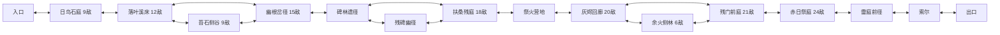

# 汤谷：房间互通地图

2026-10-26，本集成分支已接入十六房扩展候选，原生试玩与正式采用状态见[扩展实施记录](../mvp/汤谷首关扩展_实施记录_2026-10-26.md)。房间为可独立编辑的Godot场景，旧连续大地图与八房历史证据保留。

## 运行与流程

运行 `./play`，首页选择完整征程，或快速测试指定房间。源码入口仍为 `godot/scenes/tanggu_first_level.tscn`。



- 共16房、18对双向连接、36门；支路不能绕过主线战斗。普通主线119敌21波，含支路134敌24波，每波最多7只，Boss援军另计。
- 未完成战斗／读碑房封住全部门，完成后全部开放；安全房直接通过。满血不消耗祭火，也能通行。C支路清场后可选一次回血。
- 走近门按F，门显示目标房名及前行／返回／可选支路／汇入主路；方向按设计顺序。持续按F不会反复切房；药瓶拾取保留F优先级。
- 往返保留敌人、探索、地面掉落、已用祭火及完成状态；同局共享构筑、资源和冷却，不补满。加载与整理不推进有效冒险时间，Boss倒下后停止累计，现实总耗时单独记录。
- 只有入口、祭火营地、雷庭前径可整理；七主线战斗房首波首杀与A支路末波首杀的构筑战利品在波次达成时记入本房待发队列，待本房间清庭（`roomComplete`）时统一落点发放（主线7枚、含A最多8枚，血／蓝药囊仍为战中即时掉落）。
- M切换当前房总览／跟随，小地图显示全16房暗色未访轮廓。完整征程存活R先确认；阵亡后或快速测试R按本次初始条件重开。暂停／阅读／整理中R无效，返回首页先确认。
- 快速测试可选所有房间，不补前序任务、奖励或构筑，到出口仅记片段完成；从入口测试也保留测试身份。磁盘续局、正式战后结算和其他地区仍为后续范围。

以下带日期的七房／八房段落为历史实现与原型记录，不描述扩展候选当前数量。

## 2026-10-22 · 首关接入索尔灰盒

用户确认独立灰盒通过后，默认入口已扩展为八房。Boss房为1440×1040的独立灰盒场地，左门连接第三庭，右门连接原出口；原有房间只调整相邻门目标，保留布局。进房保留生命、蓝量、精力及其恢复等待和冷却，不补满资源。Boss未败时两门封锁；击败后可以移动过门与回溯，Boss不刷新，R重开全部进度。

Boss房固定显示完整场地，HUD显示索尔生命和破绽提示，小地图“首”为Boss房、“出”为原出口。镜头预留HUD空间，门柱放在战斗区外，避免侵入已验收的飞锤通路。当前全图16扇门。正式素材尚未接入，仍用已通过的几何占位；详情及后台验证见[实施记录](../mvp/首关Boss_索尔_实施记录_2026-10-22.md)。

## 扶桑残庭样板还原（2026-10-21）

用户确认石材融合修订 v0.3 后要求开始实现，本轮将这一间接入正式 `court2.tscn`。保留上沿扶桑根、偏下低矮残石、较小的原石庭，以及三门和双侧通路；其余六间维持当前场景，继续按先精做、后还原的顺序推进。

新残石使用正常导入的纹理与 AtlasTexture，来源、裁切和脚点见[素材合同](../../assets/environment/tanggu-ruin-stone-v1/README.md)。未接入原型专用脚本或完整场景底图。规则、门位、实体、素材变换与同视角离线构图按样板逐项核对；静态对齐与实际运行验证边界见[交付记录](../../output/level-design/tanggu-court2-implementation-20261021/README.md)。

## 门的通行表现（2026-10-21）

当前战斗密度已按用户确认增加为42影偶、8波：日鸟石庭4＋5，扶桑残庭4＋5＋6，赤日祭庭5＋6＋7。每波最多7个；第一波进入庭内触发，后续波清空后等待1.2游戏秒自动出现，地面预告标记下一波位置。HUD显示当前波数、剩余敌人或倒计时，全部波次完成才开门；暂停冻结，往返不刷新，R重开整段流程。

对应场景的 `Encounter`、`Encounter2` 等节点按根节点顺序定义波次，每组敌人的位置与外观可独立调整。空波次、不可走或无法到达本波中心的出生点会被拒绝。其他房间、建筑和门连接保持原布局。普通箭命中冲击、Q／E技能动效与闪避残影同步强化，伤害、范围与冷却保持现值，详见 [调校合同](../balance/首关波次与命中反馈_2026-10-21.md) 和 [动效及验证](../../output/combat-feel-20261021/README.md)。原生爽感和密集战斗性能待试玩。

全部14扇房间通道共用一份门场景。新门框沿用灰绿石材与日纹，门墩附苔藓、根须、碎石及软阴影。任务未完成时保持封门、漩涡熄灭；房间完成后才显示青金色贴地漩涡与“可通行”，靠近时出现“F · 前往房间”。漩涡对齐实际 Approach 操作点，人物绘制在其上；慢速旋转与明暗呼吸使用游戏时钟，暂停／读碑时冻结。开放效果不改变任务、门连接、碰撞或F规则。

[锁定／开放对照](../../output/level-design/tanggu-portals-20261021/index.html)，素材由内置 imagegen 制作，保留透明源图与[完整提示词、来源记录](../../output/art/TANGGU-PORTAL/2026-10-21-v1/generation.json)。编辑时继续移动整个门节点或 Approach；漩涡自动跟随，无需单独摆放。当前是后台呈现验证，原生动态效果与融合度仍待用户试玩。

## 编辑规则

当前首关场景为 [tanggu_first_level.tscn](../../godot/scenes/tanggu_first_level.tscn)，默认启动先到[原生首页](../../godot/scenes/home.tscn)，确认出发后进入；编辑器可直接运行首关场景，命令行用 `./play --test level` 直达。房间在 [godot/scenes/rooms](../../godot/scenes/rooms/)。原 [tanggu_first_level_map.tscn](../../godot/scenes/tanggu_first_level_map.tscn) 与 [tanggu_map.tscn](../../godot/scenes/tanggu_map.tscn) 保留。

1. 在 Godot 编辑对应房间。根节点的 `Room Id` 与文件名一致，`Objective` 为 safe／combat／explore。素材使用独立环境实例；其他圆庭中央继续保持净空，扶桑残庭按确认样板保留偏下残石及上下通路。
2. `Ground` 定义材质，`Walkable/Floor` 定义可走边界；调整通路时同步修改。地图根保持原点、无旋转和缩放，环境使用 Render Width／Size 定义显示和实体。
3. `Doors` 每个子节点是一扇门。`Portal Id` 标识本门，`Target Room`／`Target Portal` 定义目标，目标门须反向指回。`Target Title` 是玩家看到的目标名称。
4. 移动整个门或 Doors 分组会同步移动门锁、柱脚、互动与到达位置；旋转／缩放门或容器会校验失败，因为当前碰撞采用轴对齐占地。
5. `Approach` 是可站立的 F 互动位置，`Arrival` 是从另一房进入时的出生位置。两者须可走、互通，并位于房内。门洞不是角色碰撞中心；移动前后检查柱脚不阻挡到达点。
6. 残碑、祭火的互动点是建筑子节点，移动建筑同步移动实体和互动位置。营地支杆与铺盖也有独立脚底实体。
7. 保存重开后运行、规则和导出读取同一场景。一次性制作工具 [build_room_maps.py](../../tools/level_design/build_room_maps.py) 拒绝输出到已存在的目录，不重跑覆盖用户布局。

房间规则入口接收操作与时间，公开快照提供任务与切房状态。呈现层仅挂载当前房间，已访问房间的规则对象由本次流程保留；不把场景重建当整局 reset。通用旧战斗规则保持独立，旧连续地图的回归继续保留。

## 验证与待验

```sh
python3 tools/migration/check_godot.py
python3 tools/migration/export_godot.py
```

新增检查覆盖任务锁门、实际清敌、读碑、往返不刷新、生命／冷却连续、长按F、七房连接与可达、中央净空、编辑同步、暂停及实际输入切场景。完整流程检查通过真实移动、普通攻击、Q／E及F互动推进，不直接改生命或任务完成状态。

[七房间布局预览](../../output/level-design/tanggu-rooms-20261021/index.html) 按实际节点离线组装，接地透明渐变在SVG中近似；不含动态人物／敌人，也不是GPU截图。检查、干净导入、原生包资源及来源哈希见[验证记录](../../output/level-design/tanggu-rooms-20261021/verification.json)。当前仍仅后台验证，真实动态画面、操作感和性能待用户安排前台试玩；Windows实机继续暂缓。

## 首关构筑营地（2026-10-24）

入口、祭火房及三庭根节点下的 `CampPoint` 是真实整理点，可在编辑器移动，须保持在可行走区域。运行时100距离内且没有实体遮挡，按 I 打开整理；三庭必须清完本房全部波次。营地标记随节点位置显示，地图检查拒绝不可行走的位置。完整首关适配口径及待验项见[第一批实施记录](../mvp/第一关玩法补全_第一批实施记录_2026-10-24.md)。
