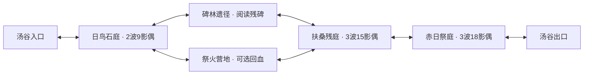

# 汤谷：七房间互通地图

2026-10-21，依据用户已确认的七项地图选择接入默认入口。使用现有独立素材与战斗操作，房间为各自可编辑的 Godot 场景；原连续大地图保留。

## 运行与流程

```sh
godot --path godot
```



- 进入未完成战斗／探索房即封住全部门，包括来路；清除敌人或阅读并合上残碑后，所有门一起开放。
- 安全房直接通行。祭火仍恢复40生命并封顶100，满血不消耗，也不阻挡通路。
- 走近门按 **F**，提示显示目标房间；进入目标门内的到达点。持续按住F不会在两间房之间来回跳转。
- 已完成房间可反复往返，保留死去敌人、已读残碑、已用祭火及任务完成状态。
- 换房属于同一局，保留生命、技能与攻击冷却。加载不推进计时；切房清理输入、待发动动作及已生效弹道／特效，避免攻击跨场景。
- **M** 查看当前房间总览／恢复跟随，**R** 重开整段流程。Esc暂停、失焦暂停、阅读暂停和全屏操作继续沿用既有规则。
- 清完第三庭并到达出口后提示流程完成，仍可回头探索。Boss、随机组合、构筑、正式磁盘存档不在本轮，退出不持久保存本次房间进度。

## 门的通行表现（2026-10-21）

当前战斗密度已按用户确认增加为42影偶、8波：日鸟石庭4＋5，扶桑残庭4＋5＋6，赤日祭庭5＋6＋7。每波最多7个；第一波进入庭内触发，后续波清空后等待1.2游戏秒自动出现，地面预告标记下一波位置。HUD显示当前波数、剩余敌人或倒计时，全部波次完成才开门；暂停冻结，往返不刷新，R重开整段流程。

对应场景的 `Encounter`、`Encounter2` 等节点按根节点顺序定义波次，每组敌人的位置与外观可独立调整。空波次、不可走或无法到达本波中心的出生点会被拒绝。其他房间、建筑和门连接保持原布局。普通箭命中冲击、Q／E技能动效与闪避残影同步强化，伤害、范围与冷却保持现值，详见 [调校合同](../balance/首关波次与命中反馈_2026-10-21.md) 和 [动效及验证](../../output/combat-feel-20261021/README.md)。原生爽感和密集战斗性能待试玩。

全部14扇房间通道共用一份门场景。新门框沿用灰绿石材与日纹，门墩附苔藓、根须、碎石及软阴影。任务未完成时保持封门、漩涡熄灭；房间完成后才显示青金色贴地漩涡与“可通行”，靠近时出现“F · 前往房间”。漩涡对齐实际 Approach 操作点，人物绘制在其上；慢速旋转与明暗呼吸使用游戏时钟，暂停／读碑时冻结。开放效果不改变任务、门连接、碰撞或F规则。

[锁定／开放对照](../../output/level-design/tanggu-portals-20261021/index.html)，素材由内置 imagegen 制作，保留透明源图与[完整提示词、来源记录](../../output/art/TANGGU-PORTAL/2026-10-21-v1/generation.json)。编辑时继续移动整个门节点或 Approach；漩涡自动跟随，无需单独摆放。当前是后台呈现验证，原生动态效果与融合度仍待用户试玩。

## 编辑规则

当前入口为 [tanggu_first_level.tscn](../../godot/scenes/tanggu_first_level.tscn)，房间在 [godot/scenes/rooms](../../godot/scenes/rooms/)。原 [tanggu_first_level_map.tscn](../../godot/scenes/tanggu_first_level_map.tscn) 与 [tanggu_map.tscn](../../godot/scenes/tanggu_map.tscn) 保留。

1. 在 Godot 编辑对应房间。根节点的 `Room Id` 与文件名一致，`Objective` 为 safe／combat／explore。素材使用已有环境实例，圆盘中央保持净空。
2. `Ground` 定义材质，`Walkable/Floor` 定义可走边界；调整通路时同步修改。地图根保持原点、无旋转和缩放，环境使用 Render Width／Size 定义显示和实体。
3. `Doors` 每个子节点是一扇门。`Portal Id` 标识本门，`Target Room`／`Target Portal` 定义目标，目标门须反向指回。`Target Title` 是玩家看到的目标名称。
4. 移动整个门或 Doors 分组会同步移动门锁、柱脚、互动与到达位置；旋转／缩放门或容器会校验失败，因为当前碰撞采用轴对齐占地。
5. `Approach` 是可站立的 F 互动位置，`Arrival` 是从另一房进入时的出生位置。两者须可走、互通，并位于房内。门洞不是角色碰撞中心；移动前后检查柱脚不阻挡到达点。
6. 残碑、祭火的互动点是建筑子节点，移动建筑同步移动实体和互动位置。营地支杆与铺盖也有独立脚底实体。
7. 保存重开后运行、规则和导出读取同一场景。一次性制作工具 [build_room_maps.py](../../tools/level_design/build_room_maps.py) 拒绝输出到已存在的目录，不重跑覆盖用户布局。

房间规则入口接收操作与时间，公开快照提供任务与切房状态。呈现层仅挂载当前房间，已访问房间的规则对象由本次流程保留；不把场景重建当整局 reset。通用旧战斗规则保持独立，旧连续地图的回归继续保留。

## 验证与待验

```sh
python3 tools/migration/check_godot.py
python3 tools/migration/export_godot.py
```

新增检查覆盖任务锁门、实际清敌、读碑、往返不刷新、生命／冷却连续、长按F、七房连接与可达、中央净空、编辑同步、暂停及实际输入切场景。完整流程检查通过真实移动、普通攻击、Q／E及F互动推进，不直接改生命或任务完成状态。

[七房间布局预览](../../output/level-design/tanggu-rooms-20261021/index.html) 按实际节点离线组装，接地透明渐变在SVG中近似；不含动态人物／敌人，也不是GPU截图。检查、干净导入、原生包资源及来源哈希见[验证记录](../../output/level-design/tanggu-rooms-20261021/verification.json)。当前仍仅后台验证，真实动态画面、操作感和性能待用户安排前台试玩；Windows实机继续暂缓。
