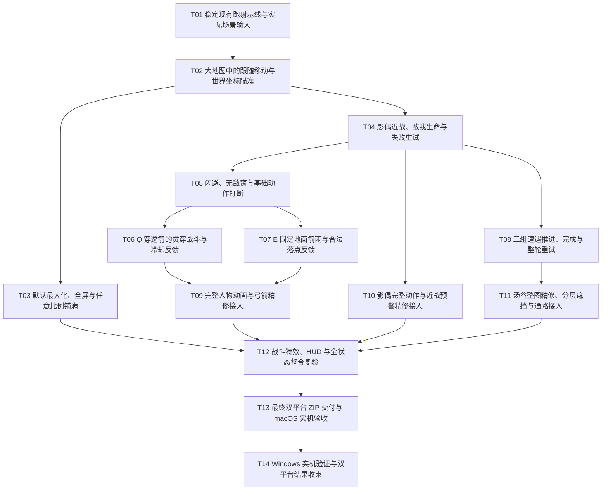

# MVP-02 票据拆分与发布记录 v0.1

2026-10-17。状态：用户已确认当前拆分；14 个 GitHub 子 Issue 已发布，17 条原生阻塞关系已回读核对；尚未开始实现。

来源：[[Spec] MVP-02：汤谷大地图、全屏与弓箭战斗切片（macOS／Windows）](https://github.com/Bacsonlx/NineTripodCauldrons/issues/2)。已读取最新完整正文及评论，当前评论 0 条。共 14 项、17 条直接阻塞边；T 编号是切片编号，GitHub Issue 编号见下表。旧 MVP-01 的八项草稿不属于本轮，也未被默认为已批准。

## GitHub 发布索引

| 切片 | GitHub Issue | 原生阻塞前置 |
| --- | --- | --- |
| T01 | [#3 稳定现有跑射基线与实际场景输入](https://github.com/Bacsonlx/NineTripodCauldrons/issues/3) | 无 |
| T02 | [#4 大地图中的跟随移动与世界坐标瞄准](https://github.com/Bacsonlx/NineTripodCauldrons/issues/4) | [#3](https://github.com/Bacsonlx/NineTripodCauldrons/issues/3) |
| T03 | [#5 默认最大化、全屏与任意比例铺满](https://github.com/Bacsonlx/NineTripodCauldrons/issues/5) | [#4](https://github.com/Bacsonlx/NineTripodCauldrons/issues/4) |
| T04 | [#6 影偶近战、敌我生命与失败重试](https://github.com/Bacsonlx/NineTripodCauldrons/issues/6) | [#4](https://github.com/Bacsonlx/NineTripodCauldrons/issues/4) |
| T05 | [#7 闪避、无敌窗与基础动作打断](https://github.com/Bacsonlx/NineTripodCauldrons/issues/7) | [#6](https://github.com/Bacsonlx/NineTripodCauldrons/issues/6) |
| T06 | [#8 Q 穿透箭的贯穿战斗与冷却反馈](https://github.com/Bacsonlx/NineTripodCauldrons/issues/8) | [#7](https://github.com/Bacsonlx/NineTripodCauldrons/issues/7) |
| T07 | [#9 E 固定地面箭雨与合法落点反馈](https://github.com/Bacsonlx/NineTripodCauldrons/issues/9) | [#7](https://github.com/Bacsonlx/NineTripodCauldrons/issues/7) |
| T08 | [#10 三组遭遇推进、完成与整轮重试](https://github.com/Bacsonlx/NineTripodCauldrons/issues/10) | [#6](https://github.com/Bacsonlx/NineTripodCauldrons/issues/6) |
| T09 | [#11 完整人物动画与弓箭精修接入](https://github.com/Bacsonlx/NineTripodCauldrons/issues/11) | [#8](https://github.com/Bacsonlx/NineTripodCauldrons/issues/8)、[#9](https://github.com/Bacsonlx/NineTripodCauldrons/issues/9) |
| T10 | [#12 影偶完整动作与近战预警精修接入](https://github.com/Bacsonlx/NineTripodCauldrons/issues/12) | [#6](https://github.com/Bacsonlx/NineTripodCauldrons/issues/6) |
| T11 | [#13 汤谷整图精修、分层遮挡与通路接入](https://github.com/Bacsonlx/NineTripodCauldrons/issues/13) | [#10](https://github.com/Bacsonlx/NineTripodCauldrons/issues/10) |
| T12 | [#14 战斗特效、HUD 与全状态整合复验](https://github.com/Bacsonlx/NineTripodCauldrons/issues/14) | [#5](https://github.com/Bacsonlx/NineTripodCauldrons/issues/5)、[#11](https://github.com/Bacsonlx/NineTripodCauldrons/issues/11)、[#12](https://github.com/Bacsonlx/NineTripodCauldrons/issues/12)、[#13](https://github.com/Bacsonlx/NineTripodCauldrons/issues/13) |
| T13 | [#15 最终双平台 ZIP 交付与 macOS 实机验收](https://github.com/Bacsonlx/NineTripodCauldrons/issues/15) | [#14](https://github.com/Bacsonlx/NineTripodCauldrons/issues/14) |
| T14 | [#16 Windows 实机验证与双平台结果收束](https://github.com/Bacsonlx/NineTripodCauldrons/issues/16) | [#15](https://github.com/Bacsonlx/NineTripodCauldrons/issues/15) |

## 已确认拆分

1. **[T01 稳定现有跑射基线与实际场景输入](01-playable-baseline.md)**  
   **Blocked by：** 无  
   **交付：** 在当前分层素材版本中，玩家可实际跑动、瞄准、射箭、绕柱、暂停和重试，形成后续扩展可重复验证的起点。

2. **[T02 大地图中的跟随移动与世界坐标瞄准](02-world-camera-aim.md)**  
   **Blocked by：** T01  
   **交付：** 玩家能在约 2560×1440 的连续占位汤谷地图穿行，镜头跟随并在边缘停止，移动镜头后仍能准确瞄准和射箭。

3. **[T03 默认最大化、全屏与任意比例铺满](03-window-fullscreen-resize.md)**  
   **Blocked by：** T02  
   **交付：** 启动默认最大化，玩家能切换／退出全屏，在普通、4:3 与超宽窗口下看到不拉伸、铺满的游戏画面并正常操作。

4. **[T04 影偶近战、敌我生命与失败重试](04-enemy-melee-health.md)**  
   **Blocked by：** T02  
   **交付：** 在大地图的一次占位遭遇中，玩家能射杀数只同款影偶，也会被可预判的近战攻击击伤、失败并按 R 重试。

5. **[T05 闪避、无敌窗与基础动作打断](05-dodge-interruption.md)**  
   **Blocked by：** T04  
   **交付：** 玩家能用空格短闪避躲过影偶攻击，穿过敌人但被墙柱阻挡，并在清楚的攻击／受击规则下行动。

6. **[T06 Q 穿透箭的贯穿战斗与冷却反馈](06-piercing-arrow.md)**  
   **Blocked by：** T05  
   **交付：** 玩家能边移动边用 Q 贯穿同一路线的多个影偶，看到不同于普通箭的基础表现及冷却，障碍仍能挡箭。

7. **[T07 E 固定地面箭雨与合法落点反馈](07-arrow-rain.md)**  
   **Blocked by：** T05  
   **交付：** 玩家能用 E 在合法鼠标地面点落圈并分段攻击多个影偶；移动或转鼠标不改变已选落点，低矮掩体不阻断施法。

8. **[T08 三组遭遇推进、完成与整轮重试](08-encounters-completion-retry.md)**  
   **Blocked by：** T04  
   **交付：** 玩家沿连续路线依次激活并清除 2／3／4 只影偶，最后获得完成提示；失败或主动 R 可从地图起点重试整个切片。

9. **[T09 完整人物动画与弓箭精修接入](09-player-animation-weapons.md)**  
   **Blocked by：** T06、T07  
   **交付：** 玩家在实际大地图战斗中使用完整四向精修动作、连续步态与弓箭，移动、普攻、三项技能和受击／失败均保持同一人物形象。

10. **[T10 影偶完整动作与近战预警精修接入](10-enemy-animation.md)**  
   **Blocked by：** T04  
   **交付：** 同款影偶在真实追击与近战交互中呈现统一画风的四向动作、可读预警、受击和消散。

11. **[T11 汤谷整图精修、分层遮挡与通路接入](11-tanggu-environment.md)**  
   **Blocked by：** T08  
   **交付：** 玩家沿安全起点、残垣廊道与战斗庭院完成三组战斗，看到精细汤谷背景、树木根系和祭坛，并能正确绕行和理解前后关系。

12. **[T12 战斗特效、HUD 与全状态整合复验](12-vfx-hud-integration.md)**  
   **Blocked by：** T03、T09、T10、T11  
   **交付：** 玩家在最终人物、影偶与汤谷环境中看清普通／强化箭、箭雨、闪避、敌方预警和所有冷却／生命／进度反馈，并得到可重复运行的完整战斗版本。

13. **[T13 最终双平台 ZIP 交付与 macOS 实机验收](13-zips-macos-acceptance.md)**  
   **Blocked by：** T12  
   **交付：** 获得同一版玩法和代表美术的 macOS Apple Silicon／Windows x64 ZIP，并完成 Mac 解压离线运行、功能、美术和性能验收，交给用户可复现的 Windows 验收步骤。

14. **[T14 Windows 实机验证与双平台结果收束](14-windows-acceptance.md)**  
   **Blocked by：** T13  
   **交付：** 在 Windows x64 实机验证用户收到的最终 ZIP，修复兼容问题并与 Mac 结果对齐，给出完整双平台验收记录。

## 依赖图

## 依赖与阶段说明

- 当前可开始的前沿只有 T01；其余按真实完成的前置任务推进，不强制整条链串行。
- T02 先在本票内完成必要的世界／视口边界整理，再交付可走可瞄准的大地图；不单独制造缺少可操作结果的架构重构票。
- T03 依赖 T02 的世界／视口边界，避免只放大窗口却仍以旧画布坐标射击。
- T06 与 T07 共同依赖 T05 的受击／闪避／冷却边界，彼此无阻塞；T08 与 T10 只依赖基础敌人，不等待全部技能。
- T09 验收完整玩家技能动作，因此依赖 Q 与 E 均可实际施放；T11 用三组遭遇验证最终地图通路，因此依赖 T08。
- T12 汇合窗口、玩家、影偶和地图四条分支，完成统一特效、HUD 与全部状态的组合复验；本票不是纯图片或纯 UI 制作。
- T02—T08 可用占位素材交付功能，仍须实际可操作；T09—T12 分别接入并验证各自代表素材，不以占位功能票通过声称画风完成。
- T13 交付两端最终 ZIP 并完成 Mac 实测即可完成；T14 独立保留 Windows 实机与双端一致性收束，避免“等待用户 Windows”反向阻塞全部实现。
- 逻辑上可开始不保证可以安全并行改同一文件；实施时按实际代码所有权协调，不为并行另造模块或回退其他人的改动。
- 所有票据使用父规格的行为、可调初值及性能门槛。MVP-01 #1 不作为整轮阻塞，不据此关闭它；父 Spec #2 正文、标签与状态不在本轮修改。

## 规格覆盖责任

下表只表示覆盖与复验责任，不表示用例已通过。尤其 AC-29／AC-30 必须分别有 Mac 与 Windows 结果。

| 验收项 | 负责票据 |
| --- | --- |
| AC-01 | T13、T14 |
| AC-02 | T02、T11 |
| AC-03 | T02、T03 |
| AC-04 | T02 |
| AC-05 | T02 |
| AC-06 | T09 |
| AC-07 | T01 |
| AC-08 | T04 |
| AC-09 | T06 |
| AC-10 | T06 |
| AC-11 | T07 |
| AC-12 | T07 |
| AC-13 | T07 |
| AC-14 | T05 |
| AC-15 | T05 |
| AC-16 | T06、T07、T12 |
| AC-17 | T05、T07、T12 |
| AC-18 | T04、T10 |
| AC-19 | T08 |
| AC-20 | T04、T08 |
| AC-21 | T08 |
| AC-22 | T08、T12 |
| AC-23 | T12 |
| AC-24 | T12 |
| AC-25 | T03、T14 |
| AC-26 | T10、T11、T12 |
| AC-27 | T09、T10、T11、T12 |
| AC-28 | T12 |
| AC-29 | T13、T14 |
| AC-30 | T13、T14 |

## 资产管理组的最终接入责任

前期票据可以使用可辨认占位与小样，最终每组只指定一个主要验收责任票；T12 汇总复核全部 19 组。制作与接入在同一可操作体验中验证，不先横向完成一批孤立图像。

| 资产组 | 主要验收票据 |
| --- | --- |
| M02-A01 | T09 |
| M02-A02 | T09 |
| M02-A03 | T09 |
| M02-A04 | T09 |
| M02-A05 | T09 |
| M02-A06 | T10 |
| M02-A07 | T09 |
| M02-A08 | T09 |
| M02-A09 | T11 |
| M02-A10 | T11 |
| M02-A11 | T11 |
| M02-A12 | T11 |
| M02-A13 | T11 |
| M02-A14 | T12 |
| M02-A15 | T12 |
| M02-A16 | T12 |
| M02-A17 | T12 |
| M02-A18 | T12 |
| M02-A19 | T12 |

## 发布核对

用户已批准当前 14 项拆分及 17 条直接依赖。已按前置顺序发布全部子 Issue，均标记 `ready-for-agent`，原生关联父规格 #2，并逐项回读核对标题、完整正文、开放状态、标签及原生阻塞边。GitHub 正文不重复维护文本阻塞清单，本地清单保留便于阅读。

父规格 #2 的正文、标题、标签、状态与评论与发布前一致。30 项规格验收均有责任票据，19 个资产管理组各有一个最终接入责任票。本记录仅证明票据发布与依赖核对完成，不表示游戏实现或平台验收完成。

当前前沿为 T01（#3）。T13（#15）交付双端 ZIP 并完成 macOS 验收；Windows 实机数据仍由 T14（#16）单独收束。未改动或关闭旧 MVP-01 #1。
