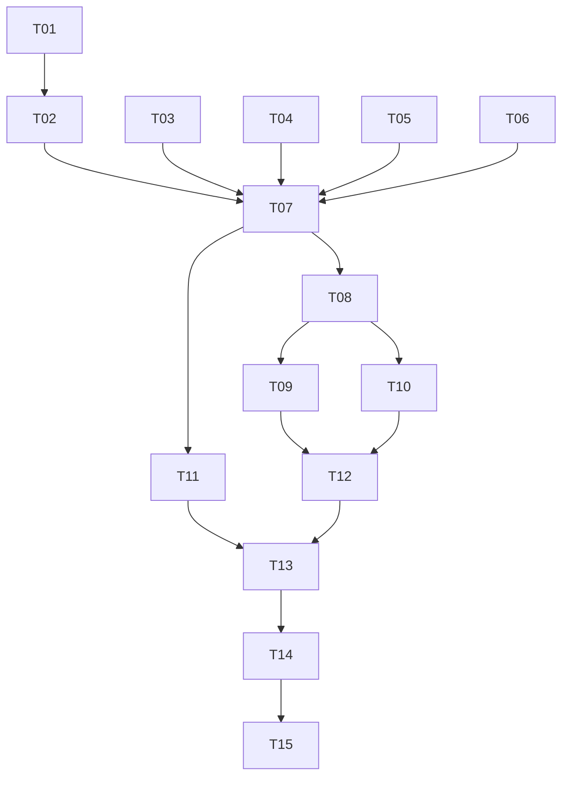

# MVP-03 票据拆分草稿

2026-10-18。来源：[MVP-03 Spec #17](https://github.com/Bacsonlx/NineTripodCauldrons/issues/17)；已读取线上完整正文和评论（无评论），正文与本地已确认规格一致。

**状态：拆分已获批准，15 个子 Issue 与 16 条原生阻塞关系均已发布并回读验证；未开始开发。**

[查看正式 Issue 映射与发布记录](../MVP03_票据发布记录_v0.1/README.md)。

## 拆分原则

- 每项交付可演示或可验证的行为，素材、输入、表现和适用检查随行为一起完成，不按美术／逻辑／UI 横向分层。
- 未发现需要单开宽泛预重构的理由。实际通路所需的最小布局与碰撞调整随 T01 先做；首条 F 互动随 T08 残碑完成，再由祭坛／门复用。
- T03—T06 可直接在现有版本开始，不被地图准备或彼此进度虚假阻塞；代码编辑重叠应协调，不人为增加产品阻塞。
- T07 必须记录用户对实际小样的明确确认，之后才能全图美术。碑文单独审阅：T01 提交，T08 可先验证明确占位阅读，T12 正式内容接入前必须获准。
- Windows 实机在 T15 等待用户回传，包构建和 Mac 测试不能代替。所有票继承不反复长时采样的要求。

## 逐项交付

1. **[T01：跑通主路、两支路与捷径预留的灰盒流程](T01-walkable-route.md)**
   - 阻塞：无，可立即开始。
   - 交付：玩家能在现有世界尺寸中沿真实道路完成三组战斗，走入两条支路并原路返回；提供全图通路布局与残碑短文审阅稿，先证明空间能走通。

2. **[T02：制作一处岔口与战斗区的环境动态小样](T02-junction-art-sample.md)**
   - 阻塞：T01。
   - 交付：玩家在真实游戏中走过一处可辨主支路的精修岔口，并在相邻典型战斗区面对影偶，验证环境风格与空间可读性。

3. **[T03：精修普通箭从拉弦到命中的完整反馈](T03-normal-arrow-vfx.md)**
   - 阻塞：无，可立即开始。
   - 交付：玩家用现有普通箭短按或按住射击时，能看见弓弦亮点、释放反馈、短箭迹与命中碎屑，射击节奏和结果保持不变。

4. **[T04：精修穿透箭聚光、贯穿与障碍终止反馈](T04-piercing-arrow-vfx.md)**
   - 阻塞：无，可立即开始。
   - 交付：玩家施放 Q 时能明确识别强箭起手和贯穿敌人的轨迹，撞实体时画面与伤害同时停止。

5. **[T05：精修箭雨预告、分段落箭与地面冲击](T05-rain-vfx.md)**
   - 阻塞：无，可立即开始。
   - 交付：玩家按 E 选定合法地面点后，能清楚辨认固定预告范围、分段落箭、落地冲击及消散。

6. **[T06：精修闪避墨影残像、扬尘与消散](T06-dodge-vfx.md)**
   - 阻塞：无，可立即开始。
   - 交付：玩家按空格时能从墨影和脚下扬尘看清位移方向，且始终辨认本体和敌方威胁。

7. **[T07：整合动态小样并取得用户画面确认](T07-sample-approval.md)**
   - 阻塞：T02、T03、T04、T05、T06。
   - 交付：用户能在同一可操作版本中体验精修岔口、典型战斗区及四种操作，确认视觉方向后再开展全图制作。

8. **[T08：跑通残碑阅读与安全 F 互动](T08-stele-interaction.md)**
   - 阻塞：T07。
   - 交付：玩家安全走入支路一，靠近残碑按 F 阅读，按 F／Esc 关闭并继续游戏；互动距离、遮挡与输入边界一起可验证。

9. **[T09：接入一次性回血祭坛与满血不消耗](T09-healing-altar.md)**
   - 阻塞：T08。
   - 交付：玩家安全进入第二条支路后主动使用祭坛恢复生命，能从反馈与熄灭状态辨认本次是否已用。

10. **[T10：接入内侧开栅门与可往返捷径](T10-shortcut-gate.md)**
   - 阻塞：T08。
   - 交付：玩家从祭坛支路内侧安全按 F 打开栅门，画面、实际通行和箭的阻挡同步改变，形成返回主路的回环。

11. **[T11：精修完整主路、三庭院与地标引导](T11-main-route-final.md)**
   - 阻塞：T07。
   - 交付：玩家能在统一风格的完整主路上看懂方向，依次作战并到达清敌终点，HUD 地标与实际景物对应。

12. **[T12：精修两支路并完成正式探索内容接入](T12-branches-final.md)**
   - 阻塞：T09、T10。
   - 交付：玩家能在完成美术的两条可选支路中阅读已审阅残碑、使用祭坛并打开捷径，探索回报与环境形成完整体验。

13. **[T13：整合全图战斗探索并完成外部行为复验](T13-full-loop-regression.md)**
   - 阻塞：T11、T12。
   - 交付：玩家在同一最终候选版本跑完主路、可选探索和清敌回访，所有技能、交互、镜头和重试规则协同工作。

14. **[T14：交付双平台运行包并验收 macOS 实际体验](T14-desktop-delivery.md)**
   - 阻塞：T13。
   - 交付：用户收到同一版 Windows x64 安装 EXE／ZIP 和 macOS arm64 ZIP；Mac 实际运行结果与 Windows 待回传步骤一并交付。

15. **[T15：收集 Windows 实机结果并收束平台记录](T15-windows-acceptance.md)**
   - 阻塞：T14。
   - 交付：用户在 Windows x64 实机运行已交付版本，回传安装、玩法、画面和窗口结果；将两平台的实际状态整理为可追溯记录。

## 阻塞图

仅列直接依赖，传递依赖不重复添加。当前可开始的前沿为 T01、T03、T04、T05、T06。T07 是画面确认点，T12 的正式碑文和 T15 的 Windows 回传分别保留人工完成条件。

## 覆盖核对

| 规格项 | 主要责任票 |
| --- | --- |
| 主路、两支路通路与三组推进 | T01 → T11／T12 → T13 |
| 四种特效与战斗规则不变 | T03—T06 → T07 → T13 |
| 场景引导、HUD 和环境统一 | T02 → T07 → T11／T12 |
| F 距离／遮挡／安全与阅读暂停 | T08 → T09／T10 → T13 |
| 祭坛、开门与 R／重启重置 | T09／T10／T12 → T13 |
| 14 组资产 | A01—A07：T02／T11／T12；A08：T08／T12；A09：T09；A10：T10；A11—A14：T03—T06 |
| AC-01—AC-29 最终外部复验 | T13；其中构建与 Mac 实机由 T14 补足 |
| AC-30 双平台记录 | T14（Mac＋双端包），T15（Windows 实机） |

## 发布约定

用户已确认粒度和依赖，现已按顺序发布为 Spec #17 的子 Issue，使用 ready-for-agent 标签并建立 16 条 GitHub 原生阻塞关系。Issue 正文不重复 Blocked by；本地原草稿保留 T 编号，正式映射见发布记录。

关联子 Issue 属于已授权的发布操作；未改写父规格正文、标题、标签或开启状态，也未关闭父 Issue。
