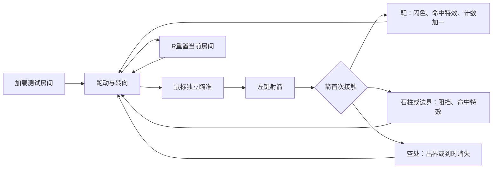

# 九鼎｜十日：MVP-01 跑动与射箭需求 v0.1

日期：2026-10-16。状态：两轮访谈已收束，需求与验收边界已确认；尚未开发、尚未绘制、尚未实测。（**历史阶段说明**：本文为 Electron／Phaser 阶段 MVP-01 需求初稿，合成规格见 [MVP-01 Spec](九鼎_MVP01_Spec.md)；现役 Godot 工程规则见[玩法与运行规则](../product/十日_玩法与运行规则.md)。）

本次用户目标：先完成一个简化MVP的需求定义，覆盖人物跑动、攻击、房间地图、反馈和制作资产。2026-10-16 第一轮访谈中，用户接受Q1—Q5推荐，明确Q6必须同时确保macOS与Windows；第二轮接受Q7—Q9推荐，补齐平台架构、ZIP交付、性能门槛与连射边界。已确认的范围与取舍以第16节为准；跑速、射速、动作时长等仍是**可调初始值**，具体动作方向与帧数须先经样例验证。第12.1节的性能门槛是已确认的验收条件，不属于可自行放宽的调参项。

## 1. 目标与成功标准

**一个汤谷风格的单屏房间，一个使用后羿弓的孩子身体，能自由跑动、独立瞄准、发射普通箭，绕开障碍，命中静态靶并看到反馈，随时重置练习。**

本MVP回答三个问题：

1. 移动与瞄准分离后，跑动、转向和射箭是否容易理解、能连续操作？
2. 等距2.5D画面中，脚点、障碍、箭和目标的空间关系是否清楚？
3. 皮影轮廓、木刻场景和少量金色特效，在动态画面中是否统一且可读？

交付成功须同时满足：

- 分两阶段验收：先用占位素材通过操作功能，再替换代表素材通过动态画风；两阶段均完成才算MVP-01完成。
- 功能闭环通过：跑动、瞄准、射箭、人物碰撞、箭碰撞、靶受击、暂停、重置均通过本文验收用例。
- 美术代表性通过：人物、弓箭、地面和石柱已具有选定风格，不能全部用程序方块代替后就声称画风验证完成。
- 无明显错位：脚底不漂移、分层无明显脱节、射箭方向与实际弹道一致、不会穿墙或穿靶。
- 双平台通过：Apple Silicon Mac与Windows x64分别在至少一台真实设备运行对应ZIP解压后的打包产物并完成验收；只有一端通过不能标记MVP完成。
- 保留验证证据：两端正常跑射录屏、遮挡与阻挡截图、验收记录和实际测试平台。本文未提供这些结果。

## 2. 与既有项目范围的关系

| 项目 | 本MVP的处理 |
| --- | --- |
| IP与身体 | 主IP九鼎、副IP十日；持续使用同一个孩子。直接进入测试房间，不演出完整请神 |
| 空间与画风 | 沿用固定等距俯视、二维战斗平面；皮影主导、像素纹理为辅 |
| 技术基线 | 沿用Electron、TypeScript、Phaser WebGL、Forge／Webpack；不因本MVP改换框架 |
| 更大的技术验证闭环 | 原先的索尔、死亡重开、借眼、签署、续玩等仍属于后续验证；本MVP是它之前的一步，不等于它已完成 |
| 操作平台 | 本次覆盖Apple Silicon Mac与Windows x64键鼠，两端各至少一台实机、分别运行对应ZIP产物；系统版本与硬件在验收记录中固定，手柄后置；Intel Mac与Windows ARM不在此步兼容承诺内 |
| 资产库 | 从[全量资产库](../art/美术资产库_v0.1/README.md)裁出最小集合；靶子与测试边界作为MVP局部占位，不自动加入正式世界设定 |

当前代码只包含初始化入口与Phaser启动场景。本需求文档不表示跑动、碰撞、攻击或素材加载已经实现。

## 3. 范围

### 3.1 本次必须包含

| ID | 需求 |
| --- | --- |
| R-01 | 进入一个固定汤谷测试房间，显示人物、障碍、靶子、准星和简短操作说明 |
| R-02 | WASD持续跑动、松键停止；支持组合方向，斜向不额外加速 |
| R-03 | 鼠标控制瞄准；移动方向与瞄准方向相互独立 |
| R-04 | 普通攻击支持短按一箭、按住按固定间隔连射、松开停止后续连射；有可见动作、飞行箭和明确攻击间隔 |
| R-05 | 玩家被房间边界与障碍阻挡；可以沿障碍滑行，不被装饰外框误挡 |
| R-06 | 箭命中第一个有效目标或障碍后结束；未命中则出界或到时销毁 |
| R-07 | 靶命中有闪色、命中特效和命中计数；同一支箭只结算一次 |
| R-08 | 地面、人物、石柱、影子和箭的遮挡顺序合理 |
| R-09 | 支持手动暂停与失焦暂停；恢复时不产生残留移动或补发攻击 |
| R-10 | 一键重置人物、靶反馈、箭、计数、动作与输入状态 |
| R-11 | 固定画面比例缩放后，鼠标落点、准星和弹道仍对齐 |
| R-12 | 完成两阶段资产与功能检查；macOS与Windows分别通过实际打包产物的操作、显示、暂停和短时稳定性验收 |

### 3.2 暂不包含

敌人AI、Boss、闪避、玩家血量与受伤死亡、靶子血量与摧毁、攻击伤害数值、蓄力箭、回收箭、多重箭、松手后仍持续的自动攻击、弹药管理、掉落、词条、房间切换、随机生成、上香与倒计时、累计香火、借眼、签署、存档与续玩、结局、完整菜单、音频制作、手柄接入、键位重绑及商业发行。按住左键连射属于本次范围。

这些排除只针对MVP-01；不废除正式游戏中已确认的规则。既有桌面窗口能力继续使用，不因缺少完整菜单新增界面工程。本次交付可解压运行的ZIP包；安装向导、发行签名及额外CPU架构兼容后置。

## 4. 玩家体验流程



靶不被打倒，命中不代表通关；这是可反复操作的测试房间。玩家可在几十秒内体验核心闭环，不需要先阅读故事或完成任务。

## 5. 输入与人物跑动

### 5.1 建议键位

| 输入 | 行为 | 限制 |
| --- | --- | --- |
| W／A／S／D | 朝画面上／左／下／右移动 | 以屏幕感知方向操作，不要求玩家理解等距网格坐标 |
| 鼠标移动 | 更新瞄准点与准星 | 仅游戏有效画面内的坐标生效 |
| 鼠标左键 | 可攻击时短按一箭；按住按间隔重复 | 普通松手让已开始拉弦的一箭完成，后续不再连射；间隔内短按不排队；离开有效画面则取消尚未放出的箭 |
| Esc | 暂停／恢复 | 暂停时禁止移动与攻击 |
| R | 重置房间 | 仅运行中接受；按住不反复触发 |

### 5.2 跑动规则

- 从静止开始，按方向键直接进入跑动；此步不做慢走、冲刺、惯性或体力。
- 松开全部移动键后停止位移并回到待机，不额外滑行。
- 相反方向同时按下相互抵消；两个垂直方向组合得到斜向，合成速度与单方向一致。
- 撞到边界或石柱时不能穿过；与阻挡面平行的移动分量仍可继续，避免贴墙完全卡死。
- 脚点作为站立和碰撞基准。红巾、弓、头发等外扩美术不扩大人物碰撞范围。
- 人物在原地被完全挡住时，不持续播放向前奔跑造成明显滑步；允许短暂步态收束后进入待机。
- 玩家不会被靶子实体挡住；靶仅作为箭的命中目标，避免此步多做一类人物推挤关系。

### 5.3 方向、分层与动作样例

- 弹道支持360°瞄准；WASD组合提供八个移动方向。动作方向数与这些操作方向分开，不把鼠标瞄准限制成四个角度。
- 已确认先做少量动作样例，验证原地绕身瞄准、左右反向跑射、上下反向跑射，再决定分层方式、方向数与帧数。
- 下身随移动、上身随瞄准是待验证的起点；需让持弓手与弓的指向匹配实际弹道。停止移动时回到稳定待机。不能在样例验证前把上下身拆法写成不可调整的制作要求。
- 至少检查向左跑向右射、向上跑向下射、斜向跑射、原地绕身瞄准四种情况。不能只实现“朝哪里跑就朝哪里射”。
- 对角瞄准可以使用最近的上身姿态，但弓与箭应继续指向真实目标；不能用明显偏离准星的姿态通过验收。
- 接近方向分界线时不得无意义左右抖动。脚点、连接点和武器握点在切帧时稳定；不提前要求16套上下身组合。
- 若四向姿态无法让弓指向与身体连接同时成立，应先调整分层或补必要斜向姿态，不能通过限制瞄准方向掩盖问题。四向不是最终角色规格承诺。

## 6. 瞄准与攻击

### 6.1 瞄准

- 鼠标进入有效画面后显示一个清楚的准星；准星落点与实际游戏坐标对应。
- 窗口缩放、留黑边或显示比例变化后仍保持映射正确。黑边和画面外点击不发起攻击。
- 鼠标进入黑边或离开有效画面时，停止连射并取消尚未放出的箭；已飞出的箭继续正常运动。重新进入画面后必须重新按下左键才能射击，不能沿用在画面外或离开前的按住状态。
- 鼠标与人物参考点几乎重合时，沿用上一次有效瞄准方向，避免零长度方向或突然乱转。
- 初次进入尚未得到有效瞄准前，使用朝右的默认持弓方向。

### 6.2 单次射箭周期

| 阶段 | 玩家看见 | 行为规则 |
| --- | --- | --- |
| 可攻击 | 待机或跑动中的持弓姿态 | 接受左键按下；持续按住时按攻击间隔开始下一次攻击 |
| 拉弦前摇 | 短促拉弦动作 | 仍可移动、转向；不接受排队的额外攻击 |
| 放箭 | 松弦动作与一支箭出现 | 在放箭时取当前有效瞄准方向；只生成一支箭 |
| 收势／攻击间隔 | 上身回到持弓姿态 | 下身移动不中断；间隔到期且仍有效按住时可开始下一次攻击 |

可攻击时短按请求一次攻击；有效按住时按固定间隔开始后续攻击。普通松手只停止后续连射，已经开始拉弦的一箭正常完成；攻击间隔内的短按忽略、不排队，持续按住则在下一可攻击时点开始新一箭。每个被接受的攻击周期只生成一支箭，系统重复事件或动画切换不能额外发箭。攻击动画不把玩家锁在原地。

以下情况与普通松手区分：鼠标进入黑边或离开有效画面、暂停、失焦和重置均取消尚未放出的箭并清除连射意图。返回有效画面或恢复运行后，必须重新按下左键；重置另按第8.2节清理。取消未放出攻击不会额外生成箭或命中记录。

### 6.3 箭的行为

- 箭从可见的弓箭释放点飞出，方向与箭身旋转一致，沿直线匀速运动；不追踪、不反弹、不穿透、不回收。
- 以运动轨迹中**最先接触的有效碰撞物**结算。靶与障碍都在路线中时，前方石柱必须先挡箭。
- 命中靶：计数加一、靶短促闪色、命中特效出现，箭立即结束；命中石柱或边界：只出现阻挡命中特效，计数不增加。
- 箭不得因一帧位移较长跳过较薄障碍或靶；同一帧与多个对象重叠也不能重复计数。
- 弓口靠近石柱时，检查可见持弓侧到出箭点之间的阻挡，不能把箭直接生成在石柱另一侧。若已被挡住，在接触处结束这一箭；不直接用人物脚点替代弓口检查。
- 飞出房间有效区域或达到最大存续时间时销毁，不留下永久箭矢贴花，不在房间外累积。
- 人物按脚点与柱基判断通行；箭按可见靶面、柱身的简化区域判断命中。这两类范围分别定义，不能只用柱基挡箭或用阴影作为靶面。
- 准星表示箭要经过的位置。弓口、可见箭路、命中区域与反馈点保持一致；不做真实高度计算或三维碰撞。

## 7. 房间地图

### 7.1 内容与布局

一个固定的、可被相机完整展示的封闭汤谷庭院。相机不旋转、不滚动、不追随，不切换房间。地面与物件呈等距2.5D外观，但没有跳跃、高低差伤害或桥上桥下交战。

已确认先使用一张固定地面底图，石柱、靶子与必要遮挡物独立摆放。底图不画死人物、目标或界面；此步不制作地图拼块系统和地图编辑工具。

| 组成 | 数量 | 布局要求 |
| --- | ---: | --- |
| 主角 | 1 | 初始站在左下偏内侧的安全位置，脚点不与任何物体重叠 |
| 地面与边界 | 1间 | 留出能围绕障碍移动的连续通路；边界在视觉上明确可见 |
| 同一石柱的重复实例 | 3 | 一根位于中部，一根形成遮挡测试，一根靠边用于贴墙移动；不能堵死路线 |
| 同一靶子的重复实例 | 2 | 一靶从出生点可直接命中；另一靶在出生点被中部石柱挡住，绕行后可命中 |
| 操作提示与命中计数 | 1组 | 靠近屏幕边缘，不覆盖主角、靶或弹道 |

布局关系示意，不是最终美术透视图或精确碰撞坐标：

```text
┌──────────────────────────────────┐
│                     靶A    靶B   │
│                          石柱2   │
│                 石柱1            │
│                                  │
│   出生点                         │
│                           石柱3  │
└──────────────────────────────────┘
```

其中“被挡靶”由实际连线校验决定；文字示意不代替遮挡验收。两靶和三柱共享素材，不代表制作两种靶或三套石柱。

### 7.2 遮挡与可读性

- 地面始终位于人物和物件之后；脚下影子不盖住角色身体。
- 角色走到柱后时，柱应在前；走到柱前时，人物应在前，不按头顶位置误排序。
- 遮挡物优先采用较低、较窄石柱；若仍把主角完全挡住，允许局部淡化柱体，避免引入整套复杂透视系统。
- 石柱可按美术需求拆前后层。人物通行只根据柱基占地，不因装饰柱头扩大不可走区域；箭另按可见柱身的简化阻挡范围检测。
- 靶心、柱基与地面反差足够。战斗区域不堆树冠、浓雾、满屏粒子、密集文字或复杂装饰。

## 8. 反馈、界面与状态

| 场景 | 必须反馈 | 本次不需要 |
| --- | --- | --- |
| 开始跑动／停止 | 步态与位移同步，影子跟随脚点 | 脚步声音、扬尘和镜头晃动 |
| 鼠标转向 | 准星、持弓方向、弹道一致 | 自动索敌、辅助瞄准 |
| 发起攻击 | 短促拉弦和松弦动作，一支箭可追踪 | 大范围发光、伤害数字、屏幕震动 |
| 命中靶 | 靶闪色＋局部金色火花＋命中数加一 | 血条、伤害计算、死亡、掉落 |
| 命中石柱／边界 | 箭在接触处结束，出现较弱火花，命中数不变 | 破坏石柱或墙体 |
| 射空 | 箭继续飞行后离开或到时消失 | 提示音、惩罚或弹药扣减 |
| 暂停／失焦 | 简单“已暂停，Esc继续”文字，模拟停止 | 完整暂停菜单和设置页面 |
| 重置 | 清理旧箭、效果和计数，人物回到出生点 | 局末结算、香火增长、存档 |

界面仅包括“WASD移动／鼠标瞄准／左键短按射箭、按住连射／R重置／Esc暂停”及命中计数。无需生命HUD、一炷香、累计香火、技能栏或正式章节字卡。

靶的闪色、阴影、准星、边界线和界面文字可由程序生成；这些仍是明确的视觉交付需求，不意味着每项都需要新画图。

### 8.1 暂停与失焦

- 按Esc暂停；人物、箭、效果与攻击间隔都停止推进，靶不能增加命中数。
- 失去窗口焦点自动进入暂停并清空按下状态；返回窗口后仍显示暂停，按Esc恢复。
- 未放出的攻击动作在暂停时取消，不在恢复后补发；已飞出的箭原地冻结，恢复后继续。
- 暂停期间点击不记录攻击，R不重置；恢复后必须重新按键或点击才能移动、射箭。
- 按住连射状态也须清空；失焦前持续按住鼠标，不得在恢复焦点后自行续射。

### 8.2 重置

- 运行中按R，人物回到出生点，靶回到基础外观，命中数归零，所有箭和临时效果清除。
- 未发出的攻击取消，攻击间隔回到可用，所有输入状态清空，瞄准先恢复默认方向，待鼠标再次给出有效位置更新。
- 关闭并重开应用也进入初始房间；此步不保存练习状态。重复重置不增加靶、柱、事件回调或资源实例。

## 9. 建议初始参数

以下均为MVP调试起点，不是正式游戏平衡，也不是美术量产规格。实现时可以集中调整；验收记录须写明实际使用值，不能在调参后仍引用旧值。

| 参数 | 建议默认值 | 约束 |
| --- | --- | --- |
| 设计画布 | 1280×720，16:9 | 复用现有入口基准；适配1920×1080输出，允许等比留边 |
| 人物显示高度 | 约80设计像素 | 仅指不含弓、长巾的视觉高度；最终以动作可读性微调 |
| 人物跑动速度 | 220设计像素／秒 | 按屏幕投影位移量衡量，斜向与直向等速 |
| 拉弦到放箭 | 约0.08秒 | 放箭时取当前有效瞄准；与动作释放点对齐 |
| 两次攻击起点最短间隔 | 0.35秒 | 从接受攻击请求算起，不因动画循环额外发箭 |
| 箭飞行速度 | 700设计像素／秒 | 必须验证薄障碍和靶不会被跳过 |
| 箭最长存续 | 2秒 | 到边界或首次命中更早结束 |
| 靶受击闪色 | 约0.10秒 | 连续命中可刷新显示时长，但计数按每支有效箭分别增加 |
| 命中特效 | 约0.15秒 | 不遮准星、主角和下一支箭 |
| 初始内容量 | 1主角、3柱、2靶 | 所有实例固定布局；不引入随机 |

未预设重力、弹道下坠、暴击、伤害、射程升级或攻击硬直惩罚。箭最长存续与速度只是清理机制；边界处已被拦截的箭不会继续飞出。

## 10. 必需制作的游戏资产

资产明细另见[最小资产清单CSV](九鼎_MVP01_最小资产清单_v0.1.csv)。沿用上轮“8组资产”，为交付拆成**11条局部记录**；这不是11张图片，人物动画含多帧、地图包含重复实例。人物上下身ID先作为需求管理单元，具体拆层和动作量经样例验证后再确定。局部ID仅用于本MVP，不重编号或改写414条全量库。

| 局部ID | 资产／制作要求 | 来源或关联 | 优先方式 |
| --- | --- | --- | --- |
| MVP-A01 | 孩子下身需求：待机与跑动，脚点一致；方向数、帧数和拆层经样例确定 | CHR-001 | 先做占位功能与少量拼合样例，最终需代表画风的动画 |
| MVP-A02 | 孩子上身需求：持弓、拉弦、放箭、收势；衣装与红巾等分层经样例确定 | CHR-001 | 先检查独立瞄准与反向跑射，不以四向或44帧作为固定交付量 |
| MVP-A03 | 后羿弓：握持、开弓、松弦；与上身的握点和释放点一致 | WPN-001 | 可并入上身图集，但保留对应关系；不能上下身各画一把弓 |
| MVP-A04 | 普通箭：透明箭图，箭尖与朝向轴明确 | WPN-002 | 一张主图可旋转复用，不做四向箭图 |
| MVP-A05 | 汤谷地面：一张低噪声固定房间底图，包含必要边缘 | ARC-001 | 已选单张底图，人物、靶和遮挡物独立；不做拼块系统 |
| MVP-A06 | 房间边界：能看清不可走范围的边沿或低矮石界 | MVP局部补充；关联ARC-001 | 可先程序线框占位；美术验收时与汤谷地面协调 |
| MVP-A07 | 石柱：一款有明确柱基与前后关系的石柱，复用3次 | ARC-007 | 静态代表素材；分别标柱基通行范围与柱身阻箭范围；按遮挡需要拆层 |
| MVP-A08 | 静态靶：一款能识别靶心和命中范围的训练目标，复用2次 | MVP测试占位，非正式怪物 | 可程序画简单靶，不需要敌人动画或死亡图 |
| MVP-A09 | 命中特效：金色局部火花，靶与石柱可复用并调整强度 | VFX-002 | 小序列或程序图形；不另做两整套特效 |
| MVP-A10 | 脚下影子：柔和扁椭圆或皮影风接触影 | VFX-041 | 可程序生成；跟脚点，不能自带在人物每帧中又叠一层 |
| MVP-A11 | 准星：清晰的小型瞄准标记 | UI-028 | 可程序生成，避免与金色箭和地面纹样混淆 |

UI提示和计数使用现有可读中文字体与程序文字；本次不制作新字库、字标、肖像、正式HUD、主菜单、树木、祠堂主体或Boss素材。若引入外部素材，交付时保留来源和授权信息；本需求稿不指定新的第三方素材。

### 10.1 人物动作样例与后续规格

本节用于列出样例必须检验的动作能力。方向数、帧数和拆层不在此时锁定；先用少量样例判断独立跑射是否成立，通过后再补制作规格。

| 层／动作 | 方向与帧的建议 | 验收重点 |
| --- | --- | --- |
| 下身待机 | 先检验前、后、左、右站姿衔接；实际方向数待样例结论 | 脚点稳定、与上身腰线匹配 |
| 下身跑动 | 先做足够检验反向跑射的短循环，不先规定每向帧数 | 起止自然、位移与步态一致 |
| 上身持弓 | 先检验绕身瞄准与握点，方向数待样例结论 | 与鼠标瞄准对应，握点明确 |
| 上身射箭 | 样例覆盖拉弦／放箭／收势，不先规定总帧数 | 与可调释放点匹配；持续跑动时不冻结下身 |
| 弓的指向修正 | 必要的独立弓或持弓手部层 | 能覆盖四向姿态之间的角度，不出现弓指左而箭飞右 |

初稿的四向与约44个层级帧位只保留为历史估算，不作为当前交付承诺。样例必须覆盖原地绕身瞄准、左右反向跑射与上下反向跑射；根据连接、握持与指向结果再确定复用和补帧。左右能否镜像复用，须先确认持弓手和衣装不产生明显矛盾。运行端继续按序列帧／图集播放，不接新骨骼运行时。

### 10.2 素材交付约定

- 动画交付透明序列帧或图集及帧描述；场景与静态物件交付可组合的图片。不能只交一张包含角色、背景和UI的完整概念图。
- 同一角色各帧使用一致画布或可靠的裁切偏移，提供脚点、腰连接点、弓握点、放箭点；切帧时不能跳位。
- 原画保留可编辑源文件；导出目录、名称与分层说明可回查局部资产ID。具体绘制软件不在此步强制指定。
- 统一粗细明确的皮影轮廓、有限木刻纹理；玩家金色攻击与赭灰地面保持反差。像素质感不等于把整张画面强行低清马赛克化。
- 图集须报告实际尺寸和文件量，但此步不以未经测试的统一4K图集或显存预算约束所有素材。
- 功能阶段允许占位；最终评审须注明哪些仍为占位，不能把程序靶或线框边界误记为正式美术完成。

## 11. 规则状态与异常边界

| 状态／事件 | 允许的行为 | 必须清理或保持的内容 |
| --- | --- | --- |
| 加载中 | 等待必要素材 | 不接受移动或射箭 |
| 运行中 | 移动、瞄准、攻击、暂停、重置 | 每支箭与命中独立、一次结算 |
| 暂停中 | Esc恢复、关闭窗口 | 停止模拟；清空输入；不补发攻击 |
| 鼠标在黑边或画面外 | 仍可用键盘移动或暂停；不射箭 | 取消未放出的箭、清空连射；已飞出箭继续；回到画面需重新按下 |
| 重置完成 | 等待新输入 | 清箭、清效果、清计数、归位，不重复建立房间对象 |
| 素材加载失败 | 明确显示无法开始 | 不停在空白画面，也不伪装为功能已就绪；可显示简短错误文字 |
| 窗口缩放 | 保持等比布局和坐标 | 地图不改变；鼠标映射重新匹配有效画面 |

## 12. 验收用例

所有用例当前均为**待执行**。实现完成后记录通过／失败、平台、实际参数和证据；不得把本文的预期结果当作已有测试结果。

| 用例ID | 操作与场景 | 预期结果 | 覆盖需求 |
| --- | --- | --- | --- |
| AC-01 | 启动并进入房间 | 一个玩家、三个柱、两个靶，操作说明可读，无出生重叠 | R-01 |
| AC-02 | 分别按W/A/S/D并松开 | 方向符合屏幕感知，松键停止，跑动与待机切换正确 | R-02 |
| AC-03 | 比较空地直向与斜向各移动2秒；同时按相反方向 | 斜向距离不比直向更长，位移差目标不超过5%；相反输入抵消 | R-02 |
| AC-04 | 固定人物，鼠标绕身一周并经过脚点附近 | 准星与持弓转向连续可理解，近零距离不乱转，无方向分界抖动 | R-03 |
| AC-05 | 左跑右射、上跑下射、斜跑射箭 | 移动不中断，箭朝准星，分层衔接稳定 | R-02、R-03、R-04 |
| AC-06 | 可攻击时短按、长按、前摇中松开、攻击间隔内快速短按；按住后移入黑边再移回 | 短按一箭，按住按间隔连射；普通松手完成已开始的一箭；间隔内短按不排队；离开画面取消未放出的箭并停连射，回来需重新按下；无动画重复出箭 | R-03、R-04 |
| AC-07 | 直射无遮挡靶，连续重复 | 每支有效箭只加一次命中数，有靶闪色和局部效果；靶不死亡 | R-06、R-07 |
| AC-08 | 从出生点射向被柱挡住的靶，再绕柱射 | 被柱挡时无靶计数；绕开后能命中，箭不穿透 | R-05、R-06、R-07 |
| AC-09 | 贴柱射箭、贴边移动、斜向蹭柱、瞄准柱身及靶面 | 弓口不跨障碍出箭；人物按柱基通行，箭被柱身阻挡、命中可见靶面，反馈点一致 | R-05、R-06 |
| AC-10 | 查看单帧箭位移较大时的薄靶或柱边命中 | 取轨迹首次接触对象，不因跳帧穿透；无重复结算 | R-06 |
| AC-11 | 围着石柱前后绕行 | 脚点决定前后关系，影子在脚下，人物不会持续完全消失 | R-08 |
| AC-12 | 在空处射箭并等超过2秒 | 箭结束并清理，无命中加分，无房间外持续累积 | R-06 |
| AC-13 | 跑动／前摇／箭飞行时分别暂停或切出窗口 | 模拟停止，未放出攻击取消；回来后仍暂停，恢复无粘键或补发 | R-09 |
| AC-14 | 射出多箭后按R，连续重置20次 | 人物归位、计数归零、无旧箭和效果；柱和靶数量恒定，无输入残留 | R-10 |
| AC-15 | 在1280×720与1920×1080窗口内容区、带留边比例下瞄准射击 | 准星和实际落点一致，黑边点击不发箭，UI不遮主要内容 | R-11 |
| AC-16 | 关闭重开；模拟必要素材缺失 | 重开是初始房间；缺失时有错误提示，不能进入半失效测试 | R-01、R-10、R-12 |
| AC-17 | 两端各正常操作5分钟，并在预热后以1080p输出连续跑射60秒；箭清理另以空处射击复核 | 5分钟无崩溃、卡死或持续累积的箭与特效；60秒平均帧率≥58 FPS、至少95%的帧间隔≤20毫秒；保留数据及内存趋势 | R-12 |
| AC-18 | 对照人物、弓箭、地面、柱的动态截图与短录屏 | 风格统一；金色箭可读；关键代表资产非全占位；动作无明显接缝与跳点 | R-08、R-12 |
| AC-19 | 在Apple Silicon Mac与Windows x64各至少一台实机上解压对应ZIP，运行应用并执行本表适用用例 | 两端均实际加载素材、可操作、暂停／恢复／重置和缩放正常；分别满足AC-17，保存版本、系统与硬件配置及结果，不能用构建成功替代运行验收 | R-01、R-09、R-10、R-11、R-12 |

AC-03中的5%是此稿建议容差；动画方向、预警之外的材质观感采用人工评审。碰撞验收应能临时查看脚点与碰撞范围，正常画面不强制显示这些调试信息。

### 12.1 已确认的性能门槛与双平台验收

两端采用同一标准，分别记录结果，不能用平均两端表现的方式抵消其中一端未通过。

| 项目 | 已确认要求 |
| --- | --- |
| 平台范围 | Apple Silicon Mac与Windows x64，各至少一台真实设备；系统版本、CPU／GPU及内存记录后作为此次验收环境 |
| 交付载体 | 对应平台可解压运行的ZIP；Mac运行其中应用，Windows运行其中程序；不以开发服务或只生成压缩包代替运行验收 |
| 输出 | 1920×1080游戏输出，以60 FPS为目标；允许1280×720内部设计画布等比输出，并如实记录内部尺寸 |
| 稳定运行采样 | 必要素材完成加载并预热后，前台连续跑动和射击60秒；两端使用同一版场景、素材和玩法参数 |
| 平均帧率 | 采样时段至少58 FPS |
| 帧间隔 | 至少95%的有效帧间隔不超过20毫秒；统计游戏呈现帧之间的时间，不用单段逻辑执行耗时替代 |
| 持续操作 | 另完成5分钟操作，无崩溃、卡死或持续累积的箭与特效；记录活动对象清理和内存趋势 |
| 非稳定采样事件 | 加载、暂停和窗口切换分别做功能验收；不计入稳定运行采样，也不跳过其功能检查 |

- 若60秒采样被暂停、失焦或窗口切换打断，恢复稳定后重新采样完整60秒，保留重采原因；不能只删除卡顿帧来满足门槛。
- 性能门槛未达到时，该端不通过；不能凭“看起来流畅”或类型检查、打包成功代替结果。
- 这套门槛仅对记录中的测试设备、系统和小场景成立，不等于最低硬件要求、所有Mac／Windows设备兼容保证或正式多敌人战斗容量承诺。
- 当前已知Mac候选为Apple M4、16 GB、arm64、macOS 26.0；这只是环境事实，不是本MVP性能结果。Windows x64测试设备的具体系统与硬件在执行验收时补录，未补齐并实测前保持待验收。
- Intel Mac、Windows ARM、安装向导、发行签名与手柄接入后置。缺少任一端实际运行或验收证据时，不能标记MVP完成。

#### 双阶段、双平台记录表

| 阶段 | Apple Silicon Mac | Windows x64 | 结论约束 |
| --- | --- | --- | --- |
| A 占位功能 | 待执行 | 待执行 | 只证明输入、规则和反馈闭环，不能声称正式画风通过 |
| B 代表素材与最终产物 | 待执行 | 待执行 | 替换素材后复验功能、动态画风、ZIP产物与性能；两端都通过才可完成 |

每端至少保留：应用版本与源码修订标识、ZIP产物名称、系统版本、CPU架构、CPU／GPU、内存、显示刷新率与缩放、内部及输出尺寸、玩法参数、用例结果、60秒原始采样或可复核统计、5分钟检查及截图／录屏。所有记录当前为空，尚无玩法测试结果。

## 13. 实现与验证边界

本节给出后续实现的约束，不在此文档阶段编写代码或安排开发任务。

- 输入、移动、瞄准、攻击、碰撞、动画与反馈留在游戏渲染进程；不逐帧跨桌面IPC传坐标。
- 不新增存档、数据库、网络、复杂实体框架或专用骨骼运行时。地图用固定布局，靶不使用AI。
- 移动意图、攻击周期和图像播放应能区分；不能因为动画未播放完就强制停止移动，或让每个放箭显示帧都生成一支箭。
- 优先从“单房间可操作体验”这一整体入口验证；必要的规则检查只覆盖斜向速度、攻击节流、轨迹首次命中、一次计数、暂停和重置等易出错行为，不按私有函数形状堆测试。
- 目前没有战斗实现或相应测试先例。后续需在真实游戏场景验证美术与输入，再以项目已有类型检查和打包链路验证入口兼容；不能把类型检查通过当成玩法验收。

## 14. 后续工作顺序与本轮交付

| 顺序 | 后续工作 | 该步完成证据 |
| --- | --- | --- |
| 1 | 阶段A：用占位素材建立单房间移动、瞄准与连射 | AC-01至AC-06的可操作结果；美术未完成 |
| 2 | 阶段A：补首次命中、反馈、暂停、失焦、重置与缩放 | AC-07至AC-16；占位功能在两端可用 |
| 3 | 阶段B：做少量代表画风动作样例，验证拼接后确定制作规格 | 绕身瞄准、左右与上下反向跑射样例；保留结论 |
| 4 | 阶段B：替换人物、弓箭、固定地面底图与石柱，复验操作和动态美术 | AC-18与受影响功能复验；先前占位通过不能代替最终通过 |
| 5 | Apple Silicon Mac与Windows x64分别运行最终ZIP产物并完成性能与完整验收 | AC-17、AC-19与两端各自证据；平均≥58 FPS、至少95%帧间隔≤20毫秒及5分钟稳定性均通过 |

以上是需求中的建议顺序，不表示这些工作已经开始，也不包含工期承诺。

需求编写与访谈阶段仅整理本文和配套最小资产CSV，未开发或绘图。随后按用户调用的to-spec流程合成[独立规格](九鼎_MVP01_Spec.md)，并发布为[GitHub Spec #1](https://github.com/Bacsonlx/NineTripodCauldrons/issues/1)，标记ready-for-agent；尚未拆分实施票、提交代码或开始制作。后续先完成本小闭环，再回到更大的战斗与叙事验证范围。

## 15. 参考依据

- [架构选型结论](../architecture/九鼎_架构选型结论.md)：固定镜头、二维战斗平面、技术基线与更大验证闭环。
- [玩法与运行规则](../product/十日_玩法与运行规则.md)：持续身体、独立移动瞄准、输入、暂停和制作边界。
- [术语表](../../GLOSSARY.md)：玩家、请神、房间、一炷香与香火等概念；本测试房间不模拟一整次神降。
- [固定等距镜头ADR](../adr/0001-fixed-isometric-2d-world.md)、[图集交付ADR](../adr/0007-offline-animation-atlases.md)：已有约束。
- [美术资产库](../art/美术资产库_v0.1/README.md)、[动作与状态需求](../art/美术资产库_v0.1/动作与状态需求.md)：资产ID和全量范围。
- [汤谷过程图](../../output/九鼎_四组章节过程图_v1/01_汤谷_上香与镜像.png)：只参考人物、材料、色彩与场景语言；不复制其Boss、第三技能或密集装饰。

## 16. 访谈确认记录

### 第一轮：2026-10-16

用户回复：“Q6需要确保mac 和 windows，其余按推荐”。

| 问题 | 已确认结论 | 本文落点 |
| --- | --- | --- |
| Q1 完成标准 | 先占位通过功能，再代表素材通过动态画风；两阶段均通过才算完成；不加入AI、Boss或剧情 | 第1、14节 |
| Q2 普通攻击 | 短按一箭、按住按固定间隔连射、松开停止后续连射；不蓄力、不排队；暂停／失焦后重新按下才能射 | 第3、5、6、8、12节 |
| Q3 人物动作 | 先用少量样例检验绕身瞄准与反向跑射，再定分层、方向数、帧数；四向与44帧非固定承诺 | 第5、10、14节及资产CSV |
| Q4 空间判定 | 人物脚点／柱基判断通行；箭按可见靶面／柱身简化范围命中；准星、弓口、箭路与反馈一致；不做三维碰撞 | 第6、7、12节 |
| Q5 地面制作 | 先一张固定地面底图，人物、靶与遮挡物独立；不做拼块系统和地图编辑工具 | 第7、10节及资产CSV |
| Q6 平台验收 | 用户调整为macOS与Windows均须实际验收，不能只验Mac；具体范围随后由第二轮Q7细化 | 第1、2、3、12、14节 |

### 第二轮：2026-10-16

用户回复：“全部按推荐”，确认Q7—Q9。

| 问题 | 已确认结论 | 本文落点 |
| --- | --- | --- |
| Q7 设备与产物 | Apple Silicon Mac与Windows x64各至少一台实机；分别交付可解压运行ZIP并记录系统与硬件；Intel Mac、Windows ARM、安装向导和发行签名后置 | 第1、2、3、12、14节 |
| Q8 性能口径 | 两端1080p输出、预热后连续跑射60秒，平均至少58 FPS、至少95%帧不超过20毫秒；另5分钟操作无崩溃、卡死或持续累积箭与特效；加载、暂停、切窗单独检查 | 第12.1节与AC-17、AC-19 |
| Q9 连射边界 | 普通松手让已开始拉弦的一箭完成；间隔内短按不排队；鼠标到黑边或离开有效画面取消未放出箭并停连射，回来须重新按下；暂停／失焦继续按已确认规则取消未发攻击 | 第5、6、8、11节与AC-06、AC-13 |

两轮访谈已收束。本次范围、取舍和验收门槛已确认；跑速、射速等通过运行调校，动作分层／方向数／帧数通过先行样例确定，Windows测试设备细节在验收时补录。这些属于后续执行输入或验证结果，不在文档中伪造为已完成，也不增加本轮开发或绘图任务。
