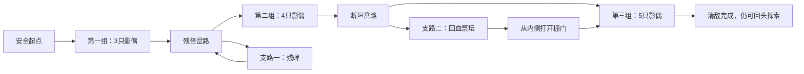

# MVP-03：弓箭特效精修、汤谷路线引导与支路探索（macOS／Windows）

> **历史阶段说明**：本文件为 2026-10-18 Electron／Phaser 阶段 MVP-03（[GitHub #17](https://github.com/Bacsonlx/NineTripodCauldrons/issues/17)）的冻结规格合同。现役工程已迁移至 Godot 并扩展为 16 个独立房间、选择门神兽祝福、50 格统一背包与单行七槽技能 HUD（见[架构选型结论](../architecture/九鼎_架构选型结论.md)、[首关扩展实施记录](汤谷首关扩展_实施记录_2026-10-26.md)及[玩法与运行规则](../product/十日_玩法与运行规则.md)）；本规格及其历史验收状态独立保留。

## Problem Statement

《九鼎》（副 IP《十日》）已交付 MVP-02 0.2.1：连续汤谷地图、跟随镜头、同一个孩子、普通箭／穿透箭／箭雨／闪避，以及三组近战影偶。当前技能主要依靠简单线条、圆环和拖尾，起手、释放、飞行与命中的表现仍显草稿，难以体现已选定的皮影与像素质感。

地图目前以单张地面底图叠加物件和碰撞呈现，较大的矩形可走区域缺少清晰道路、空间围合及主支路线索。玩家能移动和战斗，但不易判断下一处目标，也缺少主动探索的理由。

本轮需要在保持既有战斗规则与风格的基础上，精修四种操作的视觉反馈，将现有地图改造成路线清楚、支路有回报、可实际探索的短流程。既有概念图、运行包或历史测试不证明本规格已完成。

## Solution

在现有 2560×1440 世界范围内重做一张连续、手工设计的汤谷地图：一条清晰主路，保留依次进行的三组 3／4／5 只影偶；第一组之后增加通往残碑的可选支路，第二组之后增加通往回血祭坛的可选支路。第二条支路可从内侧开栅门，形成返回主路的捷径，仍须完成三组主路战斗。清敌后允许回头探索。

以石铺、灯火、开口朝向和地标引导主路，以土径、林间空地及独特景观吸引支路探索。HUD 显示当前区域与下一处主路地标，不增加常驻大箭头或小地图。地面、围合、实体物件与前景遮挡共同组成空间，不能只更换背景图而保留不匹配的通路。

精修普通箭的弓弦亮点与命中碎屑、穿透箭的聚光与贯穿拖尾、箭雨的预告／分段落箭／落地冲击，以及闪避的墨影残像与扬尘。己方技能以暖金为主，敌方预警保留朱红；增强层次的同时保持人物、敌人、地面危险范围可辨，全部伤害、冷却与判定保持 0.2.1 基线。

探索统一靠近后按 F 主动互动。安全时可阅读残碑或使用一次性回血祭坛；残碑阅读暂停游戏，祭坛恢复 40 点生命且满血不消耗。阅读、祭坛与开门状态只属于当前流程，按 R 从起点重试后重置。

先提交全图通路布局及残碑短文，再制作一处主路岔口与一处典型战斗区的真实动态小样。用户确认小样后再铺满全图；残碑文案在正式制作前单独审阅。交付 Windows x64 EXE／ZIP 与 macOS arm64 ZIP，各端实机结果独立记录，Windows 由用户回传。不重新开展反复长时稳定性采样。

## User Stories

1. 作为玩家，我希望继续操作同一个孩子，以便新地图和旧角色保持身份与画风连续。
2. 作为玩家，我希望主路有连续石铺、灯火和明确开口，以便不用地图箭头也能辨认前进方向。
3. 作为玩家，我希望起点、残径、断垣和战斗庭院有可辨认的空间差异，以便知道自己身在何处。
4. 作为玩家，我希望 HUD 告诉我当前区域和下一处主路地标，以便走入支路后仍理解主要目标。
5. 作为玩家，我希望支路入口有不同铺地与独特地标，以便能主动发现探索机会。
6. 作为玩家，我希望可以忽略支路继续主路，以便探索是选择而非完成战斗的强制条件。
7. 作为玩家，我希望在第一组战斗后找到一处残碑，以便获得汤谷环境与故事线索。
8. 作为玩家，我希望在第二组战斗后找到一处回血祭坛，以便探索对后续战斗有实际价值。
9. 作为玩家，我希望支路不强制追加战斗，以便先体验短而清楚的探索节奏。
10. 作为玩家，我希望从祭坛支路内侧打开栅门回到主路，以便发现有意义的回程捷径。
11. 作为玩家，我希望关着的栅门确实阻挡通行、打开后确实可通过，以便画面与空间规则一致。
12. 作为玩家，我希望捷径不会使主路战斗被错误跳过，以便清敌完成条件一致。
13. 作为玩家，我希望三组清完后仍能回头阅读、使用祭坛或查看环境，以便不会遗漏探索内容。
14. 作为玩家，我希望保持现有人物大小与跟随镜头，以便道路变丰富后仍能看清动作。
15. 作为玩家，我希望画面上的墙、根系、树木和地形边界与实际碰撞匹配，以便不会在看似空地处被挡住。
16. 作为玩家，我希望绕树和前景时仍能辨认角色，以便遮挡不会隐藏危险。
17. 作为玩家，我希望普通箭有清楚的拉弦亮点、短箭迹与命中碎屑，以便知道每一箭是否释放和命中。
18. 作为玩家，我希望穿透箭有区别于普通箭的聚光与贯穿拖尾，以便辨认直线强箭的释放结果。
19. 作为玩家，我希望穿透箭的画面在实体阻挡处结束，以便不会看到箭迹穿墙而伤害却停止。
20. 作为玩家，我希望箭雨清楚显示预告、分段落箭和地面冲击，以便理解伤害发生的位置与时机。
21. 作为玩家，我希望箭雨画面与实际范围一致，以便不会把装饰光晕误认为有效伤害区。
22. 作为玩家，我希望闪避有短促墨影残像和脚下扬尘，以便快速位移有清楚的方向感。
23. 作为玩家，我希望残像消失后仍能看清本体，以便不会误认角色位置或无敌时间。
24. 作为玩家，我希望特效变精细而原伤害、冷却和动作判定不变，以便熟悉的操作仍可靠。
25. 作为玩家，我希望暖金己方特效与朱红敌方预警同时可辨，以便特效丰富时仍能判断威胁。
26. 作为玩家，我希望靠近探索物件时看到 F 键提示，以便知道哪些景物可以使用。
27. 作为玩家，我希望范围内只提示最近的一项，以便按 F 时目标可预测。
28. 作为玩家，我希望不能隔墙使用物件，以便探索遵循实际通路。
29. 作为玩家，我希望路过祭坛不会自动使用、按住 F 不会重复触发，以便自己决定使用时机。
30. 作为玩家，我希望已激活的影偶尚存活时不能阅读、回血或开门，以便互动不会成为暂停躲敌的手段。
31. 作为玩家，我希望失败和普通暂停时不能新开互动，以便不同界面的输入不会互相干扰。
32. 作为玩家，我希望残碑打开后暂停游戏，以便能从容阅读。
33. 作为玩家，我希望按 F 或 Esc 关闭残碑，并在关闭后重新输入动作，以便不会误射或误放技能。
34. 作为玩家，我希望已读残碑仍能再次阅读，以便可以回顾线索。
35. 作为玩家，我希望失焦时保持暂停，回焦不会自行恢复，以便返回游戏时不被误操作影响。
36. 作为玩家，我希望祭坛恢复 40 点生命且不超过 100，以便恢复效果明确。
37. 作为玩家，我希望满血时提示无需恢复且保留使用机会，以便不会浪费探索回报。
38. 作为玩家，我希望成功使用的祭坛熄灭并不能再次回血，以便能看出本次使用状态。
39. 作为玩家，我希望按 R 重试后残碑记录、祭坛与栅门一并复原，以便每次从起点获得一致体验。
40. 作为玩家，我希望技能结束、阅读关闭或重试后不残留光效和输入，以便连续操作稳定。
41. 作为美术制作者，我希望先做真实岔口和战斗动态小样，以便在铺满全图前确认风格、路线可读性与特效节奏。
42. 作为美术制作者，我希望明确素材分组、必要状态与复用范围，以便不遗漏交互状态或重复重画现有角色。
43. 作为项目负责人，我希望残碑短文先单独审阅，以便环境线索不会擅自改变正式故事。
44. 作为验收者，我希望通过真实输入与外部结果检查互动、通路及战斗，以便不把内部实现正确误当作体验完成。
45. 作为验收者，我希望动态小样有截图／录屏和人工结论，以便不会用自动化测试代替观感判断。
46. 作为 Windows 玩家，我希望获得可安装 EXE 和完整免安装 ZIP，以便选择方便的运行方式。
47. 作为 Mac 玩家，我希望获得可解压运行的 arm64 ZIP，以便独立验证同一版内容。
48. 作为项目负责人，我希望平台实测结果各自记录且不重复长时采样，以便聚焦本轮画面与探索改进并尊重已调整的验收方式。

## Implementation Decisions

### 基础、架构与状态边界

- 基于已交付 0.2.1 继续，不从旧 MVP-01 或 MVP-02 原始数量初值重新实现。现有基础包含玩家分层动画、弓箭、三种影偶外观、生命／失败／R、三组 3／4／5 遭遇、跟随镜头、默认最大化、全屏与任意比例视口。
- 沿用 Electron 桌面容器、TypeScript、Phaser WebGL、Forge／Webpack 和现有 Windows 安装器包装方式；保持受限 preload，游戏规则和表现留在游戏窗口，不增加逐帧 IPC 或专用骨骼动画运行时。
- 固定等距俯视与二维战斗平面。角色、树木、残墙、阴影、前景和光效形成 2.5D 观感，不增加镜头旋转或真实高度交战。画风保持皮影为主、像素质感为辅。
- 扩展现有房间规则、输入、场景表现及地图布局职责；对外通过输入、时间推进、可观察状态验证结果，不另建通用交互框架或大型实体系统。
- 当前流程新增残碑阅读记录、祭坛使用状态、栅门开启状态及阅读界面状态。这些状态与原生命、遭遇、技能、箭和镜头重试一起重置，不写入磁盘，不称为正式跨局进度。

### 地图与路线

- 世界范围仍为 2560×1440；调整现有通路与围合，不靠扩大空地延长流程。保留人物大小、跟随镜头、世界／视口坐标区分、窗口最大化／全屏及不拉伸比例规则。
- 一张连续手工地图。一条主路依次经过三组战斗；第一组之后可选残碑支路，第二组之后可选祭坛支路。支路没有新增强制战斗，不改变既有三种外观共用一种近战规则的设计。
- 第一条支路可原路返回；第二条通过内侧开栅门形成回程回环。捷径接回第三组战斗之前的主路，不能替代、提前结算或跳过任何一组战斗。
- 全图布局须标明主路、两处岔口、支路入口、残碑、祭坛、栅门内外侧、战斗区域、地标与可走边界。具体坐标和装饰密度在通路设计及动态小样中确定，不继承旧底图上失配的障碍坐标。
- 通过残墙、树根、树木及地形边界形成实际道路与庭院；地面铺装和可走区域匹配。石阶作为同一平面的视觉表现，不新增高度规则。装饰与实体阻挡分别定义，不让没有视觉依据的碰撞挡路。
- 关闭的栅门是实体阻挡，玩家和闪避不能穿过，阻箭遵循实体障碍规则；开启后同步更新画面、通行与阻箭状态，适用的敌人寻路也必须遵循当前阻挡。不能出现门已开但仍被空气墙阻挡，或门关着却能穿过。
- 镜头仍夹紧世界边界，前景遮挡保持角色可辨。所有道路与互动点在正常键鼠操作下可达，不能依靠穿模、跳跃或测试接口传送。

上图只表达通路关系，不代表最终坐标与构图。主路在不使用探索物件、不打开捷径的情况下也必须能够完成；探索行为不成为额外胜利条件。

### 路线引导与 HUD

- 主路使用连续石铺、灯火、开口朝向和下一地标的构图线索；支路使用不同地面、林间空地与独特景观。不是在一大片可走空地上仅绘制一条没有空间约束的路。
- HUD 保留生命、技能冷却和遭遇进度，增加或完善当前区域及下一处主路地标。主路提示依已完成的遭遇推进，不把残碑或祭坛变成必做任务；主路完成后表达已完成／可探索状态。
- 不增加常驻大箭头或小地图。F 提示属于局部互动提示，不承担穿墙导航或远距离目标标记。不同窗口比例和镜头边缘仍能看见必要提示，HUD 不拉伸或随世界滚动。

### 技能表现与战斗不变项

| 操作 | 本轮增强的视觉环节 | 必须保持的边界 |
| --- | --- | --- |
| 左键普通箭 | 弓弦亮点、释放反馈、短拖尾、命中碎屑 | 原拉弦／释放周期、短按／按住规则、伤害、射速及首次接触停止 |
| Q 穿透箭 | 起手集中聚光、箭身强调、贯穿拖尾、各次有效命中反馈 | 原冷却、前摇与伤害；贯穿敌人但每只只命中一次，实体障碍仍挡箭 |
| E 箭雨 | 清楚的范围预告、分段落箭、落地冲击、短暂收尾消散 | 原施法距离、固定合法落点、预告时长、分段伤害时机、有效半径与冷却；无效输入不扣冷却 |
| 空格闪避 | 沿位移方向的墨影残像、脚下扬尘、快速消散 | 原位移、无敌窗、冷却、方向选择、打断及穿敌不穿实体规则 |

- 不新增技能、伤害段、击退、屏幕范围伤害或持续增益。粒子、拖尾、装饰光晕与残像不产生额外伤害、碰撞或无敌。
- 暖金己方表现与朱红敌方预警同时保留形状和色彩区别。光效不覆盖大面积战斗区，不隐藏敌人轮廓、生命条、人物脚点或危险范围。
- 特效跟随实际规则事件与世界坐标，受相机变换一致影响。箭被阻挡后不能继续显示具有攻击含义的贯穿箭迹；箭雨预告与实际有效范围一致，装饰扩散不得暗示更大判定。
- 失焦、暂停、打断、失败和重试沿用基线取消／冻结规则；不因重播特效重新造成伤害，不因更换特效改变冷却或动作优先级。瞬态特效结束后清理，R 清空旧效果。
- 复用现有人物、弓箭和三种影偶身份及已接入动作。美术可交付离线帧序列／图集，少量程序绘制可用于辅助；验收以实际精修效果和可读性为准，不以素材文件数量为准。

### F 互动与安全限制

- E 始终保留箭雨用途。探索仅使用 F 主动触发，不在路过时自动阅读、回血或开门。
- 以玩家脚点到物件前方可到达互动点约 80 世界单位为初值，距离可在小样中调校并记录。不能把互动点放在实体内部，不能隔墙或关门使用物件。
- 合法范围内只提示最近的一项，提示目标与 F 实际使用目标一致；等距时采用稳定顺序，避免提示闪动。长按 F 不重复触发，必须释放再按下才接受下一次操作。
- 场上只要存在已激活且存活的影偶，残碑、回血祭坛和栅门均不能使用。尚未激活的影偶不阻止安全探索；在战斗中接近物件不能通过互动冻结敌人或恢复生命。
- 失败、普通暂停或失焦时不能新开互动。不可用时提供简洁原因，不改变物件状态、不消耗祭坛机会，也不触发其他攻击。
- 打开或关闭阅读、切换焦点时清空相关移动、攻击与技能输入，恢复后必须重新输入；不得因同一次 F 按下在同一轮输入中立即打开又关闭阅读。

### 残碑阅读与暂停

- 一处残碑展示一段汤谷环境与故事线索短文，文案在正式制作前单独提交用户审阅；不擅自新增正式故事真相、主线推进、档案收藏、任务链或奖励。
- 安全靠近后按 F 打开阅读面板，暂停人物、敌人、已生效箭／技能与冷却等游戏时间。阅读只是表现与探索状态，不恢复生命或返还冷却。
- 阅读时 F 或 Esc 关闭面板；这是阅读界面的关闭操作，不能被“暂停不可新开互动”的普通限制拦截。关闭输入只执行关闭，不同时施技、射箭、移动或再次开碑。
- 正常关闭阅读后恢复游戏，允许再次阅读。阅读期间按 R 沿用暂停时不重试的边界；关闭后再按 R 执行完整重试。
- 阅读期间失焦仍保持暂停，回焦不自动恢复。关闭面板不能绕过独立的失焦暂停；存在失焦暂停时，关闭后仍须按 Esc 手动恢复，并重新输入动作。

### 回血祭坛与栅门

- 一处回血祭坛，每次从起点重试后的当前流程可成功使用一次。恢复 40 点生命，最多到 100；例如 30→70、80→100，不产生上限提升。
- 满血时按 F 提示“无需恢复”且不消耗使用机会。成功恢复后呈现恢复反馈、祭坛熄灭；再次按 F 不能重复回血，使用状态可辨。
- 祭坛不产生持续回血区域、可携带药物、货币或跨流程收益；使用失败或处于战斗禁用状态不消耗。
- 一处栅门，初始关闭，只能从祭坛支路内侧在安全状态下按 F 开启。外侧靠近不能提前开启；打开后当前流程保持打开，可往返，不做反复开关。
- 按 R 后回安全起点，生命、敌人／遭遇、箭／箭雨／特效、技能和镜头按基线重置；新增阅读标记清空、祭坛恢复可用、栅门重新关闭。重新启动应用同样没有上次探索状态。
- 三组清完后仍允许移动、阅读、回血和开启尚未开启的捷径；已激活影偶全灭后的安全限制不会因为完成提示而永久封锁探索。

### 美术资产制作范围

以下 14 项是管理组，不等于 14 张图片。具体图集尺寸、帧数和装饰密度通过动态小样确定；每组须有实际用途、必要状态、复用／新增说明及来源记录，不要求无意义地重画可复用素材。

| 组 | 资产内容 | 必要状态／验收用途 |
| --- | --- | --- |
| A01 | 汤谷地面底色、分区纹理 | 地区整体色调与庭院／林地差异，避免大面积重复空地 |
| A02 | 主路石铺、支路土径、过渡贴片 | 连续道路、岔口与转折可辨，主支路有区别 |
| A03 | 草地、根系、地形边沿等边界 | 与实际可走范围一致，边缘有可理解的阻挡依据 |
| A04 | 残墙、扶桑树根、石阶 | 围合通路和庭院，视觉阻挡与碰撞匹配；无真实高度交战 |
| A05 | 树木、灌丛、远景剪影 | 林间空地、前后层次及角色遮挡可读性 |
| A06 | 灯火、小范围环境光 | 主路转折引导、低强度环境动态，不淹没战斗预警 |
| A07 | 主路地标、终点景观 | 可与 HUD 对应识别，主路完成位置明确 |
| A08 | 残碑、F 提示、阅读面板 | 可阅读／已读仍可再读、长短窗口适配；正式短文先审阅 |
| A09 | 回血祭坛、恢复特效及反馈文案 | 可用、满血不消耗、成功恢复、已用熄灭 |
| A10 | 栅门、内侧互动提示 | 初始关闭、开启过渡、保持打开、R 复原；与阻挡同步 |
| A11 | 普通箭特效 | 弓弦亮点、释放、短箭迹、敌人／实体命中碎屑、消散 |
| A12 | 穿透箭特效 | 聚光、强化箭身、贯穿拖尾、命中、障碍终止与消散 |
| A13 | 箭雨特效 | 预告、分段落箭、地面冲击、收尾；范围和时机不误导 |
| A14 | 闪避特效 | 方向明确的墨影残像、扬尘、消散，本体始终可辨 |

### 制作阶段与确认点

1. **通路与文案准备：** 给出全图通路／碰撞布局和地标分布；单独提交残碑短文供用户审阅。本文不直接批准任何未提供的碑文。
2. **动态小样：** 在真实游戏中完成一处主路岔口及一处典型战斗区，接入现有人物、影偶和四种精修特效，展示移动、镜头、危险预警及攻击同屏的实际节奏。提交可操作小样与截图／录屏，不用静态概念图替代动态验证。
3. **小样确认：** 用户确认道路辨识、皮影／像素质感、四种特效节奏及遮挡后，才批量制作和铺满全图；把用户结论和所对应的小样版本记录下来。未确认的小样不自动当作已批准。
4. **完整接入：** 完成主路、两支路、残碑、祭坛、栅门、HUD 与全部必要状态，复核代表美术下的实际通路及输入。
5. **交付：** 提供 Windows x64 EXE／ZIP、macOS arm64 ZIP、版本／源码标识、资源及交付文件清单、操作说明和每端检查结果。Windows 实机由用户回传，在回传前保持待验。

## Testing Decisions

### 主要测试入口

- 用户已确认：以现有房间输入、时间推进与可观察结果为主要自动化入口，扩展现有地图布局和镜头检查，不为测试暴露内部贴图、粒子容器或私有方法。
- 现有房间测试已有移动、阻挡、短按／连射、暂停与重试用例；汤谷战斗测试已有影偶、三组推进、穿透箭、箭雨、闪避、绕障碍及重试；镜头测试已有屏幕／世界换算与宽屏边界。本轮在这些入口补充探索和新布局行为，保留战斗回归。
- 用真实输入建立受伤、清敌、接近与交互场景，观察生命、位置、进度和可用状态；不用改血量、强行清敌或跳组冒充最终实机结果。自动化用例可选用受控的小布局制造边界情况，但断言应面向外部行为。
- 实际可走路线必须通过地图中的移动验证；不能只断言一组坐标存在就称可达。技能观感、路线辨识和遮挡以人工动态复核为准，不能靠“某图片已加载”替代。

### 验收清单

| 编号 | 操作／场景 | 期望结果 |
| --- | --- | --- |
| AC-01 | 复核全图布局并从起点行走 | 世界仍为 2560×1440，主路、两支路和捷径组成实际可走空间，无新地区／换房间 |
| AC-02 | 不使用支路物件，沿主路战斗 | 可依次完成 3／4／5 共 12 只影偶，探索不是胜利前置 |
| AC-03 | 仅看环境与简洁 HUD 寻路 | 主路连续可辨，转折有铺地／灯火／开口依据，当前区域及下一主路地标对应实际景物 |
| AC-04 | 第一组清完走入支路一 | 可找到残碑、按实际通路接近并返回主路，无额外强制战斗 |
| AC-05 | 第二组清完走入支路二 | 可到达祭坛及栅门内侧，通路没有装饰与碰撞错位 |
| AC-06 | 从栅门外侧靠近、再从内侧开启 | 外侧不能提前开门；内侧安全按 F 开门，门状态、实际通行与阻箭同步 |
| AC-07 | 栅门打开后沿捷径返回 | 可往返且仍须完成第三组主路战斗，不能提前触发完成 |
| AC-08 | 三组清完后回头探索 | 仍可阅读、使用尚未消耗的祭坛及打开未开的捷径 |
| AC-09 | 在近处、远处、隔墙、多个物件附近按 F | 仅合法近处最近对象响应，不隔墙；提示目标与结果一致，距离以调校记录为准 |
| AC-10 | 路过祭坛或持续按住 F | 路过不自动用，长按不重复触发，残碑不在同一次按键中开后即关 |
| AC-11 | 有已激活存活影偶时尝试读碑／回血／开门 | 均不可用，有简洁反馈，不冻结战斗、不回血、不改变物件；未激活影偶不阻止安全互动 |
| AC-12 | 普通暂停、失败或失焦时按 F | 不新开互动、不消耗；恢复后不补触发此前输入 |
| AC-13 | 安全打开残碑并等待 | 正确展示已审阅短文，人物／箭／技能／冷却等游戏时间冻结，阅读记录可观察 |
| AC-14 | 按 F 或 Esc 关闭残碑 | 正常阅读暂停解除，动作需重新输入；不误射、误放技能或立刻重新打开 |
| AC-15 | 再次阅读、阅读中按 R、阅读时失焦再回焦 | 可重复阅读；阅读暂停时不重试；回焦不自动恢复，关闭面板不绕过失焦暂停 |
| AC-16 | 安全且 30／80 生命时使用祭坛 | 分别到 70／100；产生恢复反馈并熄灭，同一流程再次使用不再回血 |
| AC-17 | 满血或战斗禁用时尝试使用祭坛 | 不消耗使用机会，满血提示无需恢复；之后满足条件仍可使用 |
| AC-18 | 读碑、用祭坛、开门后按 R | 玩家归起点，阅读标记／祭坛／门与原战斗状态一并重置，无旧箭雨、特效或输入残留 |
| AC-19 | 关闭应用后重新启动 | 不保留上次探索记录，不新增档案收藏、主线推进或存档 |
| AC-20 | 普通箭对空、对敌、对实体发射 | 起手／释放／箭迹／命中可辨，保留原伤害、射速及首次接触停止规则 |
| AC-21 | Q 贯穿多个敌人并射向墙或关门 | 聚光与强箭可辨，每敌一次、实体阻断不变，画面不继续暗示穿墙攻击 |
| AC-22 | E 合法、非法落点及预告／落箭同屏 | 预告、分段伤害、冲击与收尾对应实际固定范围与时机，无效输入不扣冷却 |
| AC-23 | 移动／静止时闪避、对敌／墙闪避 | 墨影和扬尘方向正确、本体可辨，原位移／无敌／冷却／打断规则保持 |
| AC-24 | 玩家技能与影偶预警密集同屏 | 暖金与朱红、人物与敌人、脚点与危险范围都可区分，没有大面积光效遮挡 |
| AC-25 | 绕树、残墙、根系、栅门和边缘行走 | 前后遮挡、可走区域与视觉一致，角色不被无依据的空气墙挡住，镜头不露地图外空白 |
| AC-26 | 跟随移动、窗口缩放及全屏进出 | 世界瞄准、HUD 与 F 提示仍正确；比例不拉伸，不粘键或补发动作 |
| AC-27 | 特效播放结束、暂停／打断／失败及 R | 效果按规则结束、冻结或取消，无重复伤害、旧效果或输入泄漏，不影响原冷却 |
| AC-28 | 检查 14 组资产与动态小样记录 | 必要状态、复用／新增、来源齐全；碑文审阅和小样确认独立有记录，未确认前未当作全图美术通过 |
| AC-29 | 运行静态检查、适用行为测试和打包检查 | 检查有真实结果，失败项修复或明确保留；构建成功不替代视觉与实机验证 |
| AC-30 | 两端最终运行包实际键鼠操作与画面复核 | Mac／Windows 各自记录功能、路线、互动、风格、焦点和全屏结果；Windows 回传前待验 |

### 记录与完成边界

- 动态小样先验道路辨识、画风、四种特效节奏与遮挡，并记录用户确认；全图完成后复核这些结果，不能只凭小样通过认定全图通过。
- 残碑文案的具体文字尚待单独审阅；可以先实现阅读能力，但不得把占位短文视为已批准的正式内容。
- 按项目已有命令做类型／静态检查、适用行为测试及构建／资源检查；改动构建或进程入口时补对应打包验证。纯视觉状态不写镜像实现的无效测试。
- 保留真实截图／录屏、版本／源码标识、平台／显示条件、各项通过／失败／未测、异常及必要操作步骤。持续使用技能导致的明显卡顿或残留按实际问题记录并处理，不关闭正常特效、AI 或伪造焦点来证明通过。
- 按用户最新指示，不自行重启反复 60 秒／5 分钟长时采样，也不把其作为本轮文档发布或包交付的循环阻塞条件。原 1080p／60 FPS 的体验目标保持；本规格不新增未经测试的性能达标声明、最低配置或正式游戏容量承诺。
- Windows 实机仍由用户回传；回传前可交付构建和待验清单，不能把本规格的双平台验收记为完成。MVP-01／MVP-02 历史未验项目保持原状，不追溯关闭或改写。

## Out of Scope

- 新技能、伤害／冷却改版、技能树、装备、背包、随机掉落、货币、商店、可携带消耗品及支路强制战斗。
- 新角色、影偶规则类型、Boss、新地区、随机地图、多房间切换、开放世界、跳跃、旋转镜头、真实三维高度或桥上／桥下交战。
- 常驻方向大箭头、小地图、任务追踪系统、正式档案收藏、主线推进、借眼、签署、香火、一炷香或完整神降结算。
- 跨重试／跨启动探索持久化、正式存档、检查点恢复、在线功能及账号系统。
- 音乐／音效／配音制作、手柄、键位重绑、移动／主机平台、Intel Mac／Windows ARM 兼容承诺、发行签名或商店发布。
- 本次 to-spec 的代码实现、图像生成、动态小样制作、全图批量美术、票据发布、代码提交或推送。本轮只整理并发布规格。
- 自动重新执行用户已叫停的反复长时稳定性采样，或把未测／失败项目写为通过。

## Further Notes

- 2026-10-18，Q1—Q12、14 组资产、阶段确认点及主要测试入口均已得到用户逐项与整体确认；用户已授权整理并发布本规格。后续实现不需要重新询问已明确的选择，但仍须履行碑文审阅与动态小样确认。
- 本规格从已交付 0.2.1 增量推进。原 [MVP-02 Spec #2](https://github.com/Bacsonlx/NineTripodCauldrons/issues/2) 与 [MVP-01 Spec #1](https://github.com/Bacsonlx/NineTripodCauldrons/issues/1) 保持独立，不以它们的旧数量初值覆盖 0.2.1 的三组 3／4／5，也不以本规格发布补写历史通过。
- 14 组是制作管理范围，不是工作量或素材张数承诺；具体地图坐标、图集与动效帧数依通路设计和小样结果细化，不能自行改变已确认的玩法规则。
- `ready-for-agent` 表示可进入后续任务拆分与分阶段实现，不表示碑文／小样已获确认、资产已制作或 AC-01—AC-30 已通过。发布时本规格尚未实现。
