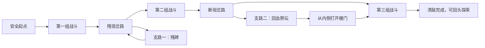

# 九鼎 MVP-03：技能表现与汤谷探索（范围确认稿）

2026-10-18。基于已交付的 MVP-02 0.2.1 继续打磨。Q1—Q12、整体范围及测试边界已由用户确认，并授权整理和发布正式规格；本文不代表实现或验收已经完成。（**历史阶段说明**：本文为 Electron／Phaser 阶段 MVP-03 范围确认稿；现役 Godot 工程 16 房路线与规则见[首关扩展实施记录](汤谷首关扩展_实施记录_2026-10-26.md)及[玩法与运行规则](../product/十日_玩法与运行规则.md)。）

## 本轮目标

用户反馈技能表现潦草、地图缺少明显路线引导，希望适当增强特效，并增加有探索价值的区域。继续保持等距俯视、皮影为主与像素质感为辅的风格。

当前代码采用单张地面底图叠加场景物件与碰撞，已有三组遭遇；技能主要使用简单线条、圆环与拖尾。改进需要同时考虑画面、可走通路及探索互动。

## 已确认

- Q1：继续使用一张连续汤谷地图，增加一条清晰主路、两条可选支路及一处返回主路的捷径。通过残墙、扶桑树根、石阶、灯火和地面铺装区分道路、战斗庭院与探索区域。
- Q2：支路提供两种探索回报：可阅读的残碑／故事线索，以及一次性恢复生命的祭坛。
- Q3：保留普通箭、Q 穿透箭、E 箭雨和空格闪避的现有伤害、冷却与判定，集中精修表现。普通箭补弓弦亮点与命中碎屑，穿透箭补集中聚光和贯穿拖尾，箭雨表现清楚的预告、分段落箭与落地冲击，闪避补墨影残像和脚下扬尘。玩家技能以暖金为主，敌方预警保留朱红，避免大面积光效遮挡敌人。
- Q4：路线以场景本身引导，HUD 仅显示当前区域及下一处主路地标；主路使用连续石铺、灯火与开口朝向，支路使用不同地面与独特地标。暂不增加常驻大箭头或小地图。
- Q5：残碑、祭坛靠近后显示 F 键提示，按 F 主动互动；E 保留箭雨用途，路过不自动使用。
- Q6：场上存在已激活且存活的影偶时，残碑和祭坛暂不可用。残碑阅读时暂停游戏，按 F 或 Esc 关闭并恢复；允许再次阅读。
- Q7：祭坛每次从起点重试后可用一次，恢复 40 点生命，最多到 100；满血提示“无需恢复”且不消耗。使用成功后外观熄灭，按 R 重试后重置。
- Q8：第一条支路位于第一组战斗之后，通往残碑；第二条支路位于第二组之后，通往祭坛。支路不强制新增战斗；第二条支路从内侧按 F 开栅门，形成回主路的捷径，不能绕过三组主路战斗。最后清敌后仍可回头探索。
- Q9：在现有 2560×1440 世界尺寸内重做道路、庭院、林间空地和支路布局，保留人物大小及跟随镜头。
- Q10：残碑只展示汤谷环境与故事线索短文，不接正式档案收藏或主线进度；文案在制作前单独审阅。阅读记录、祭坛使用及栅门开启只属于当前流程，按 R 重试后统一重置，不跨次启动持久化。
- Q11：脚点接近物件前方可到达的互动点约 80 世界单位时，仅提示最近的一项；不能隔墙互动，长按 F 不重复触发。失败或暂停时不可用，栅门也须安全时开启；关闭阅读后清空输入。距离是可调初值。阅读界面中的 F／Esc 关闭操作按 Q6 单独处理，不因阅读暂停而被普通互动禁用规则拦截。
- Q12：先完成一处主路岔口及一处典型战斗区的动态小样，确认道路辨识、皮影／像素质感、四种特效节奏及遮挡后，再铺满全图。
- 用户此前已要求停止反复稳定性采样；本轮不自行重启这类采样。

## 路线结构

下图表示通路关系，不代表实际坐标、最终画面或缩放比例。三组敌人数量沿用 0.2.1 的 3／4／5。

## 美术资产初步分组

以下是制作规划，不表示素材已制作，也不把一组等同于一张图片。现有人物、三种影偶和弓箭身份继续复用。

| 组 | 内容与用途 |
| --- | --- |
| 1 | 汤谷地面底色与分区纹理，保留整体环境色调 |
| 2 | 主路石铺、支路土径及过渡贴片，形成可辨认的连续道路 |
| 3 | 草地、根系、断崖／边沿等边界表现，与实际可走范围一致 |
| 4 | 残墙、扶桑树根和石阶，围合通路与庭院；石阶只作同一战斗平面的视觉表现 |
| 5 | 树木、灌丛和远景剪影，区分林间空地与路线边界 |
| 6 | 灯火及小范围环境光，引导主路转折 |
| 7 | 主路地标与终点景观，支撑 HUD 的下一处地标提示 |
| 8 | 残碑、可互动提示及阅读面板 |
| 9 | 祭坛可用／已使用状态、恢复反馈及满血提示 |
| 10 | 栅门关闭／打开状态、开门过渡及内侧互动提示 |
| 11 | 普通箭弓弦亮点、短拖尾、命中碎屑 |
| 12 | 穿透箭聚光、箭身强调、贯穿拖尾及命中反馈 |
| 13 | 箭雨范围预告、分段落箭、落地冲击与收尾消散 |
| 14 | 闪避墨影残像、脚下扬尘及消散 |

路线、遮挡、碰撞与互动点需共同设计；不能在新底图上沿用不匹配的旧障碍。特效不得误示更大的伤害半径、不同的生效时机或更长无敌时间。

## 分阶段交付

1. 先明确全图通路与碰撞布局，提交残碑短文供单独审阅。
2. 在真实游戏中交付一处主路岔口和一处典型战斗区的动态小样；使用现有人物与影偶验证四种特效及镜头下的可读性，不用静态效果图代替动态确认。
3. 用户确认小样后，按同一风格制作完整地图、两条支路、残碑、祭坛及捷径；完成对应美术与互动接入。
4. 交付运行包与实际检查记录。延续 Windows x64 EXE／ZIP、macOS arm64 ZIP 的交付方式，Windows 实机由用户回传；构建成功不自动算实机通过。

本轮不新增技能机制、敌人类型、支路强制战斗、随机地图、多房间切换、小地图、正式档案收藏、跨局成长或存档系统。地图仍是二维战斗平面，不增加桥上／桥下高度交战。

## 已确认的验收边界

- 自动化沿用现有房间规则／输入接口验证外部结果：通路可达、碰撞、三组完成、F 互动、安全限制、阅读冻结、恢复生命、满血不消耗、门的阻挡变化，以及 R 后全部状态重置。避免把内部对象结构、贴图数量或实现函数当成玩法验收。
- 真实键鼠跑通主路、两条支路和捷径；复核门的视觉／碰撞同步、跟随镜头与边缘提示、阅读关闭和窗口失焦后的恢复行为。
- 动态小样和最终画面人工复核：主路／支路可辨，技能预告与实际范围及时机一致，四种操作可区分，人物、影偶和朱红预警不被特效淹没。截图／录屏及用户观感结论独立保留，不用自动测试代替。
- 保留 Mac／Windows 各自结果；Windows 实机由用户回传。不自行重启反复的长时稳定性采样，不把 MVP-02 既有未验项目追溯标为通过。

用户已确认使用 to-spec 整理并发布正式规格，见 [MVP-03 Spec](九鼎_MVP03_Spec.md)。本阶段未修改运行代码、未生成新美术、未重启采样。

正式规格已发布为 [GitHub Issue #17](https://github.com/Bacsonlx/NineTripodCauldrons/issues/17)，发布核验见 [规格发布记录](MVP03_规格发布记录.md)。
