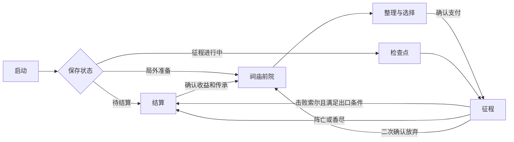

# 九鼎局外安全屋需求与验收

2026-11-09。四轮 Q1—Q22 已确认。用户随后要求在仓库主分支 `master` 直接开发正式版本。各轮决定见[需求讨论记录](局外安全屋_需求讨论记录_2026-11-09.md)。

## 玩家流程

- 正常启动以最大化窗口进入可行走的祠庙前院，或恢复同一玩家的未完成征程／结算。前院底图等比铺满视口。出征与回屋沿用当前窗口模式。前院是紧凑、固定布局、无敌人的局外地图。孩子在前院活动，出征请后羿并进入汤谷。
- `WASD` 行走，靠近 NPC 按 `F`，`B` 整理背包，`Esc` 关闭当前面板或打开系统菜单，`F11` 切换全屏。打开服务或背包时停止移动，关闭后留在原地。局外展示筹备资源、香火与交互提示，战斗操作和战斗 HUD 只在征程使用。
- 铁匠提供已解锁的装备配方，商人提供构筑补给，守祠人汇总请神、地区、背包、技能和传承并确认出征。首版只有后羿与汤谷。快速测试走开发命令，与正式进度隔离。

## 筹备与经济

| 项目 | 规则 |
| --- | --- |
| 免费基础方案 | 训练弓、布履、青龙、羊角、鼠毫、素食。每次新局准备时提供，允许少带以腾出空间。回屋时重新提供，付费选择需要重新加入。 |
| 背包 | 现有 50 格构筑，装备 6×5、祭坛 4×4、收纳 4×1。摆放、旋转、嵌符并预览技能。 |
| 打造 | 已解锁配方替换对应基础装备并预嵌一符，保留技能与羁绊。预嵌符随打造选择。手动嵌符使用准备中的实物，出征前可撤销，出征后沿用不可拆规则。 |
| 商店 | 羊角、虎牙、鼠毫、燧火、素食。每次出征最多额外两件，同名最多额外一件。嵌入装备的付费符也计入购买限制。 |
| 支付 | 加入或取消选择时调整准备，持续显示持有量、总成本与支付后余额。确认出征时统一支付并生成本局实物与首个检查点。资源不足、布局非法或出发失败时保留余额与准备。 |
| 资源来源 | 正式局末按完成的战斗房计筹备资源，同一房间每局只计一次。胜利额外奖励，阵亡和香尽保留已完成内容的收益。快速测试、普通退出和主动放弃不发放。 |
| 跨局保留 | 筹备资源、香火、配方、制作资格跨局保留。筹备资源不占格，香火用于进度。金币与器魂按局内规则处理。 |

| 试玩初值 | 数值 |
| --- | --- |
| 初始筹备资源 | 0 |
| 完成战斗房（含 Boss） | 每房 10 |
| 正式胜利 | 额外 30 |
| 商品／打造 | 每件 10／20 |
| 胜利、阵亡、香尽正式结算 | 香火 +1 |

| 配方 | 首次正式结算的解锁条件 | 占格与效果 |
| --- | --- | --- |
| 训练弓＋羊角 | 完成第一庭 | 2×3，装备区最大生命 +30 |
| 训练弓＋鼠毫 | 完成第二庭 | 2×3，装备区拾取半径 +5% |
| 布履＋羊角 | 完成第三庭 | 1×2，装备区最大生命 +30 |
| 布履＋鼠毫 | 通关汤谷 | 1×2，装备区拾取半径 +5% |

## 征程、传承与恢复

- 出征物成为本局实物，临时强化与战利品按局内规则结算。残影须合法放入祭坛，出征前可旋转摆放，出征后锁位。首版无名档最多一件，可选零件。确认不带现有残影前提示失去传承。
- 索尔倒下停止有效冒险计时并形成战后检查点。抵达出口且满足现有完整通关判定后进入最终结算。阵亡直接进入结算。香尽保留对应结算规则，正式时限另定。
- 结算显示结果、筹备资源、香火、配方解锁与传承候选。候选是仍持有、正常且具有容器归属的实物或旧残影。确认后统一提交收益与传承，再回前院。残影保留原物种类、品质、形状和容器归属，固定一票。已烧毁、消耗、留地的物品及嵌符、强化状态不传承。
- 活着时可从暂停菜单二次确认放弃。确认列出已投入物品和携带残影的损失，放弃不发本局收益与新传承。取消保留原局。正式征程禁用 `R` 重建，开发测试保留快捷重试，背包内 `R` 继续旋转。
- 采用单个本地玩家进度。保存安全屋准备、正式出发状态、房间结算点与战后检查点。未完成房间按最近保存边界重试。首间房尚未结算时恢复本局出发状态。保留该边界的计时、构筑与随机序列。索尔已败后无需重战，结算打开后重启优先恢复待确认结算。
- 出发扣款与本局记录一并提交，局末收益与关闭本局一并提交。重复触发不重复扣费或发奖。普通退出／异常关闭可续玩，征程途中不可回屋补货后继续。

## 交付验收

| 验收面 | 可观察结果 |
| --- | --- |
| 入口与操作 | 新玩家启动可走到三位 NPC，靠近按 F 打开正确服务。关面板留在原地，键鼠不穿透。正式入口、暂停和结算都使用安全屋。 |
| 筹备 | 零资源可免费出征。解锁、取消、购买限额、嵌符撤销、满包和资源不足结果正确。成功只扣一次，真实布局和技能来源带入征程。 |
| 检查点 | 复启保留准备或同一局。已完成房间与索尔败退状态保留。结算中退出后能继续确认。 |
| 局末 | 胜利与阵亡结算后回屋，香尽通过规则用例验证。重复提交不叠加，传承锁位，放弃和不携带损失有提示。 |
| 视觉与发布 | 正式地图、孩子、NPC 与功能面板在不同窗口可辨识。干净导入、后台逻辑、实际键鼠、原生画面、双平台打包和性能分别记录。 |

其他地区和角色、神兽脾气、惩罚契约、签署剧情、全量道具、正式香尽时限、多档案和云同步留给后续版本。筹备资源正式名称与 NPC 文案后续完善，产出、价格及开局强度以试玩调校。
