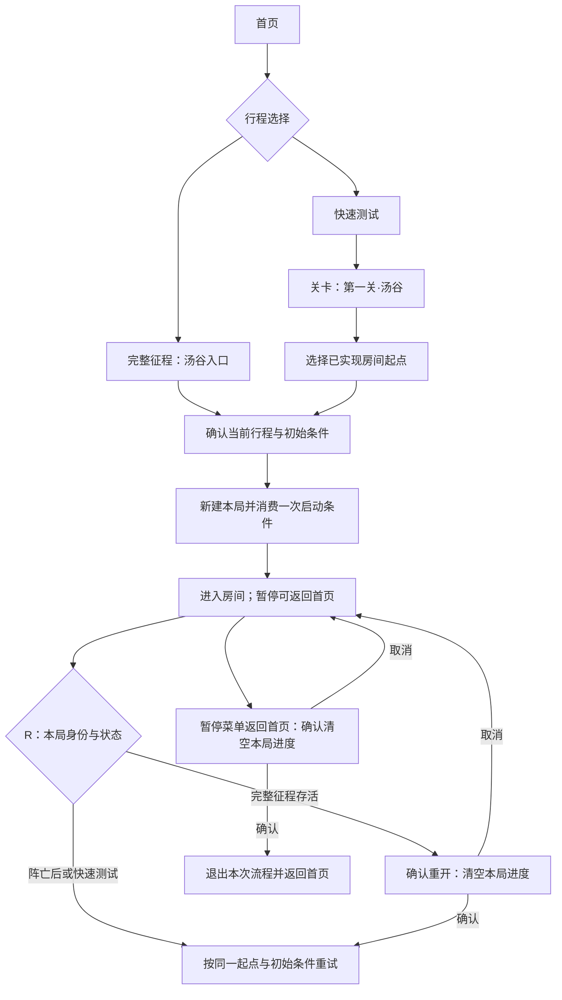
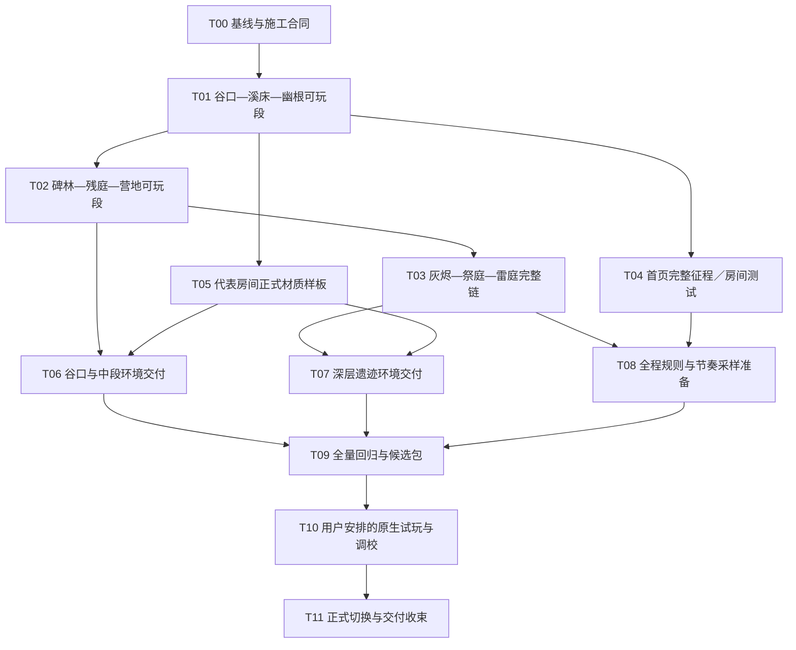

# 汤谷首关扩展：完整施工计划

日期：2026-10-26。状态：**设计合同定稿，已获用户 implement-spec 授权；当前集成候选施工与验证见实施记录。**

用户已要求基于原型生成完整施工计划，暂不修改代码逻辑。三轮答复“都按建议”分别确认 Q1—Q5、Q6—Q10、Q11—Q13；连续阅读见[共同理解稿](汤谷首关扩展_共同理解稿_2026-10-26.md)，确认来由见[讨论记录](汤谷首关扩展_讨论记录_2026-10-26.md)。本文列清施工内容、依赖、验收和后续量测／评审事项。随后用户明确要求“按照原型图和施工计划精准还原实现”，据此进入实现；本计划的验收条件保持有效。

## 1. 目标、依据与决策状态

### 1.1 要解决的问题

当前汤谷首关路线短，战斗集中在三庭，持续探索和场景变化不足。扩展后应在同一汤谷地区形成正常游玩约 15–20 分钟的正式首关，增加路线层次及野怪数量，使玩家逐步深入遗迹，并能从首页快速进入指定房间测试。

玩家应获得以下体验：

1. 从谷口进入汤谷，逐步经过溪床、幽根、碑林、遗迹、灰烬地带和雷庭。
2. 面对不同形状与视野条件的战斗空间，而不是反复进入同一圆庭。
3. 看得懂主线方向，能选择短支路并汇回主线。
4. 战斗、探索、补给与准备交替出现，能感到压力上升，也有整理机会。
5. 跨房保留本局构筑和资源，回头探索不刷新已完成内容。
6. 完整征程与快速测试入口清楚区分，按钮显示与实际起点一致。
7. 测试指定房间时不必先打整关，仍可继续向后推进。
8. 制作完成后由实际完整游玩证明时间、地图可读性和战斗节奏达到目标。

### 1.2 资料优先级

| 资料 | 本计划的使用方式 |
| --- | --- |
| [玩法与运行规则](../product/十日_玩法与运行规则.md)、[术语表](../../GLOSSARY.md) | 已确认的房间、计时、药瓶、构筑和 Boss 边界 |
| [架构选型结论](../architecture/九鼎_架构选型结论.md)、[ADR-0010](../adr/0010-godot-migration-direction.md) | Godot 原生 2D、编辑器承载布局、锁定引擎及平台边界 |
| [ADR-0001](../adr/0001-fixed-isometric-2d-world.md)、[ADR-0013](../adr/0013-independent-room-map-progression.md) | 固定镜头、单一二维战斗平面、独立房间和双向门 |
| [当前房间说明](../guides/汤谷房间地图使用说明.md)、[首页实施记录](首页与征程入口_实施记录_2026-10-24.md) | 现有实现与用户编辑成果 |
| [首关玩法第一批记录](第一关玩法补全_第一批实施记录_2026-10-24.md) | 现有三类敌人、营地和构筑符预算 |
| [原型任务记录](../../output/level-design/tanggu-expanded-20261026-v1/README.md)、[原型数据](../../output/level-design/tanggu-expanded-20261026-v1/route.json) | 本轮规划输入；参数、视觉及施工细化仍为候选 |
| [验证与资产追溯指南](../guides/验证证据与资产追溯.md)、[游戏 Skills 指南](../guides/游戏开发Skills使用指南.md) | 制作记录、分层验证、素材交付和后台操作边界 |

### 1.3 已明确要求、规划基线与开工门

| 编号 | 内容 | 状态与处置 |
| --- | --- | --- |
| D0 | 延长首关至约 15–20 分钟，增加路线与野怪，场景逐步深入；先原型后正式制作 | 用户明确要求 |
| D1 | 本轮编制计划并访谈，暂不修改代码逻辑 | 规划阶段要求；随后实现指令已授权施工 |
| D2 | 13 主线＋3 支路作为第一版规模；119 主线固定敌人、21 主线波次为调校初值 | Q2 已确认规模与可调方式，不锁死最终敌人数 |
| D3 | 15–20 分钟按正常首通、含 Boss 的有效游玩衡量，暂停／阅读／整理／加载另计 | Q1 已确认；熟练速通允许更快，不新增20分钟强制失败 |
| D4 | “完整征程／快速测试”两入口；选关卡再选房间，默认构筑与三资源 100 | Q5 已确认；可继续推进，R回所选起点，不伪造前序进度 |
| D5 | 采用13房必经主线与3个汇回主线的小环路，祭火位于主线中段 | Q2 已确认第一版结构；这是对原八房的扩展，不倒改 ADR 历史 |
| D6 | 构筑符先以整关最多8枚作为可调初值；七个主线战斗房首波首杀各1枚，A支路末波首杀1枚 | Q4、Q6 已确认；主线7枚，含A最多8枚，废止草案“全部留在原三庭”的分配 |
| D7 | 保留现有三类敌人和任务机制，以空间／职责组合产生变化 | Q3 已确认；先不增加机关／护送／环境危险，基础战斗与掉率暂沿用 |
| D8 | 整理点集中到入口、祭火营地、雷庭前径三处，三庭取消整理入口 | Q7 已确认；整理可选、暂停计时，不免费回血回蓝；回血祭火独立处理 |
| D9 | 完整征程阵亡后R从入口新局重来，快速测试R回所选起点，均清空本局临时进度 | Q8 已确认；暂停／阅读／整理中R无效，不新增单房复活或磁盘续局 |
| D10 | 门提示目的地与主路／支路，小地图保留整关轮廓和暗色未访问房间，M仍是本房总览 | Q9 已确认；场景地标指引深入，不新增整关大地图界面或强制箭头 |
| D11 | 首页测试仅选关卡／房间，采用默认合法出生点；入口先整理，其他房按正常任务触发 | Q10 已确认；不加资源／构筑／种子表单，保留已有CLI调试 |
| D12 | 主路门标前行／返回，支路入口标可选支路，支路出口标汇入主路，均显示目的房名 | Q11 已确认；按入口至Boss的设计方向判断，完成状态独立显示，不新增路线规划 |
| D13 | 主线碑林保留既有互动，B支路新增一则一至两段的可选短碑文，阅读合上后开门 | Q12 已确认；补充环境与已有线索，不新增关键真相，正式文本另列稿审核 |
| D14 | 完整征程存活时R、暂停菜单返回首页需二次确认；阵亡后R及快速测试R直接重试 | Q13 已确认；确认层停时并清输入，取消回原状态，说明本次未保存进度会清空 |

三轮已收束本次扩展的产品决定，不再保留待答访谈题。具体空间尺寸、出生位置、敌人组合及材质样板仍按已有合同量测、调校和评审；正式短碑文及原生视觉也需后续对应内容验收。这些属于施工产物与验证边界，是否实现及通过以对应版本的[实施记录](汤谷首关扩展_实施记录_2026-10-26.md)为准。

## 2. 当前基线与工程落点

### 2.1 已核对的现状

- 当前基线为提交 `a10e563` 加已有未提交工作树；仅提交号不能还原首页、道具和 Boss 等当前内容，开工必须额外保存源文件清单与工作树快照。
- 主工程为 `godot/`，锁定引擎 `4.7.2.stable.official.ed1daf0bf`，Compatibility；本轮不改引擎、渲染器或模板。
- 八个独立房间由场景读取，旅程模块维护当前房间和已访问规则对象；当前固定列表包含入口、三庭、碑林、祭火、Boss 和出口。
- 三庭共 42 只固定敌人、8 波；普通每波最多 7 只。索尔另有持续援军，不能把 42 写成包含 Boss 战的整关总数。
- 首页现在有完整地图、Boss 测试、野怪测试三个快捷起点；已有命令行支持指定房间、初始资源和种子。
- 当前首页左栏并非持久的模式选择；底部出发按钮固定打开完整地图确认，正式改版必须统一选中态、确认层和传入参数。
- 当前完整流程标记只检查第三庭、Boss 和出口，不能直接作为扩展后所有必经内容的验证。
- 现有每波首杀发构筑符的实现没有独立的“整关 8 枚”硬上限；8 枚来自当前只有 8 个普通波次。直接加到 24 波会使预算失控。
- 已有累计有效时间，但尚未接通“一炷香”超时失败、正式战后结算及磁盘续局。增加内容不自动实现这些后续系统。

### 2.2 职责与改动边界

未来实现继续使用现有职责：场景定义布局与遭遇，战斗规则裁决伤害／互动／时间，旅程管理跨房连续状态，呈现层读取公开状态，首页只选择入口并交付启动条件。

| 工程区域 | 预计施工内容 | 边界 |
| --- | --- | --- |
| 独立房间场景 | 新增八房，调整既有连接、部分庭院波次与构图 | 不覆盖用户编辑结果，不从生成脚本重建整个房间目录 |
| 场景到规则的布局转换 | 复用出生点、可走边界、障碍、遭遇和门定义 | 仅在已确认奖励策略确需字段时补最小数据，不另建通用关卡框架 |
| 旅程和启动参数 | 扩充合法房间、保持跨房状态、明确正式／测试身份 | 不实现模拟前序构筑、存档或多地区调度 |
| 构筑奖励 | 使新增波次不会自动扩大奖励预算 | 保留真实击杀、实例唯一性、跨房去重与既有拾取方式 |
| 首页、确认层及首关呈现 | 原生模式／关卡／房间控件，同步按钮，显示测试身份与完整房间图 | 不用整张 UI 生图当交互热区，不改角色与装备试装逻辑 |
| 既有测试与检查入口 | 更新当前首关期望，增加扩展路线与测试入口行为 | 冻结迁移夹具保持历史含义，不为新地图改写旧事实 |

这里只描述未来改动，本轮不修改上述模块。

## 3. 完整路线与门连接合同

### 3.1 主线与支路


共 16 房、18 对双向连接、36 个门实例。进入三个支路均不能跳过任何主线战斗房；支路是否访问不作为正式完整流程的必需条件。这里只要求本局内记忆，不实现退出后的磁盘续玩。

### 3.2 逐房施工表

“邻接”列是完整目标集合，不代表房间内的方位或门节点名称；具体门位在灰盒按视野和到达安全确定。门标识必须在房内唯一，目标门必须反向指回。

| 编号／ID | 房间与任务 | 新增或复用 | 精确邻接 | 空间与施工要求 |
| --- | --- | --- | --- | --- |
| 01 `entry` | 汤谷入口，安全／初始构筑 | 复用 | `court1` | 保留真实入口构筑、教学书和出发流程；不增加强制长对白 |
| 02 `court1` | 日鸟石庭，战斗 | 复用 | `entry`、`dry_creek` | 保留识别度和入门圆庭；由两波进入既有战斗节奏 |
| 03 `dry_creek` | 落叶溪床，战斗 | 新增 | `court1`、`root_fork`、`moss_side` | 干燥 S 形可走带及开阔战斗口袋；水只做边界，不需跳石 |
| 04 `root_fork` | 幽根岔径，战斗 | 新增 | `dry_creek`、`moss_side`、`stele` | 低根障分流后汇合；两侧均可通行，根冠不挡地面威胁 |
| 05 `stele` | 碑林遗径，探索 | 复用 | `root_fork`、`court2`、`stele_side` | 阅读并合上残碑后开门；先复用现有已实现互动 |
| 06 `court2` | 扶桑残庭，战斗 | 复用 | `stele`、`stele_side`、`altar` | 保留已接受的上沿扶桑根、低残石与双侧通道；波次独立修订 |
| 07 `altar` | 祭火营地，安全 | 复用 | `court2`、`ash_cloister` | 中段整理与可选回血；满血不阻挡通行，不因变为主线强制消耗祭火 |
| 08 `ash_cloister` | 灰烬回廊，战斗 | 新增 | `altar`、`gate_forecourt`、`ember_side` | L 形开放拐角及退让区；避免不可见远程敌人长期射击 |
| 09 `gate_forecourt` | 残门前庭，战斗 | 新增 | `ash_cloister`、`ember_side`、`court3` | 错列低障形成横移路线；残门为环境地标，不新增钥匙任务 |
| 10 `court3` | 赤日祭庭，战斗 | 复用并修订 | `gate_forecourt`、`thunder_approach` | 扇形开阔战场，综合三类敌人；不是第二个日鸟圆庭 |
| 11 `thunder_approach` | 雷庭前径，安全／整理 | 新增 | `court3`、`boss` | 战前安静阈口与可选整理点，可辨认下个目标；不自动补满资源，不增加强制等待 |
| 12 `boss` | 索尔雷庭，Boss | 复用 | `thunder_approach`、`end` | 保留已实现索尔、居中相机及完整攻击空间；只改来路指向 |
| 13 `end` | 汤谷出口，安全／收束 | 复用 | `boss` | 正式与测试完成提示区分；不在本任务补写真实奖励／签署 |
| A `moss_side` | 苔石侧谷，可选战斗 | 新增 | `dry_creek`、`root_fork` | 短挑战和绕行路线；末波首杀提供1枚构筑符，使用既有药瓶，不新增宝箱系统 |
| B `stele_side` | 残碑幽径，可选探索 | 新增 | `stele`、`court2` | 一则一至两段的可选短碑文，阅读并合上后开门；补充环境与已有线索，正式文字另列稿审核，灰盒占位明确标注 |
| C `ember_side` | 余火侧林，可选战斗／补给 | 新增 | `ash_cloister`、`gate_forecourt` | 清敌决定开门，一次性回血仍可选；不新增“必须回血”复合任务 |

### 3.3 通行与回溯约束

1. 未完成战斗／探索房仍封全部门；完成后全部开放，包括来路。安全房直接通行。
2. 回到已完成房间不刷新敌人、残碑、祭火、药瓶或构筑奖励；药瓶及地面物品仍归属原房间。
3. 过门继续使用 F，显示目标房名；主路门补充“前行／返回”，支路入口标“可选支路”，支路出口标“汇入主路”。方向按入口至Boss的设计顺序判断，完成状态独立显示，不能把所有已访问目标一律标为返回。小地图保留全部房间轮廓与暗色未访问状态，M仍是当前房间总览。长按不能反复跳房，药瓶优先级沿用既有规则。
4. 进房位置使用目标门内的到达点；快速测试使用该房默认出生点，两者分别检查。
5. 跨房保留生命、蓝量、精力、等待恢复、技能冷却、临时效果和共享背包；清理输入与不应跨房的弹道／表现。
6. C 房的祭火沿用现有一次性互动，不创造新开门条件；按Q7不设精细整理点。
7. Q7 已确认仅入口、祭火营地、雷庭前径三处设整理点，取消三庭整理入口；此项取代原草案保留五处的安排。整理自选、暂停规则计时，不免费回血回蓝；安全房可直接通过，不强迫整理。

## 4. 空间指标与灰盒施工方法

### 4.1 从实际操作能力出发

现有基础移动速度为 220 世界单位／秒；无障碍基础闪避为 600×0.20，即约 120 世界单位，实际受碰撞和当前效果约束。纸面攻击范围为 300，箭雨选点范围为 480，第一波遭遇触发半径为 170。以上是当前代码事实，不是此次拟改数值。

灰盒先在既有坐标和碰撞中量取玩家占地、现有门通行净宽、实际射程、敌人寻路及 1080p 相机可见范围，记录后再定房间尺寸。不要用生图的像素距离直接换算世界单位。

- 主要绕行线应允许连续移动和闪避，不依赖贴边逐像素通过；以一次实际 120 单位闪避的可达性检查关键转角。
- 同一低障两侧必须留出可选路线；有视觉缝隙却不可走的地方要通过实体与美术明确表达。
- 长房间增加的是有意义的转折和遭遇空间，不把数百米空走路当时长来源。
- 远程出生点需有可识别的预警及可接近／绕行路线；遮挡区域不能造成纸矢无解压制。
- 出生点、门的到达点与互动点、残碑、祭火及营地均须在合法可走区，不能贴在柱脚或障碍中。
- 房间根节点仍无缩放、无旋转；遵循现有轴对齐实体限制。L 形与分叉通过可走边界和障碍表达，不偷偷引入新导航系统。

### 4.2 先走通、再装饰

每房依次交付：边界与出生 → 门及到达点 → 可走区／障碍 → 遭遇点与波次 → 互动／营地 → 相机与地图 → 环境实例与遮挡 → 保存重开检查。

溪床的多个战斗口袋首先仍是同房空间设计；本计划不新增“每个口袋必须另行靠近才刷下一波”的触发机制。后续波沿用清波后 1.2 游戏秒激活；若长形房间导致下一波不可见，优先调整位置和可走范围，而非扩展遭遇系统。

总览中的岩台高差只是独立房间的环境表达。正式场景保持同一战斗平面，不新增桥上桥下、攀爬、跳跃、坠落伤害或新危险地表。

## 5. 遭遇、掉落与补给施工

### 5.1 波次与职责初值

下表全部为可调施工初值。组合顺序为“鸟面近战／纸面远程／木甲厚血”，各组三数之和为该波人数；不新增敌人种类或能力。

| 房间 | 波次人数 | 各波职责组合 | 固定敌人 |
| --- | --- | --- | ---: |
| 日鸟石庭 | 4、5 | 2/1/1；1/2/2 | 9 |
| 落叶溪床 | 5、7 | 3/1/1；3/2/2 | 12 |
| 幽根岔径 | 4、5、6 | 2/1/1；2/2/1；2/2/2 | 15 |
| 扶桑残庭 | 5、6、7 | 2/2/1；2/2/2；2/3/2 | 18 |
| 灰烬回廊 | 6、7、7 | 2/3/1；3/2/2；2/3/2 | 20 |
| 残门前庭 | 4、5、6、6 | 1/2/1；2/2/1；2/2/2；2/2/2 | 21 |
| 赤日祭庭 | 5、6、6、7 | 2/2/1；2/2/2；2/2/2；2/2/3 | 24 |
| 苔石侧谷 | 4、5 | 2/1/1；2/2/1 | 9 |
| 余火侧林 | 6 | 3/2/1 | 6 |

主线 119 只／21 波；全支路 134 只／24 波。普通单波最多 7，索尔援军维持当前上限 8，Boss 本体另计。保持敌人基础生命、速度、伤害与预警数值，先通过阵形、组合和地形产生变化。

每个战斗房至少检查：第一波触发可达、所有敌人可到战斗中心、远程可建立合法攻击线、清波后出现预告可读、最后一波清空才开门、往返不刷新，以及暂停／失焦／读碑中断不会漏波。

### 5.2 构筑符预算保护

Q4、Q6 已确认：首轮以**整关最多8枚**作为可调初值，奖励覆盖整个深入过程。原草案“原三庭2＋3＋3，其余房间不发”的分配已被取代，不再作为施工合同。

| 房间／范围 | 触发与收益 | 普通构筑符数 |
| --- | --- | ---: |
| 日鸟石庭 `court1` | 首波首杀 | 1 |
| 落叶溪床 `dry_creek` | 首波首杀 | 1 |
| 幽根岔径 `root_fork` | 首波首杀 | 1 |
| 扶桑残庭 `court2` | 首波首杀 | 1 |
| 灰烬回廊 `ash_cloister` | 首波首杀 | 1 |
| 残门前庭 `gate_forecourt` | 首波首杀 | 1 |
| 赤日祭庭 `court3` | 首波首杀 | 1 |
| A 苔石侧谷 `moss_side` | 末波首杀，额外挑战收益 | 1 |
| B 残碑幽径 `stele_side` | 可选故事线索，不独占主线必需物品 | 0 |
| C 余火侧林 `ember_side` | 清场后可选使用一次回血祭火 | 0 |
| Boss 及援军 | 不新增普通构筑符来源，援军仍仅提供既有药囊 | 0 |

不走支路可发7枚，包含A最多8枚；更多波次不自动扩大奖励。羊角／鼠毫按**实际发出的奖励次数**交替；资格和去重分开处理，禁止将无资格波次计入发放序号。奖励保留真实击杀掉落，不把“可发”写成玩家必已拾取。实现先考虑扩展首关范围内的少量资格记录，避免重做通用掉落系统。

验收要覆盖新增房大量击杀仍不超预算、反向进入三庭不重复、往返与测试重开、Boss 援军不占预算，以及地面奖励仍属原房。直接测试某庭只新建本次测试局，不伪造此前已经发过的奖励；其掉落节奏不能替代完整征程平衡。

### 5.3 药瓶、祭火与资源曲线

- 血／蓝药囊继续采用当前概率、恢复量、每波蓝囊保底及 F 拾取；不恢复旧自动回蓝。
- 更多波次会自然带来更多药囊。整关记录每分钟产出、实际拾取、满值留地、资源枯竭和阵亡，不能仅看总瓶数。
- 中段祭火和 C 支路的一次性祭火保持独立房间状态，满血不消耗，恢复封顶尊重当前生命上限。
- 玩家进 Boss 房不自动满资源；快速测试的满资源起点必须明确标识，不能拿它推断完整征程难度。
- 若长关资源曲线不成立，先记录原因，再提出有明确依据的参数修订；不在扩图施工中静默修改掉率、伤害或技能消耗。

## 6. 时间预算、采样与调校

### 6.1 原型预算及规则对齐

| 段落 | 房间 | 原型预算 | 体验目的 |
| --- | --- | ---: | --- |
| 谷口进入 | 01—04 | 4:45 | 建立操作节奏，首次分叉与绕障 |
| 遗迹深入 | 05—07 | 2:45 | 探索线索、混合遭遇、中段整理 |
| 灰烬推进 | 08—11 | 6:15 | 转角、横移与综合战斗，战前缓冲 |
| 索尔与收束 | 12—13 | 3:15 | Boss 约 3:00，出口约 0:15 |
| A／B／C 全部支路 | 三个支路 | 额外 2:15 | 额外挑战、探索和补给 |

原型合计主线 17:00、全支路 19:15，其中含出口 0:15。已确认规则要求 Boss 击败后停止一炷香计时，因此应分别记录：

- **有效冒险预算**：主线约 16:45，全支路约 19:00，截止 Boss 击败。
- **内容操作预算**：加上出口收束后分别约 17:00／19:15。
- **实际总耗时**：另含营地整理、阅读、暂停等实际花费，不保证与上两项相同。

这只是对原型预算的解释，不改写原型数据，也不新增强制 20 分钟限时。用户若要求包含整理在内的实际总耗时不超过 20 分钟，必须重新分配预算。

### 6.2 采样字段与最小实现

优先读取现有公开状态和有效时间，必要时仅增加开发用采样，不引入线上遥测服务或专用统计框架。每份记录至少包含版本标识、正式／测试入口、种子、设备、路线与构筑说明：

| 范围 | 必记信息 | 用途 |
| --- | --- | --- |
| 每房 | 进入、首次交战、完成、离开、重访及有效耗时 | 定位空走、卡路和冗余战斗 |
| 战斗 | 波次、职责组合、清波用时、生命／蓝量／精力变化 | 区分难度问题与内容不足 |
| 掉落 | 药囊产出／拾取、构筑符实际发放、地面遗留 | 防止扩图引起经济和续航失控 |
| 中断 | 暂停、失焦、阅读、整理、加载的停时区间 | 分开有效冒险和现实耗时 |
| 局末 | Boss 击败时刻、出口时刻、死亡／重试、测试身份 | 防止把局部测试或失败重试当正常首通 |

### 6.3 调校顺序与成功标准

后台自动完整流程先证明可通，不证明正常玩家需要多少分钟。后续前台安排后，建议保留主线正常首通、支路探索、熟练重玩三类记录；首通目标以正常路径和正常构筑衡量，熟练重玩允许更快。样本不足时只报告已记录样本，不宣称所有玩家都满足目标。

- 少于目标：先找是否遭遇过少、支路缺乏意义或技能组合清场过快；补体验内容，避免堆血、拖波间等待或强制空走。
- 超过目标：先找迷路、重复回走、卡视野、远程死角和过量波次；优先修正摩擦，再考虑删减内容。
- 中段掉血过重：定位职责／空间组合和药瓶可拾取性；不直接把所有房间变成回血点。
- 视觉过于重复：调整通路轮廓、障碍关系和地标，再调整材质颜色。

阶段成功条件是：完整路线可通、主线／支路清楚、战斗无软锁、预算可解释、完整正常游玩的有效时间落在目标区间。未安排前台时，只能完成“可玩候选和采样准备”，时间与体验验收保持待验。

## 7. 环境素材与正式资产制作

### 7.1 三张参考的效力

| 参考 | 用途 | 不可直接推导的内容 |
| --- | --- | --- |
| [无标注总览](../../output/level-design/tanggu-expanded-20261026-v1/overview-v1.png) | 环境深入、整体材质和房间气氛 | 有额外相似石庭及近似道路，不能作为精确拓扑或整张运行底图 |
| [四房近景](../../output/level-design/tanggu-expanded-20261026-v1/room-studies-v1.png) | 溪床、幽根、回廊、祭庭的空间方向 | 不是实际碰撞、导航、相机或遮挡证据 |
| [首页候选](../../output/level-design/tanggu-expanded-20261026-v1/home-selection-v1.png) | 两入口和二级选择的排版 | 不是当前 Godot 截图，旧参考的数值和装备显示不属于新需求 |

### 7.2 素材包清单

先盘点并复用 `assets/` 与当前 Godot 环境资源；下表是用途清单，不把“已有类似素材”写成“已可正式使用”。新增数量由灰盒实际缺口确定，不先承诺整套新图集。

| 包 | 主要内容 | 优先复用 | 新制／修订目标 |
| --- | --- | --- | --- |
| 谷口与日鸟 | 暖土、落叶、门与日纹 | 当前入口、石庭、门柱 | 修正与溪床衔接的边缘及引导 |
| 干溪 | 浅沙、干石、低岸、边界水 | 现有地表与碎石 | 足够区分干燥可走地面和非通行岸线 |
| 幽根 | 主根、低根障、根须、暗苔 | 扶桑根与残石 | 分叉轮廓、低障变体，避免树冠盖住威胁 |
| 碑林与残庭 | 残碑、灰褐石、低墙、蕨叶 | 已接受残庭与碑素材 | 保留原样板特征，补支路线索差异 |
| 祭火与侧林 | 小祭火、补给、焦木与地面痕迹 | 现有祭火与营地 | 清楚区分整理点、回血点和装饰火 |
| 回廊与残门 | 低墙、断柱、灰烬地面、边缘布片 | 现有石材、门、柱 | 可复用的 L 形空间边界与地标组合 |
| 赤日祭庭 | 扇形地面、半弧日纹、焦根与碎石 | 现有日纹、石材 | 修订扇形轮廓，保持中央和横移路线净空 |
| 雷庭与出口 | 索尔场地、预警空间、出口 | 当前正式 Boss 与场地 | 原则上只做过渡连接，不重制 Boss |
| 首页控件 | 选中态、字段、箭头与文字 | 当前原生主题和字体 | 以原生控件实现，通常不需新增整图素材 |

### 7.3 制作合同与接入门

1. 每个新资产记录用途、镜头、显示尺寸、脚点、实体占地、遮挡层、是否挡投射物及透明边处理。
2. 生成候选时使用内置 ImageGen，保留完整提示词、实际附图、候选和 SHA-256；本计划不触发生图或视频服务。
3. 地图环境不走人物动画流程；若后续制作道具或角色，按 Sprite Forge 指南另选最少技能。
4. 先做一个代表房间的正式材质样板，核对与已接受残庭的连续性，再批量铺房。用户视觉选择与 AI 技术评审分开记录。
5. 运行素材必须进入正式资源路径，通过正常导入／AtlasTexture 等既有方式引用；不能只留在 `output/` 或生成工具默认目录。
6. 用户编辑的八房先做快照，逐节点修改；旧连续地图保留。既有一次性生成工具不得被重跑用来覆盖用户布局。
7. 原型当前位于被忽略的 `output/`；确认选定后再将必要源图／提示词纳入对应 `assets/` 追溯入口，避免正式交付仅依赖本机忽略文件。

## 8. 首页与快速测试完整流程

### 8.1 状态与交互



- 默认选完整征程；选中态、底部摘要、主按钮与确认层始终一致。
- 完整征程主按钮“踏入汤谷”；快速测试主按钮“进入测试”。
- 关卡字段当前只有“第一关·汤谷”；保留设计中的选择位置，不添加不可用的归墟等条目，也不为单选项建设多关卡平台。
- 房间列表来自真实合法房间定义，按主线顺序排列并清楚标识支路，不能把中文房名直接当稳定 ID。
- 切回完整征程时起点回入口；从战斗返回首页再选择时，不继承旧低资源、种子或一次性参数。
- 确认后防重复启动；取消确认、Esc、窗口变化和焦点恢复沿用当前 UI 规则。
- 保留键鼠和原生控件焦点；不借此扩展手柄范围。
- Q10 已确认首页测试范围仅为关卡／房间选择，不加资源、模拟构筑或固定种子表单；高级调试沿用CLI。默认出生点需留出安全辨认场景的空间，入口测试先整理，其他房按正常任务触发。

### 8.2 初始化与完成语义

| 项目 | 完整征程 | 快速测试 |
| --- | --- | --- |
| 起点 | `entry` | 所选真实房间的默认出生点 |
| 初始构筑 | 现有首关默认构筑；入口真实整理后出发 | 现有默认构筑，不模拟前序奖励 |
| 初始资源 | 当前默认条件，整理遵守现规则 | 生命／蓝量／精力默认各 100 |
| 入口教学书 | 沿用正常入口规则 | 仅测试起点为入口时按现规则生成 |
| 前序完成状态 | 从零正常推进 | 不把未访问前序房标成已完成 |
| 后续推进 | 正常全关 | 允许向后推进或回溯，完成房仍不刷新 |
| R | 存活时先确认，阵亡后直接从入口新局重来，清空本局临时进度 | 直接回到本次所选起点与同一显式条件，新建测试局 |
| 到出口的提示 | 检查所有主线必要目标和正常入口身份 | 显示测试段完成，不宣称正式完整通关 |
| 返回首页 | 暂停菜单先确认，确认后结束本次内存流程，说明本次未保存进度将清空 | 同左 |

Boss 快捷入口与野怪快捷入口可收纳为 `boss`／`court1` 房间选择，不删已有 CLI 模式。现有 `level`、`boss`、`drops`、`alpha`、`rules` 及资源／种子参数继续保持各自意义；不必为 UI 显示词另建一套启动协议。

Q8 已确认暂停／阅读／整理中R无效；上图R分支仅适用于允许处理R的状态。本批不新增保留构筑的单房复活或磁盘续局。此前已确认的“退出后从房间结算点续玩”仍为后续系统方向，不因本轮暂缓而取消。

Q13 已确认误操作保护：完整征程存活时R及暂停菜单返回首页均需二次确认；阵亡后R、快速测试R直接重试。确认层暂停规则时间并清理持续输入，取消后回到打开前的状态；从暂停菜单打开则取消后仍暂停。取消不重建旅程，不改变资源或进度；确认只执行一次，不恢复已清理的持续输入。提示准确说明本次未保存进度将清空，不宣称已支持磁盘续局。

必须避免“非入口测试＋补走出口”被识别成正式完整通关。应有最小明确的运行身份，不能只靠起点是否为入口推断；快速测试入口房依然是测试。这里不新增持久通关统计、存档解锁或真实局末奖励。

## 9. 任务拆分与阻塞关系

以下为本地施工任务合同。用户已授权 implement-spec 实现，逐项完成情况及未验条件见[实施记录](汤谷首关扩展_实施记录_2026-10-26.md)。远程发布被自动审批拒绝，任务号仍为本地标识，不代表 GitHub Issue 编号。复选框只在有对应证据时更新。

### 9.1 任务图与并行范围



T04 可与后续地图施工并行，但共享启动／旅程改动必须指定一人整合；T06／T07 可分不同房间目录制作，但不同时编辑共享场景或同一素材元数据。实现阶段使用独立工作树并行施工，串行合入集成分支。

### 9.2 可独立验收的任务

执行记录（2026-10-27）：勾选表示对应制作或后台证据已完成，原生表现不由静态检查推定。T05／T07原生视觉、T06正式文案、T09后台候选包验证已完成，T10／T11见[实施记录](汤谷首关扩展_实施记录_2026-10-26.md)。

#### T00：固定工作树基线和施工合同

阻塞：无。交付：后续可以从明确版本安全施工。

- [x] 记录已有未提交内容、源文件／素材清单、引擎锁和场景快照，不把当前 HEAD 当完整基线。
- [x] 复核已确认 Q1—Q13及共同理解稿，核对本计划与既有 ADR；保留七房／八房历史事实及后续续局方向，不将设计确认写成实现完成。
- [x] 确定施工分支／隔离方式；未提交用户场景先保存再工作，不删除或重置既有改动。
- [x] 固定16房、18对门、波次及奖励预算；若采用其他规模，先同步本文数据。

#### T01：打通谷口—溪床—幽根及 A 支路

阻塞：T00。交付：玩家可从入口进入新溪床与幽根，选择侧谷，再接回当前后段。

- [x] 增加 `dry_creek`、`root_fork`、`moss_side` 灰盒和对应门，保留入口与日鸟石庭。
- [x] 每个新房都有真实敌人、任务、过门和回溯，短链之外仍可接到旧后段出口，施工分支保持可通。
- [x] 扩充房间合法列表与 CLI 起点，更新有关真实输入完整流程的测试，不直接写任务完成状态。
- [x] 同步引入已确认的奖励资格保护；新房新增波次不悄悄扩大奖励预算。
- [x] 入口保留整理，第一庭取消整理入口；本段三个主线战斗房首波首杀各发1枚，A末波首杀发1枚。
- [x] 验证三房直达、清波、支路回归、资源连续和长按 F；记录第一版空间指标与后台结果。

#### T02：打通碑林—残庭—中段营地及 B 支路

阻塞：T01。交付：完成探索与残庭后，到中段安全房整理，再继续向后。

- [x] 调整原碑林／祭火并行关系，加入 `stele_side`，保留残庭已接受构图和材质。
- [x] 扶桑残庭更新三波 5＋6＋7，首波首杀发1枚构筑符，取消该庭整理入口；残碑阅读、祭火营地整理及一次性回血可用。
- [x] B不访问也能通过；进入后读碑并合上再开门。新增一则一至两段短碑文，补充环境与已有线索，正式稿另作内容审核；灰盒占位明确标注，不复制主线碑文充当正式交付。
- [x] 验证满血通行、整理停时、生命上限不免费回血、来回不重复奖励，局内背包始终同一份。

#### T03：打通深层遗迹、C 支路及完整 16 房

阻塞：T02。交付：灰盒能走完全部主线与三支路，最终进入现有索尔和出口。

- [x] 增加 `ash_cloister`、`gate_forecourt`、`ember_side`、`thunder_approach`；赤日祭庭修订波次与扇形战场。
- [x] 各房主线遭遇符合表格，C 的回血不变成门锁任务；中段到 Boss 不补满资源。
- [x] 灰烬回廊、残门前庭、赤日祭庭首波首杀各发1枚；第三庭取消整理入口，雷庭前径提供战前可选整理。
- [x] 16房、18对门、36门实例可加载、可达、双向匹配；支路不绕过主线战斗。
- [x] Boss 规则与相机保留，击败后援军清理、药囊保留、出口与回溯可用。
- [x] 正式完成条件包含全部必要主线目标，不能仍只依赖第三庭／Boss／出口三点。

#### T04：首页选择完整征程或任意房间测试

阻塞：T01。交付：玩家可从首页选择当前已实现房间测试，后续新增房自动进入正确列表。

- [x] 原生控件实现两入口、关卡字段及房间选择；不展示未实现内容。
- [x] 主按钮、选中态、摘要、确认层与实际起点一致，包含从仓库返回后的出发路径。
- [x] 测试身份、默认合法出生点、初始条件、重试、返回首页、取消确认和重复确认行为均符合第8节；首页只选关卡／房间。
- [x] 按Q13接入重开／离开确认层，覆盖完整征程存活、阵亡后、快速测试三种R语义；取消保留原进度与暂停状态，确认执行一次，期间停时并清理输入。
- [x] 覆盖从低资源 CLI 返回首页、再进完整征程的条件隔离；现有专项参数仍兼容。
- [x] 用已实现房间集合驱动检查；最终 T03 合入后验证全16房均可选，而非仅前三个快捷入口。

#### T05：完成一个代表房间的正式材质样板

阻塞：T01。交付：选定溪床或幽根作为可在编辑器保存重开的正式环境样板。

- [x] 盘点复用素材和缺口，按第7节合同制作必要候选；保持独立源图与追溯。
- [x] 环境、障碍、脚点与可走边界对齐，贴图不是整房不可编辑底图。
- [x] 完成静态 AI 评审、导入与加载检查；用户视觉确认的对象和范围单独记录。
- [ ] 样板方向确认后再铺后续房间；若前台未安排，清楚区分离线源图确认与原生画面待验。

#### T06：谷口、支路和中段环境交付

阻塞：T02、T05。交付：入口至祭火营地及 A／B 支路具备连续而不同的环境。

- [x] 逐房按灰盒稳定尺寸铺设素材，保留原入口／残庭的用户编辑与已接受特点。
- [x] 干溪、幽根和碑林的地面轮廓、地标与材质过渡有区别，门目标提示可读。
- [ ] 主线碑林既有互动保留，B支路正式短碑文已完成内容审核并替换占位；不新增关键真相或长段强制演出。
- [x] 与样板同合同的运行资产可追溯，导入后的实体和遮挡无新增结构问题。
- [x] 编辑、保存、重开、场景加载取同一来源，不依赖制作期临时脚本。

#### T07：深层遗迹、C 支路与战前过渡环境交付

阻塞：T03、T05。交付：中段以后呈现灰烬回廊、残门、赤日与雷庭的递进。

- [x] L形回廊、错列前庭和扇形祭庭的空间差异可辨，不复制圆庭贴图。
- [ ] 远程预警和地面威胁可读；树根、门柱、碎石不侵入既有 Boss 攻击通路。
- [x] C祭火与装饰火在表现上区分，雷庭前径整理点可辨认；战前缓冲不靠新增强制等待。
- [x] 完成素材追溯、运行引用与后台加载检查，原生视觉保留待验状态。

#### T08：全程规则、掉落与节奏采样准备

阻塞：T03、T04。交付：完整灰盒及测试入口在真实规则下可回归，并能为后续时长调校提供数据。

- [x] 正常入口走完整主线、全支路回溯、任意房间测试分别验证，不直接改敌人生命或门状态来冒充通关。
- [x] 固定敌人119／134、波次21／24、普通最多7、主线构筑符7／含A最多8及Boss援军例外均可核对。
- [x] 验证仅入口／祭火营地／雷庭前径可整理，三庭整理入口取消；地图信息、前行／返回／可选支路／汇入主路提示及R语义符合三轮决定。
- [x] 确认层打开后规则时间停止、持续输入清理；取消不丢进度，从暂停菜单取消仍暂停，重复确认不多次重开／跳转；暂停／阅读／整理中R仍无效。
- [x] 每个房间验证出生、遭遇、药瓶、资源连续、暂停／失焦、R和返回首页。
- [x] 按第6节保存有效时间、停时、资源、掉落及出口收束的采样；不引入超时失败。
- [x] 消除测试脚本中旧固定房名顺序、单一坐标和短循环上限造成的误判；保留明确超时，禁止无限等待。

#### T09：全量回归、干净导入与原生候选包

阻塞：T06、T07、T08。交付：可供用户安排试玩的明确版本候选。

- [x] 完成项目全量检查，更新当前首关测试期望而不改写冻结迁移夹具。
- [x] 无缓存副本干净导入；Mac Universal／Windows x64包导出、资源读回与版本哈希登记。
- [x] Mac包后台加载到首页、普通新房与Boss，运行资产不引用 `output/`。
- [x] 分别记录构建、逻辑、后台加载和待验项；Windows只写构建结果，不写实机通过。

#### T10：用户安排的原生完整试玩与调校

阻塞：T09，以及用户安排前台验收。交付：有实际记录支持的时长、路线、视觉与操作结论。

- [ ] 正常主线首通、带支路探索和熟练重玩分开记录，含版本／种子／构筑及计时口径。
- [ ] 按第6节定位并修复偏离目标的原因；修改后重验受影响房间和完整路线。
- [ ] 实测看路、过门、掉落拾取、整理、失败重试和回首页；确认空间差异与节奏。
- [ ] 按既有设备与采样约束检查60秒跑射及5分钟稳定性；另做覆盖完整长关的资源／场景切换观察。
- [ ] 用户视觉认可只覆盖该候选、场景和动作范围；Windows实测仍按安排单列。

#### T11：正式默认关卡切换与交付收束

阻塞：T10，且用户明确安排正式采用候选。交付：默认完整征程使用新首关，文档、资源和验证指向同一版本。

- [ ] 默认入口与包内首关、首页房间列表、CLI说明和操作文档一致，不留混合八房／十六房状态。
- [x] 同步房间说明、Godot README、实施记录、候选验收和文档索引；历史证据保留原版本含义。
- [x] 留存可恢复的旧八房源文件／素材快照与已验证候选，不靠重置用户工作树回退。
- [ ] 正式关卡采用、Mac原生体验和Windows未验分别记载；不借此关闭无证据的迁移或商业版事项。


### 9.3 执行方式

每个任务都应能在独立上下文完成和核验，后续发布为票据时补完整验收、来源及原生阻塞边。施工分支按段替换旧连接，未制作区域仍接现有后段，保持短链可通；不为保存旧版而引入永久双版本运行架构。

不在本文承诺总工期或固定人日。先完成 T01 和 T05，测得实际房间制作／素材迭代成本后，再按剩余房间估算；前台验收时间由用户安排，不能算成后台任务已完成。

## 10. 验证矩阵与验收边界

### 10.1 测试接口选择

规则测试优先以旅程“输入＋有效时间 → 公开状态”为最高边界，覆盖实际房间与共享背包；首页使用真实控件信号、输入适配和一次性启动条件验证。场景布局另测编辑保存与加载一致性。

复用既有规则／旅程／布局／波次／完整流程／首页／启动测试，不另建测试框架。失败必须返回非零，有明确进程与游戏时间上限。节点数量、纹理存在、锚点断言只证明结构，不作为视觉通过。

### 10.2 必须覆盖的行为

| 类别 | 关键检查 | 支持的结论 |
| --- | --- | --- |
| 拓扑／布局 | 16房、18连接、36门；双向、主线必经、支路可回、所有出生／互动可达 | 实际场景合法且无已知结构软锁 |
| 战斗／波次 | 三职责、各波人数、第一波触发、后续缓冲、最后清波开门 | 当前规则下遭遇可完成 |
| 状态连续 | 生命／蓝量／精力／冷却／临时效果／背包、残碑／祭火／地面物品 | 跨房与回溯不重置或复制内容 |
| 掉落／构筑 | 药囊波保底、F规则、七个主线房各1／A末波1、资格及去重、整关8枚上限 | 扩图未意外改变补给及构筑预算 |
| 整理／引导 | 仅入口／祭火／雷庭前径可整理，三庭取消；门示前行／返回／可选支路／汇入主路及目标，完成状态独立；未访问地图暗显，M为本房总览 | 整备及路线信息与Q7、Q9、Q11一致 |
| 叙事／占位 | 主线碑林保留，B一则一至两段短碑文，阅读合上开门；正式稿已审核、占位已替换 | Q12范围内的内容可交付，不替代关键剧情确认 |
| 首页／测试 | 模式／关卡／房间／按钮一致，所有起点、条件隔离与重试 | 自动化层的进入／退出流程可用 |
| 正式完成 | 必要主线与Boss完成后到出口；测试局不得冒充正式完整通关 | 运行身份与流程标记正确 |
| 操作中断 | Esc、失焦、阅读、整理、窗口变化；重开／离开确认停时清输入，取消保持原进度与暂停状态，确认一次生效，阵亡／测试R直接重试 | 原输入适配边界不退化，Q13误操作保护生效 |
| 构建／加载 | 完整检查、干净导入、包资源、Mac后台启动 | 指定模式可解析／导入／加载 |
| 视觉／交互 | 玩家真实看到的地标、预警、遮挡、门提示、面板焦点及真实键鼠 | 原生体验，须前台证据 |
| 时长／性能 | 完整游玩采样；规定设备的帧时间和稳定性 | 仅支持记录版本／设备／样本内结论 |

### 10.3 未来执行命令

从仓库根目录运行；这里只列施工时检查入口，**本轮没有运行 Godot 或导出**。

```sh
python3 tools/migration/check_godot.py
godot --headless --path godot --script res://tests/run_tests.gd
python3 tools/migration/export_godot.py
./play --room court2 --dry-run
```

最后一项只验证现有启动器的命令拼装，不启动窗口，也不等于场景加载。新增房间在实现前不运行其启动命令。`check_godot.py` 和导出脚本会涉及导入／构建，正式执行时遵循项目权限与后台规则。

性能门沿用已确认指定设备与1080p：60秒连续跑射平均≥58FPS、至少95%帧间隔≤20ms、5分钟稳定性；本轮不新定商业版最低配置。完整15–20分钟流程额外观察不替代上述标准采样。

## 11. 风险、变更与恢复

| 风险 | 预防／发现方式 | 处置与边界 |
| --- | --- | --- |
| 增怪仍过短，或反而冗长 | 逐房和全关采样 | 按体验缺口调内容；119是初值，不是不可变合同 |
| 支路看似复杂、实际迷路 | 地标、门名与完整路线试玩 | 先修引导与重复回走，不堆更多岔路 |
| 波次放大奖励／药囊 | 奖励资格、上限、每分钟采样 | 构筑符先保8枚；药瓶参数调整另有依据 |
| 用户编辑场景被覆盖 | 开工前快照与逐节点差异 | 不重跑覆盖式生成工具，不用破坏性Git回退 |
| 旧测试绑坐标／短时限 | 按实际任务与公开状态推进，检查上限 | 延长到合理有限边界，不删掉超时或硬改敌人死亡 |
| 小地图／合法列表仍写死八房 | 追踪当前所有房间枚举和UI消费处 | 以真实定义同步，全部16房验证；不做泛化过度的关卡平台 |
| 素材图好看但不适合碰撞 | 样板、灰盒、可走区和原生观察 | 原型不直接作为底图，按独立物件接入 |
| 正式／测试身份混淆 | 入口选择、状态和出口测试 | 入口房也可作为测试，不能仅凭起点推断身份 |
| 长关误重开或误退出 | 存活完整征程R、暂停菜单回首页二次确认 | 停时清输入，取消保留原状态；阵亡／测试R仍可快速重试 |
| 既有索尔动画并行工作冲突 | 固定当前Boss基线，共享文件单人整合 | 只改门连接和明确必要呈现，不顺带替换动画路线 |
| 前台／Windows未安排 | 分类记录证据 | 后台候选可交付，时长、画面和Windows实机保持待验 |

每批集成前保存可回查的源文件和素材版本。需要回退时，仅恢复本任务在隔离施工基线上的增量，重做受影响检查；恢复旧版本不能删除用户后续编辑。正式源图不覆盖历史候选，包同名更新后用哈希区分版本。

## 12. 范围外

- 其他地区、随机地图生成、随机房间组合和通用多关卡调度框架。
- 新敌人类型、精英词缀、Boss招式／生命重做、角色四向动画与独立的索尔连续动作试点。
- 正式一炷香限时失败、存档／故障恢复、战后签署／真实Boss奖励／跨局结算。
- 完整六器内容、商店、装备经济重做、153件道具铺设与首页试装带入战斗。
- 手柄、联机、移动端、Steam完整功能或最低配置承诺。
- 本轮任何游戏代码、场景、运行配置或素材变更，以及发布Issue、创建PR或开工。

## 13. 本轮交付与文档验证

本文初次产出为完整施工计划和索引入口；三轮访谈 Q1—Q13 已全部确认并同步，文档定稿，连续阅读见[共同理解稿](汤谷首关扩展_共同理解稿_2026-10-26.md)，来由见[讨论记录](汤谷首关扩展_讨论记录_2026-10-26.md)。全部施工任务仍为计划状态；设计确认不等于逐张原型或原生画面的最终视觉认可，现有游戏仍为八房。

| 类别 | 本轮状态 | 证据／边界 |
| --- | --- | --- |
| 文档／数据一致性 | 三轮决定与定稿同步检查 | [定稿检查](../../output/level-design/tanggu-expanded-plan-20261026/discussion-round3-verification.json)覆盖Q1—Q13状态、当前计划数据、任务、链接及历史证据保护；[初稿](../../output/level-design/tanggu-expanded-plan-20261026/verification.json)、[第一轮](../../output/level-design/tanggu-expanded-plan-20261026/discussion-round1-verification.json)、[第二轮](../../output/level-design/tanggu-expanded-plan-20261026/discussion-round2-verification.json)保留原哈希与当时范围 |
| 代码／资源保护 | 通过 | 定稿检查比较原基线798项非文档文件SHA-256，无改动 |
| 构建／导入 | 不适用 | 本轮仅文档，不运行引擎或导出 |
| 逻辑／回归 | 未验证 | 仅核对计划数字与源码现状，不执行新游戏行为 |
| 运行／加载 | 未验证 | 未加载新关卡，八个新房尚未创建 |
| 交互／流程 | 未验证 | 首页仍是当前实现，改版只列在计划中 |
| 视觉／表现 | 未新增验证 | 引用上一轮候选图；原生画面与用户确认待后续 |
| 性能／稳定性 | 未验证 | 未采样；15–20分钟仍为目标及预算 |

完成标准：本文给出完整路线、逐房工作、遭遇／奖励、素材合同、首页流程、12项带依赖的任务及验证路径，后续可在确认施工基线后转成实施规格／票据。本轮不将任务发布为可执行Issue，不进入实现阶段。
