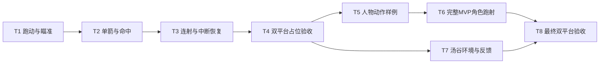

# MVP-01 票据拆分草稿

状态：待用户审核，尚未发布、尚未开工。来源为[已发布Spec #1](https://github.com/Bacsonlx/NineTripodCauldrons/issues/1)的完整正文；读取时无评论。所有草稿编号T1—T8都不是GitHub Issue号。

## 建议拆分

| 草稿 | 标题 | 直接阻塞 | 可演示或可核验的交付 |
| --- | --- | --- | --- |
| [T1](01-room-move-aim.md) | 单房间跑动、绕柱与独立瞄准 | 无 | 占位人物在固定房间跑动、绕柱，鼠标独立瞄准；有靶、影子和操作提示 |
| [T2](02-arrow-first-hit.md) | 单箭跑射、首次命中与靶反馈 | T1 | 边跑边射单箭；柱能挡箭，绕行后命中靶，闪色、火花与计数正确 |
| [T3](03-hold-pause-reset.md) | 持续连射、暂停失焦与一键重置 | T2 | 按住连射，松手／出画面／失焦按规则中断，恢复无粘键，重置可反复练习 |
| [T4](04-placeholder-cross-platform.md) | 缩放与加载异常下的双平台占位版验收 | T3 | 两端实机解压运行占位ZIP，操作完整；缩放瞄准与资源失败提示正确，阶段A通过 |
| [T5](05-character-motion-sample.md) | 在房间中验证代表角色的跑射动作样例 | T4 | 少量代表素材接入输入，实际检查绕身与反向跑射，确定分层和制作规格 |
| [T6](06-character-gameplay-integration.md) | 替换完整MVP角色与弓箭并复验跑射 | T5 | 按样例结论补齐MVP角色与弓箭，在房间中完成可评审的动态跑射 |
| [T7](07-tanggu-scene-feedback.md) | 替换汤谷场景并保持绕行、遮挡和命中反馈 | T4 | 固定汤谷底图、石柱与反馈接入可操作房间，通行、阻箭和遮挡仍正确 |
| [T8](08-final-dual-platform-acceptance.md) | 最终双平台ZIP与性能、动态画风验收 | T6、T7 | 最终素材组合后的两端ZIP、完整用例、动态画风与性能证据齐全 |

## 依赖理由

- T1直接扩展现有启动入口即可演示，无现存战斗调用点需要提前大范围重构，因此没有独立“基础设施”或“重构”票。
- T2需要T1的房间、人物输入和障碍；T3需要T2的真实箭与攻击周期，才能验证连射、取消和清理。
- T4必须验证T3完成后的占位闭环，防止只在Mac开发窗口运行后就开始扩大美术制作。
- T5与T7同被阶段A验收阻塞，满足先占位功能、后代表画风的顺序；它们分别使用现有概念方向，可在依赖图上独立推进。
- T6真正依赖人物样例结论T5，不需要等待环境美术T7；T7也不必等待完整人物，可使用既有可操作角色检查场景替换。
- T8需要人物与场景两支都完成；最终组合可能改变释放点、判定、遮挡、资源与性能，因此必须复验。
- 只列直接依赖，不重复添加传递依赖。当前可开始的前沿只有T1；图中的并行机会不表示已经获准启动代理或实施。

## 规格覆盖与边界

8张票合计覆盖42条用户故事、全部19项AC及11条资产记录。草稿正文逐票列出范围、验收清单和直接阻塞；部分AC按功能阶段分担，T8仍对最终产物完整复验。

所有任务只针对一房间、一玩家、三柱、两靶的简化MVP；按父Spec保持Boss、敌人AI、剧情、存档、手柄等后置。动作方向和帧数通过样例确定，不预锁四向或44帧。

最终两端各至少一台实机，1920×1080输出；预热后跑射60秒分别平均≥58 FPS、至少95%帧间隔≤20毫秒，另5分钟无崩溃、卡死或箭／特效持续累积。Windows缺少实际设备或验收证据时不能记通过。

## 审核与发布

需要审核：票据粒度是否合适、直接依赖是否真实阻塞、是否要合并或再拆。确认拆分后才发布；草稿不是已创建Issue。

获批后按依赖顺序在当前GitHub仓库创建8个子Issue，关联Spec #1，标记ready-for-agent，并将T编号替换为真实Issue引用、建立原生阻塞关系。若平台无法使用原生依赖，再保留可回查的文本阻塞引用。父Spec的正文、状态和标签保持不变；按技能要求的子Issue关联只建立关系，不重写或关闭父Issue。

本轮未执行任何GitHub写入、开发或绘图。清单JSON只是草稿索引，不是游戏运行配置或已批准实施任务图。
