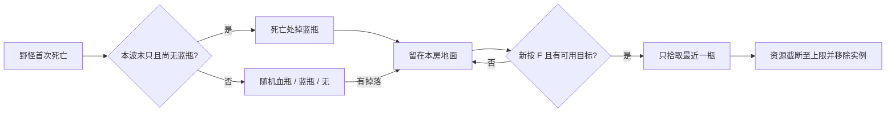

# 野怪药瓶掉落：原型与施工计划 v0.1

2026-10-22。状态：两轮选择已由用户确认，随后用户要求按计划实现。独立 Godot 掉落灰盒已接入，后台证据与 Task 状态见[实施记录](野怪药瓶掉落_实施记录_2026-10-22.md)；默认入口仍保持旧机制，尚未通过游戏内试玩。概率和恢复量用于本轮灰盒，不是最终平衡。

## 1. 本轮范围与依据

原型回答：野怪死亡后生成地面药瓶，玩家能否在战斗中用一次 F 立即补充，同时正确处理满值、门边目标选择和跨房保留？交付[可点击原型](野怪药瓶掉落_机制原型_v0.1.html)及本文；双击 HTML 即可打开，无安装、无联网、无持久化。它是状态演示，不是 Godot 试玩或最终 UI。

已确认的规则写在[玩法记录 Q100—Q104](../product/十日_玩法与运行规则.md#2026-10-22--野怪药瓶与-boss-掉落设计确认)。药瓶补给与装备战利品分开：前者立即恢复、不入背包；后者留给后续背包系统。本轮不设计装备属性、品质权重、词条、格子、商店、正式存档，也不发布外部票据。

目前正式工程仍按[旧资源规格](../product/首关_蓝量与精力规划_v0.1.md)自动回蓝。新设计将同时替代击杀回 4 和清波回 12，不能在接入时叠加两套收入。技能成本 Q12／E28、精力恢复、回血祭火和既有攻击规则沿用。完整背包的“默认自动入仓／快捷尝试放祭坛”见玩法 Q49，仍不由药瓶 F 规则改写。后续 Boss 装备是否需要 F 确认，要在背包设计中专门衔接。

技术依据：[架构结论](../architecture/九鼎_架构选型结论.md)、[独立房间 ADR](../adr/0013-independent-room-map-progression.md)、[Boss 计划](首关Boss_索尔_原型与施工计划_v0.1.md)。当前八房、第三庭后索尔雷庭的流程沿用；本轮不把掉落奖励作为开门或通关前置。

## 2. 已确认的交互与候选细化

| 情境 | 规则 |
| --- | --- |
| 普通野怪死亡 | 只在首次死亡结算时抽取掉落；受伤、尸体动画和重复快照不抽取 |
| 血瓶／蓝瓶 | F 拾取立即恢复对应资源，不进入背包、不增加可携带瓶数 |
| 战斗中拾取 | 允许移动与战斗中拾取，不暂停、不取消攻击或技能，不增加喝药动作锁定 |
| 单次 F | 每个新按下只消费一瓶最近的可用药瓶；按住不连取，取瓶当次不再执行门或其他互动 |
| 满资源 | 对应瓶留地；部分缺失也整瓶消耗，实际恢复截断到上限，不保存余量 |
| 多目标 | 可用药瓶优先于门；候选细化：同距按生成顺序，满值药瓶跳过，不挡住另一种可用药瓶或开放门 |
| 互动距离 | 候选沿用 80 世界单位；要求同房、合法可走落点、与玩家之间无阻挡，不隔墙吸取 |
| 换波／换房 | 不清除旧药瓶；本局房间缓存保存留地状态，回房不刷敌、不重抽、不重复领取 |
| 重开 | R 清掉全部房间药瓶、死亡与保底记录，按正式工程的初始资源重新开始 |
| 暂停／阅读／失焦 | 冻结或阻断规则时不拾取；取消旧输入，恢复后重新按 F。药瓶自身无到期计时 |
| 失败 | 阵亡／失败状态不能靠地面药瓶复活；重试前不再处理拾取 |
| Boss 倒下 | 展示装备与道具类别的未入库占位；不生成真实背包物品，不阻止离房 |

暂停／阅读时 F 的既有“合上残碑”语义先执行，不能在同次按键又捡药。同帧规则保持现有更新顺序：F 处理时尚未生成的掉落不能被这次按键领取，下一次重新按下才可取；已经结算失败则拒绝拾取。最终提示与执行读取同一份候选，不能显示“拾取蓝瓶”却实际过门。

掉落点候选为死亡瞬间脚点，位于非法区域则投影到邻近可达地面；保底也由最后一只怪产生实物，不在玩家脚边凭空发蓝。并排药瓶可以轻微错开显示，但不能改变可拾取距离的裁决位置。不会放置合法落点时应在制作校验中报错并修复场地，不能直接删除保底奖励。

## 3. 首轮掉落参数与资源预算

采用一只普通怪至多一瓶：蓝瓶 30%、血瓶 12%、无 58%，相互排斥；每瓶恢复 20。每波此前没有产生过蓝瓶时，最后一只强制蓝瓶，替代这只原本的随机结果，不额外叠一瓶。是否已拾取、玩家是否满蓝，不影响“已掉蓝瓶”的保底计数；上波留下的蓝瓶也不算本波掉落。

此方案直接对既有波次工作，不按实时血蓝量动态提高掉率，不增加连续失败救济或装备修正系统。首轮仅保证每波至少一瓶蓝瓶，不保证血瓶。正式平衡前对比总产出、实际到手、溢出与绕路成本，避免用更高掉率掩盖难捡的问题。

当前三庭为 4＋5、4＋5＋6、5＋6＋7，共 42 怪／8 波。每波 n 只的蓝瓶期望为 `0.30n + 0.70^n`：后项是整波原本没掉蓝瓶而触发替换的概率。以下是独立随机、全部拾取且不溢出的静态预算，不代表实际到手或通关。

| 指标 | 旧自动机制 | 药瓶候选 |
| --- | ---: | ---: |
| 八波总回蓝 | 42×4＋8×12＝264 | 期望约 13.90 瓶＝278.04 蓝 |
| 八波最低掉蓝 | 固定 264 | 8 瓶＝160 蓝，仍需玩家拾取 |
| 每波各一次 Q＋E | 总耗蓝 320 | 初始 100＋期望 278.04 可覆盖总量；时间顺序、漏捡与溢出可能导致局部不足 |
| 极端每波仅保底 | 不适用 | 初始 100＋160＝260，不能保证八波都放 Q＋E |
| 血瓶总产出 | 无 | 期望约 4.82 瓶＝96.34 生命，不保证掉血瓶；另有原祭火最多 40 |

血瓶期望扣除了末只强制蓝瓶替换随机血瓶的情况，计算为 `Σ[0.12 × (n − 0.70^(n−1))]`。战中可回血会提高容错，不能把药瓶当纯呈现改动；如果怪物压力大幅下降，先检查实际回血量与分布，再调参数，伤害与怪物生命不随本轮一同改动。

2026-10-22 实施阶段用户确认：R 重开使用新随机种子，本局内往返与重复查看保持已有结果。原型固定种子仅为重演；Godot 规则回归也使用固定种子，不将其当作正常 R 的行为。

## 4. 原型操作与验证范围

原型默认 60 生命／40 蓝，方便观察即时补充；这是演示夹具，正式开局仍为 100／100。图中的“靠近”按钮模拟位置，普攻击杀、受伤、Q 均为离散按钮，没有真实攻击轨迹、伤害时序、闪避或碰撞。自动回蓝在原型内关闭。

| 标签 | 要观察的结果 |
| --- | --- |
| 即时补给 | 两种瓶各恢复对应资源；一次只取一瓶，攻击意图保持 |
| 满值与溢出 | 满值不消耗；缺 12 时只恢复 12，整瓶移除 |
| 门边优先 | 第一次 F 捡瓶，第二次 F 才过门 |
| 按住防重复 | 保持按下不再拾取，松开重按才生效 |
| 跨房保留 | 两房任务预先完成，往返保留旧瓶；R 重开清空所有状态 |
| 暂停保护 | 暂停不消耗，继续后新输入才能拾取 |
| 随机与保底 | 受控全不掉落场景中末只产生保底蓝瓶，清波不自动加蓝 |
| Boss 奖励边界 | 一次生成两类占位，重复结算不增加；未领取可离房 |

自由操作可经历第一庭到第三庭的实际八波数量，再进入 Boss 占位。引导中的样本瓶和预清场夹具明确标注，不能作为自然随机产出证据。自由操作会退出引导步骤，点击标签可重置重演。

原型文件还未得到用户体验反馈；按 `prototype` 的归档流程，待它实际回答设计问题后再将验证结论和原型保存在独立原型分支，并由实现入口引用。本轮不在存在其他未提交改动的工作区自动切分支或提交。

## 5. Godot 实施接缝

当前代码事实基于本轮工作树；实施前需重新核对，不能覆盖已有未提交改动。

| 位置 | 现状与最小改动方向 |
| --- | --- |
| [TrainingRoom.impact](../../godot/scripts/combat/training_room.gd) | 普通箭、Q 多目标和 E 三段统一经过此入口；死亡分支改为唯一掉落裁决，移除 4 点回蓝，不能由动画生成 |
| 同文件 `update_enemies` 清波分支 | 移除 12 点清波回蓝；保底必须在末只死亡入口生成，此处只处理换波，避免重复生成 |
| 同文件 F 处理、`nearest_interaction` 及 `interact` | 已有按下沿去重；新增战中可用药瓶候选，独立于残碑／祭火“先清敌”限制，沿用阻挡检查；互动自身检查暂停与失败 |
| [JourneyRoom](../../godot/scripts/journey/journey_room.gd) | 门与基础互动目前按距离竞争；汇合药瓶优先级，单次 F 只执行一个动作；入房仍要求松开重按 |
| [RoomJourney](../../godot/scripts/journey/room_journey.gd) | 缓存每房规则实例；药瓶留在房间状态，不放进玩家 `travel_state`；restart 清缓存 |
| [BossRoom.impact](../../godot/scripts/combat/boss_room.gd) | 覆写死亡入口，不能只改基类；本轮计划仅增加奖励占位快照，不接真实装备生成器 |
| [房间呈现](../../godot/scripts/presentation/room_journey_scene.gd)、[HUD](../../godot/scripts/presentation/combat_hud.gd) | 只读快照画瓶、突出当前目标、显示实际恢复量；不自行扣瓶或修改资源 |
| [测试入口](../../godot/tests/run_tests.gd) | 扩展现有 runner，沿用规则输入／时间／可观察状态边界，不创建第二套框架 |

最小状态：每房保存地面瓶列表（唯一实例标识、来源怪物／波次、类型、落点）、每波是否已掉蓝瓶、掉落随机状态；全局重开时统一清理。怪物 ID 只在单房内唯一，唯一来源应包含房间和本局，避免多庭的相同敌人 ID 相互去重。Boss 占位另用已生成标志，不能被药瓶的 F 消费逻辑误当成可回血物品。

现有 F 处理发生在 `step` 的暂停／失败短路之前，因此药瓶消费不能只依赖外层短路来阻断。独立 Boss 场景在 complete 后停止更新，占位须在死亡分支即时生成；后续体验领取／离房边界使用有门房间，不误把独立场景冻结视为奖励阻塞。

先在现有规则对象内加少量状态和方法；不因后续背包需要而提前建通用物品事件总线、资源经济框架、存档协议或大范围拆分 training_room。药瓶合法性、选取、恢复与删除由一次规则操作完成，快照只供读取。`pending_mana` 是技能前摇预扣费，继续负责取消退款，不与掉落奖励混用。

## 6. 施工顺序与验收门

以下保留施工合同；当前实现与待验状态见实施记录。不承诺自然日工期，不自动创建外部票据。用户已授权开始 Godot 独立灰盒，随后由用户安排试玩，通过后再切换正式八房入口。

| 任务 | 依赖 | 最小交付 | 完成证据 |
| --- | --- | --- | --- |
| D01 死亡掉落规则 | 本原型反馈及正式随机重开策略明确 | 独立规则夹具、血蓝瓶与保底、关闭两类旧回蓝 | 普攻／Q／E 都只在首次死亡掉一次；末只保底唯一；重复命中／快照不增奖 |
| D02 F 即时补给 | D01 | 战中 F 候选、单瓶消费、满值留地与实际恢复量 | 距离边界、等距选择、满值跳过、截断；按住不连捡；不取消技能或改冷却 |
| D03 房间与输入中断 | D02 | 门边优先、跨房缓存、重开、暂停／失焦／阅读接缝 | 一次 F 不过门又捡瓶；往返不刷新；R 全重置；恢复后要求新输入 |
| D04 地面呈现与灰盒体验 | D03 | 沿用画风的红／蓝瓶占位、形状／文字辅助区分、目标高亮与 HUD 实际恢复 | 可读、可达、不遮前摇；用户实际战中拾取无误操作；未通过先改交互 |
| D05 八波预算与 Boss 占位 | D04 | 完整 42 怪／8 波资源记录、Boss 唯一占位、不阻挡离房 | 多组可控随机轨迹，记录低资源、漏捡／溢出、进 Boss 状态；占位不发装备属性 |
| D06 正式接入与交付 | D05 及用户确认灰盒 | 默认房间切换药瓶规则，文档同步、干净导入、原生包 | 项目后台检查、导出及对应平台原生证据分别记录；旧冻结迁移夹具不静默改写 |

游戏内验证清单：

- 随机阈值边界、保底替换而非额外掉瓶、保底按“掉出”而非“捡到”判断；同波多目标死亡及不同时间步长不重复奖励。
- 满生命／满蓝、只缺 1、两瓶重叠、最近满值而稍远可用、同距、边墙／柱子、死亡脚点与尸体后续击退分离。
- F 在攻击前摇／收招／闪避中、按键重复、松开重按、门边、入房持键；暂停／失焦／阅读／窗口变化／失败／R 的输入取消。
- 地面瓶不跨房跟随，旧瓶跨波保留，往返不重抽；R 清掉所有房间与 Boss 占位；同帧新生成瓶不被此前 F 回溯领取。
- 旧 4／12 自动回蓝确实关闭，`pending_mana` 退款继续正确；精力和祭火原语义保持；Boss 死亡只展示一次占位。

修改 Godot 代码后运行 `python3 tools/migration/check_godot.py`，定位规则可单跑 `godot --headless --path godot --script res://tests/run_tests.gd`。资源呈现改动按项目要求做干净导入及 `python3 tools/migration/export_godot.py`。当前只执行后台检查；真实画面、走位拾取与性能等待用户安排前台，Windows 实测暂缓，不能以 HTML 或后台规则通过替代双平台原生验收。

## 7. 后续背包设计入口

Boss 装备和道具“会掉落”已经确认；本轮的两个占位只代表奖励类别，不决定掉落数量、名称、品质或所有权。后续需决定：与 Q49 自动入仓如何衔接、空间不足如何留地、奖励是否局内有效、Boss 后到正式结算的时机、存档恢复与防重复领取。既有 Q66 把局内技能奖励放在 Boss 前，Boss 后以跨局进度／传承／叙事为主，因此新装备奖励的用途与带出边界要单独确认，不能默认继承到下一局。

## 8. 本轮实际检查

两个内联脚本通过 Node.js 语法解析；用纯状态模型依序推演八个引导场景，结果符合上表：满值留地、截断恢复、F 去重、门边先捡后过、往返保留／R 清空、暂停阻断、末只保底、Boss 占位去重。未增加原型测试框架。掉落期望用独立公式核对；本文及相关文档的本地链接检查通过，`git diff --check` 通过。

内置浏览器因安全策略拒绝 `file:` 本地页面，未进行浏览器视觉与真实点击验收；没有改用其他入口绕过限制。用户可直接双击 HTML 评审。没有修改 Godot 脚本或场景，没有运行 Godot 检查、导出或原生窗口；本轮检查不代表游戏内实现或玩法验收通过。
