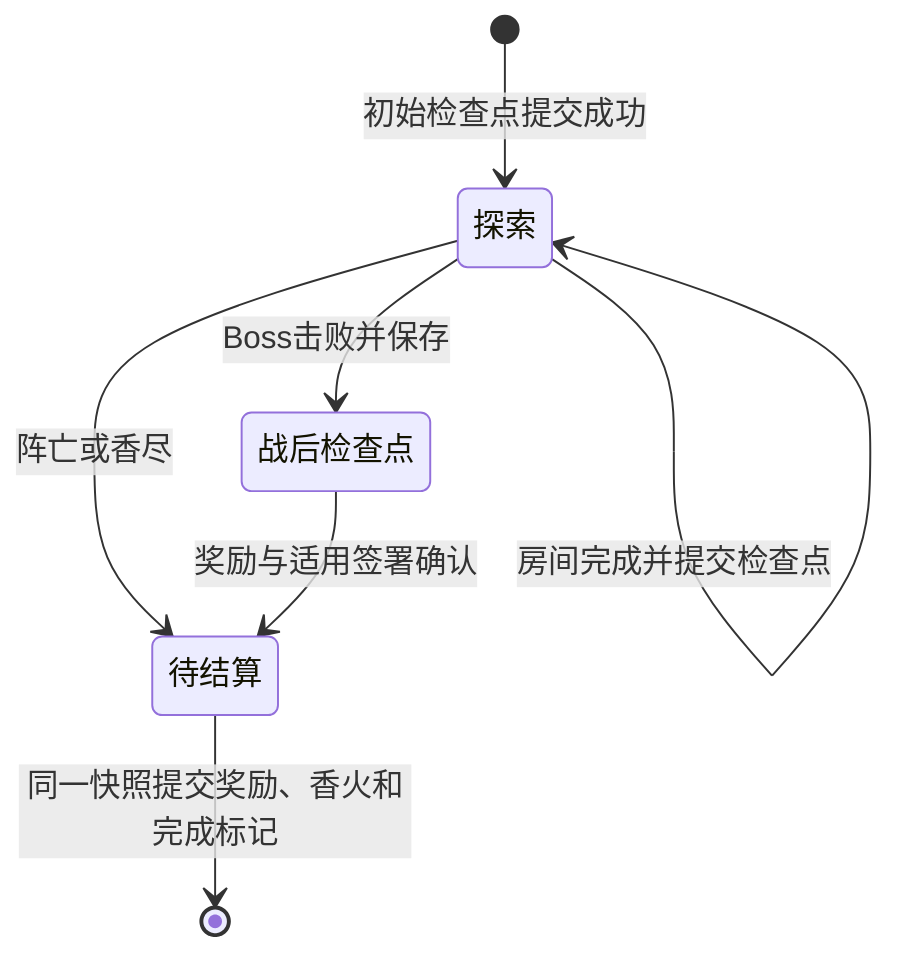

# 九鼎：Godot 架构评估与迁移落地方案

2026-10-19 · Q1—Q9 已确认，首个迁移交付的决策已收敛 · 本次仅收敛方案，尚未迁移业务代码。

**实施规格：**M0—M4 已整理为 [Godot 迁移 Spec](mvp/九鼎_Godot迁移_Spec.md)，发布至 [GitHub #33](https://github.com/Bacsonlx/NineTripodCauldrons/issues/33)；后续拆票、实施与验收以该规格为合同，本文保留架构依据和后续商业版预案。

用户本轮确认：**2D 手绘／精灵＋俯视或等距视角；PC／Steam；先交付完整方案，再决定代码迁移。** 延续 Windows x64 与 macOS Apple Silicon 的双平台要求。Steam Deck、Linux 原生、移动端、主机不自动纳入首发范围。

**后续访谈确认（Q1—Q3）：**用户已确定切换到 Godot；验证用于决定主工程切换时点和修复事项。保持已确认的玩法规则、数值、碰撞和操作中断行为，使用现有素材与构图作参照，表现改进须经用户确认；已知缺陷单列，不作为必须复制的规则。内容制作采用“用户在 Godot 编辑器查看、调整和验收，AI 负责脚本与批量配置”。该决定见 [ADR-0010](adr/0010-godot-migration-direction.md)。本次访谈尚不等于开始代码迁移。

**第二轮确认（Q4—Q6）：**首个交付为 M0—M4，覆盖当前汤谷完整战斗、探索、镜头、反馈、Windows／Mac 原生运行，以及编辑器调整布局后立即试玩。游戏脚本统一使用带类型的 GDScript；Node.js 可继续用于制作与转换工具。随机房间、Boss、成长和正式存档进入后续商业闭环；Steam 早期只核实接入路径与兼容性，成就、云存档及 Overlay 等功能在本地玩法和存档稳定后接入，不阻塞汤谷迁移。

**第三轮确认（Q7—Q9）：**迁移性能在登记的 Windows x64 与 Apple Silicon Mac 各至少一台实机上验收：1080p，预热后连续跑射 60 秒，平均 ≥58 FPS，至少 95% 帧间隔 ≤20ms，另做 5 分钟稳定性检查；结果仅适用于实测设备，商业版最低配置后续单独验证。首个交付完整支持键鼠，手柄双摇杆、菜单与断连重连进入后续商业闭环。先制作可实际试玩的动态小样，包含角色移动、独立瞄准、普通射箭、一个影偶、一个遮挡物与跟随镜头；用户确认画面和手感后再接入完整汤谷，小样直接复用到正式迁移工程。

**规格边界：**Q1—Q9 是已确认决策。引擎补丁版本、导出模板和渲染器属于 M1 的技术验证任务；M0 登记测试设备并固定对照基线，不能把尚未实测的设备写成已通过。第 6—8 节中涉及 RunSession、正式存档、鼎成恢复与 Steam 完整功能的细化是后续方案预案，尚不构成首个交付的实施要求或已经确认的全部接口设计。

证据范围：本地 HEAD `8f7fe1bdce638e9549abd8a1f81f61e73a22391a` 加当前未提交工作区；Godot 官方仓库、官方文档与 Steamworks 文档。仓库没有 `.codegraph/`，按项目要求未新建索引，直接读取源码。这里是适配性与实施设计，未编译 Godot 源码、未运行 Godot 性能对比，也不是对整个引擎的源码审计。

## 1. 结论与决策条件

**已确定切换到 Godot，在等价切片通过后切换商业版主工程。游戏脚本采用带类型的 GDScript，保持原生 2D 与离线图集路线；本地版本化 JSON 属于后续正式存档设计，具体引擎版本与渲染器由早期兼容验证锁定。**

当前架构可以实现已确认的 2.5D 表现，没有证据证明 Phaser 性能不够，也不能把商业化等同于必须换引擎。此次建议切换的原因，是项目仍处在较小的战斗探索切片阶段，而商业版随后需要大量房间、敌人、技能、对白、UI、音效与发行维护；Godot 集成编辑器更适合作为这些内容的长期制作入口。这个收益需要由一次真实“制作新房间”的实验验证，不能只通过引擎功能清单推断。

| 决策 | 建议与边界 |
| --- | --- |
| 是否马上删除 Electron／Phaser | 否。先并行保留旧版参照和 Godot 切片；双平台验收通过后切主入口 |
| 是否用真实 3D 实现 2.5D | 否。维持二维世界坐标、固定视角、脚点排序与图集动画 |
| 是否需要 fork／编译 Godot 引擎 | 首期不需要。采用官方编辑器与匹配的导出模板 |
| 是否保留 TypeScript 战斗运行时 | 不建议。移植规则和测试，避免嵌入 JS、双运行时及插件维护成本 |
| 是否换完就具备商业版 | 否。随机房间、局外成长、存档结算、发行能力是另外的新增工作 |
| 商业模式假设 | 按离线买断产品设计技术边界；定价、DLC 和经营策略不在本次决定 |

**主工程切换的四项门槛：**当前汤谷行为与画面通过对照；Windows／Mac 实包达标；用户可在编辑器调整道路、障碍、敌人出生点和互动点并立即试玩，无需修改战斗代码；关键依赖、资产许可与发行链路有明确负责人。

初稿曾将“验证后继续 Phaser”列为备选，已被用户 Q1 的确定迁移决定取代。兼容或质量问题会阻塞主入口切换，需修复或重新讨论具体技术路径；不会自动撤销 Godot 方向。旧版作为迁移参照和过渡运行入口，不同时长期开发两个商业版。

## 2. 现状：已经实现什么，尚缺什么

### 2.1 实读代码与可复用能力

当前 `package.json`：Phaser 3.90.0、Electron 44.8.0、TypeScript 5.9.3、Electron Forge 7.11.2，Forge Webpack 打包。以下行数仅是当前文件规模，不是工作量估算。

| 文件／符号 | 实际职责 | 迁移处理 |
| --- | --- | --- |
| `src/game/TrainingRoom.ts`，603 行；`update`、`step`、`contact`、`route`、`snapshot` | 无 Phaser 导入；移动、攻击、敌人阶段、寻路、探索、伤害与快照集中在规则模型 | 按测试逐项移植为 `RoomSimulation`，保留几何与时间语义 |
| `src/game/PlayerControls.ts`，66 行；`interrupt`、`update` | 点按脉冲、按住、暂停、失焦与操作中断 | 移植输入状态机；DOM 事件替换为 Godot 输入与窗口通知 |
| `src/game/CombatBalance.ts` | 玩家、敌人、攻击参数 | 数值可复用，转为只读 Resource 配置 |
| `src/game/Tanggu.ts`，64 行；`TANGGU`、`tangguGuidance` | 2560×1440 手工布局、三组 3／4／5 影偶、两支路和回程门 | 初期原坐标导入；随后开放编辑器布局入口 |
| `src/game/TrainingScene.ts`，308 行 | 图集裁切、上下身组合、握点、角色／箭视图、镜头、DOM HUD | Godot 场景与表现层重写，参数及观感复用 |
| `src/game/TangguBackdrop.ts`／`CombatEffects.ts` | Phaser 场景道具、遮挡及战斗反馈 | 用 Node2D、Sprite2D、CanvasItem 材质等重建 |
| `src/game/HitFeedback.ts`，35 行 | 与 Phaser 独立的反馈去重、寿命与槽位管理 | 移植行为，尤其保留跨重试清理和伤害事件去重 |
| `src/game/CameraView.ts` | 缩放、边界、屏幕到世界转换 | 保留公式作为对照；Godot 相机与输入转换共用一个变换 |
| `src/desktop/main.ts`、`preload.ts`、`src/shared/desktop-api.ts` | 窗口、全屏、版本查询与状态通知 | 替换为 Godot Window／DisplayServer 等；不保留 IPC |
| `assets/mvp*` 中实际被引用的 PNG、frames JSON | 角色、影偶、场景、特效与锚点 | PNG 可复用，元数据需转换；未引用版本不默认全部打包 |
| `tests/*.test.cjs` | 可观察规则与边界测试 | 用例和断言可复用，测试执行器和 TS 导入不可直接复用 |

`TrainingRoom.update(input, seconds)` 接受输入和时间，`snapshot` 输出可观察状态，是现有最有价值的迁移边界。它并非已经拆成完整商业版领域层：战斗、探索、布局类型和反馈数据仍有耦合；初期不为追求分层拆成大量系统。

### 2.2 文档与代码的差异

- 原架构文档开头保留了“战斗尚未实现”的初始化历史，后续 MVP 更新和当前代码已实现战斗与探索；不能按空项目估算迁移。
- 已有连续手工汤谷地图，不等于“手工房间随机组合”已实现；三组遭遇也不自动等同于三个房间结算点。
- 当前桌面 API 没有持久化接口；没有正式存档、Boss 战后结算、签署、香火累计与鼎成恢复协议。当前 R 为切片重试，不能直接解释成正式神降结算。
- 输入代码以键鼠为主；手柄双摇杆属于已确认目标，尚需补齐与实机验证。
- 本轮在当前 macOS 工作环境运行 `npm run check` 和 `npm test`，**64／64 测试通过**。未启动实机玩法或重跑长时采样，不能据此补写旧 MVP 的 Windows／Mac 原生验收。

## 3. Godot 与现有架构的比较

| 维度 | 现有 Electron＋Phaser | Godot 2D | 对九鼎的影响 |
| --- | --- | --- | --- |
| 目标画面 | 已能实现二维分层、跟随镜头和图集 | 原生二维场景、精灵、相机、遮挡和灯光工具 | 两者都适配，不需要 3D 迁移 |
| 内容制作 | 当前地图、动画与道具较多写在 TS／JSON 中 | 场景、资源、动画和 UI 可在编辑器组织 | 长期内容生产是主要收益，必须实测编辑效率 |
| 战斗规则 | 已有独立规则和测试 | 可保持独立规则对象，接 Godot 表现 | 并非从零设计战斗，但必须跨语言移植 |
| 调试 | TS 工具链与浏览器调试成熟 | 场景树检查、编辑器调试和性能分析集成 | 游戏内容定位更集中；团队需学习新工具 |
| 桌面交付 | Electron／Forge／Webpack 多层依赖 | 引擎导出模板与平台资源 | 减少网页容器链路；签名和平台验证仍需做 |
| 性能／体积 | 当前没有足够商业规模实测 | 不带 Chromium 容器，但引擎和资源仍有成本 | 不承诺帧率倍增或固定体积下降 |
| Steam | 需要桥接及发行配置 | 同样需要平台接入和发行配置 | Godot 不自带完整 Steam 商业集成 |
| 代码复用 | 继续开发成本低 | TS 规则移植，Phaser／DOM 层重写 | 现在切换比内容量扩大后更可控，仍有返工成本 |
| 商用授权 | 需要核对所用软件及素材许可 | 引擎 MIT、无引擎版税，游戏可闭源 | 仍需附带许可及第三方声明，不代表素材自动可商用 |
| 主机扩展 | 现有边界未承诺 | 官方说明通常需平台准入及第三方移植路径 | 本次不将主机便利作为切换承诺 |

引擎提供的二维工具和编辑能力见 [Godot 功能列表](https://docs.godotengine.org/en/stable/about/list_of_features.html)；商用许可见 [官方许可说明](https://docs.godotengine.org/en/stable/about/complying_with_licenses.html)，主机限制见 [官方 Console Support](https://godotengine.org/consoles/)。上表关于项目成本和生产效率的结论是结合当前代码作出的工程判断，并非官方性能保证。

### 3.1 版本、语言与渲染器

- 本轮查询的 [官方归档](https://godotengine.org/download/archive/)列出 4.7.2 stable 与 4.8 beta1。**以 4.7.2 stable 为候选锁定版**，迁移开工时核对下载校验信息、导出模板及插件兼容，不追随 `master` 或 beta。版本升级单独回归。
- 已在 Q5 确认带类型的 GDScript，游戏脚本统一使用该语言；现有 TypeScript 规则与测试作为移植依据，Node.js 仅用于制作／转换工具。选择依据是场景工作流直接，且当前没有必须采用 C# 的约束；初稿中的 C# 替代选项保留为决策背景，不作为实施期开放选项。见 [官方脚本语言说明](https://docs.godotengine.org/en/stable/getting_started/step_by_step/scripting_languages.html)。
- 初始候选为 **Compatibility**，先复现当前精灵／贴图效果；如果代表性灯光与材质效果要求超出它的能力，再对 Mobile 做同场景 A/B。Forward+ 不作为二维项目默认前提。三者特性和驱动要求不同，不能把自动切换渲染器当作无差异降级。见 [官方渲染器比较](https://docs.godotengine.org/en/stable/tutorials/rendering/renderers.html)。
- 首期不改引擎源码、不引入 ECS、不引入跨语言运行时；出现明确瓶颈后再考虑数据结构优化或 GDExtension。

## 4. 目标工程与职责划分

单份跨平台方案，Windows／macOS 共用游戏逻辑，只在平台能力与交付测试中区分。

| 层／执行环境 | 职责 | 不承担的职责 |
| --- | --- | --- |
| Godot 游戏进程：规则对象 | 移动、碰撞、技能、AI、探索、局状态 | 不直接播放音效或修改 UI |
| Godot 游戏进程：场景表现 | 读规则状态，表现动画、特效、镜头、HUD | 不在动画回调重复扣血 |
| 本地存档服务 | 完整快照提交、校验、迁移和恢复 | 不依赖 Steam 在线才能保存 |
| 平台适配 | 窗口、手柄、Steam 能力与离线退化 | 不成为战斗规则的依赖 |
| 编辑器／构建工具 | 资产转换、房间编辑、导出和校验 | 不在发行包中运行 Node.js 工具 |
| Steam 平台 | 分发、更新及所选云存档／成就能力 | 不替项目实现结算一致性 |

建议迁移期同仓新增 `godot/`，原有 `src/`、测试与素材作为对照；不同时修改根启动入口。迁移批准后，在独立迁移分支中建立以下结构：

```text
godot/
  project.godot
  export_presets.cfg
  scenes/boot.tscn
  scenes/world/tanggu.tscn
  scenes/actors/player_view.tscn
  scenes/actors/enemy_view.tscn
  scenes/ui/hud.tscn
  scripts/combat/room_simulation.gd
  scripts/input/player_controls.gd
  scripts/presentation/world_presenter.gd
  scripts/run/run_session.gd           # 商业闭环阶段新增
  scripts/save/save_service.gd         # 商业闭环阶段新增
  scripts/platform/platform_services.gd
  content/rooms/
  content/balance/
  assets/
  tests/fixtures/
  tests/run_tests.gd
tools/migration/                     # 仅制作／验证使用
```

这些路径是计划，不表示已经创建。`boot` 管理当前场景；局状态由 `RunSession` 持有，房间模型随切房释放。只有设置／存档／平台这类跨场景服务考虑 Autoload，避免把全部对象塞进全局单例。

### 4.1 2.5D 空间与表现的具体实现

1. **保留当前二维世界单位。** 当前坐标已经用于移动、肩高瞄准、握点和场景视觉，不再套一次等距投影矩阵，否则会改变方向、距离与碰撞。地形美术提供等距观感。
2. `World` 下分地面、脚点排序对象、前景、空中特效；HUD 放 `CanvasLayer`。角色根节点放脚点，上下身、弓、影子作为视觉子节点。按脚点 Y 排序，不按纹理中心或顶部排序。
3. 长墙／树冠需要拆分前后遮挡部分；不能认为开启 Y 排序就能解决所有大图遮挡。迁移期保留既有遮挡／透明策略作为对照。
4. `Camera2D` 复现 `cameraView` 的缩放和边界，输入通过同一个 Canvas 变换取世界坐标。保持任意比例铺满和角色可读大小；默认不新增相机缓动、鼠标偏移或旋转。
5. 首轮继续使用既有离线图集。上下身方向、受击、技能与握点由规则状态驱动；动画只能反映攻击阶段，不能改变前摇或命中时刻。
6. 手绘素材按实际缩放验证过滤与图集出血；不要全局强制最近邻，也不要为追求平滑把皮影边缘全部模糊化。每种素材配置导入预设。

### 4.2 规则移植：先等价，再优化

`RoomSimulation` 初期使用普通带类型脚本对象，先保留 `TrainingRoom` 的短步进、线段最早接触、穿透命中去重、敌人阶段与路径规则。角色视图用 Node2D 表达模型结果，不同时让 `CharacterBody2D` 再做一次运动裁决。

理由：如果迁移同时换成引擎物理／导航，就无法区分手感变化来自语言移植还是物理语义。Godot 的价值仍然可以先体现在编辑器、资源、呈现和交付上。未来若自定义寻路或几何成为实际瓶颈，再独立评估 `NavigationAgent2D`／物理查询，运行相同测试。

时间适配采用 `_physics_process` 驱动规则，初始拟定 60 Hz；每次规则更新仍保留不超过 0.01 秒的小步进语义。离散输入脉冲只消费一次，不能在子步进重复触发。迁移对照夹具直接传入原测试中的时间步长，以验证长帧边界；实时适配另外测试暂停、卡顿和恢复，不能仅凭固定频率声称确定性。休眠／失焦返回清理输入与累积时间，不补跑后台战斗。

当前伤害、击退、冷却、祭坛数值从基线导出，不在迁移中调平衡。浮点位置允许明确容差，伤害次数、生命值、事件数量和阶段转移必须严格匹配。随机生成系统将来保存实际结果，不能依赖不同语言／版本使用相同 seed 就有相同随机序列。

### 4.3 资产与编辑器管线

转换工具读取当前实际引用清单与 frames JSON，生成 `AtlasTexture` 和帧描述 Resource。每帧保留 `name`、裁切矩形、`originX/Y`、scale、动作与方向。

现有非居中锚点不能丢失。若 Sprite2D 使用 `centered=false`，帧偏移可按 `(-originX × width, -originY × height)` 生成，再由节点应用现有 scale；上下身组合偏移和弓握点分别验证。变长帧不能只设置统一 `hframes/vframes`。

转换器遇到图集越界、重复帧 ID、缺失图片或非法数值必须失败退出，输出源文件哈希与生成清单；工具幂等运行，无差异时不改生成文件。实际使用的导入选项随工程版本管理，`.godot/` 缓存不提交；资源 UID 相关文件按锁定版 Godot 的版本管理规则保留。

汤谷初次按旧数据导入 `RoomDefinition`，编辑器显示脚点、可走区域、阻挡、遭遇出生点及互动距离。验收后以资源文件作为唯一布局来源，不长期双向维护 TS 和场景两份真相。重复地面可用 `TileMapLayer`，独特的大幅手绘地景继续 Sprite2D，不为了使用瓦片工具强行切碎整幅画。[官方 TileSet 文档](https://docs.godotengine.org/en/stable/tutorials/2d/using_tilesets.html)提供等距瓦片、碰撞及遮挡编辑能力。

Resource 只放定义数据；生命、冷却、门是否开启放运行状态，防止共享资源使不同敌人或不同局互相污染。编辑器内容数据与玩家存档明确分开，依据 [Resource 语义](https://docs.godotengine.org/en/stable/classes/class_resource.html)实施。

## 5. 本期迁移与后续新增的边界

| 能力 | 迁移等价切片 | 商业闭环新增 |
| --- | --- | --- |
| 汤谷、三组影偶、四种操作、两支路 | 全部保持 | 新房间／新敌人与平衡另行扩展 |
| 残碑、祭坛、内侧开门、R 重试 | 全部保持 | 与正式房间结算点衔接 |
| 暂停／失焦／窗口／键鼠 | 全部保持；Q8 确认首个交付完整支持键鼠 | 手柄双摇杆、完整菜单、重映射、断连重连及设置持久化 |
| 图集、上下身、镜头、反馈 | 等价重建 | 完整音频、更多动作、商业画面精修 |
| 房间随机组合 | 不混入移植验收 | 手工模板＋连通规则＋固定生成结果 |
| 一炷香、借眼、Boss、签署、香火 | 当前并未完整实现 | 按既定玩法逐项实现 |
| 存档、Steam、商业发布 | 早期验证交付风险 | 正式协议、接入与发行验收 |

最小商业闭环仍采用原架构定义的“后羿＋汤谷短流程＋一个 Boss 阶段＋借眼／跳过＋签署＋下局世界变化＋退出恢复”。迁移当前汤谷通过，只证明可以接替旧工程，不证明这个闭环已经完成。

## 6. 新增接口与数据结构

以下均为建议契约，迁移实施时落到具体类型；不引入网络服务。

### 6.1 模块接口

| 接口 | 入参 → 出参 | 责任与失败语义 |
| --- | --- | --- |
| `RoomSimulation.step` | `InputFrame, dt` → `RoomSnapshot` | 同一规则更新入口；无节点／文件操作 |
| `PlayerControls.interrupt` | `reason` → 无 | 区分失焦、窗口、阅读、鼠标离开；保持现有不同语义 |
| `WorldPresenter.present` | `snapshot, render_dt` → 无 | 同一命中事件只播放一次；不写回伤害 |
| `RoomDefinition.validate` | 定义 → 错误列表 | 检查 ID、出生点、通路、资源引用；错误阻止构建 |
| `RunSession.begin` | 档案、地区 → 局状态 | 固定本局地区版本与生成结果 |
| `RunSession.checkpoint` | 完成房间／Boss 后状态 → 待提交快照 | 未提交成功不显示保存完成 |
| `RunSession.finalize` | `settlement_id, choice` → 新档案 | 重复调用返回已结算结果，不重复加香火 |
| `SaveService.commit` | 完整快照、预期 revision → 成功或错误 | 串行写入；旧 revision 拒绝覆盖 |
| `SaveService.load` | 档案 ID → 有效快照或恢复选项 | 不静默读取跨鼎成世代旧备份 |
| `PlatformServices` | 成就 ID／窗口请求 → 状态 | Steam 不可用时保留离线玩法；平台失败不回滚游戏结算 |

### 6.2 核心字段

| 结构／字段 | 类型 | 来源 | 必要性 |
| --- | --- | --- | --- |
| `InputFrame.move/aim` | `Vector2` | 现有规则 | 移动与瞄准分离；序列化时拆成数值 |
| `InputFrame.fire/skill/interact` | bool／动作 ID | 现有规则 | 区分按住与一次性按下脉冲 |
| `RoomSnapshot.run_id/event_id` | int | 现有规则 | 反馈去重；不得直接用作全档案结算 ID |
| `RoomDefinition.id/content_version` | string | 建议新增 | 稳定引用及内容升级检查 |
| `RoomDefinition.walkable/obstacles/spawns/exits` | 类型化数组 | 现有布局＋新增房间出口 | 编辑器生产与通路验证 |
| `SaveEnvelope.schema_version` | int | 已确认版本化存档 | 控制格式迁移 |
| `SaveEnvelope.profile_id` | string | 建议新增 | 标识玩家本地档案，避免错误覆盖 |
| `SaveEnvelope.generation_id` | string | 建议新增 | 区分鼎成前后进度世代 |
| `SaveEnvelope.revision/parent_revision` | int／int? | 建议新增 | 本地提交顺序和分叉检测；不是云冲突自动胜负依据 |
| `SaveEnvelope.content_version` | string | 建议新增 | 识别已删除或变化的内容 ID |
| `SaveEnvelope.checksum` | string | 建议新增 | 检测字节损坏；不承担防作弊功能 |
| `SaveEnvelope.profile` | object | 已确认规则 | 地区解锁、证据、九鼎碎片、香火和签署计数 |
| `SaveEnvelope.run` | object? | 已确认规则 | 无进行中神降时为 null |
| `RunState.run_id/region_id/region_version` | string | 规则＋建议稳定 ID | 一局身份和本局世界版本冻结 |
| `RunState.room_plan/rolled_results` | 数组／对象 | 建议新增 | 保存已生成房间与奖励结果，避免恢复重抽 |
| `RunState.remaining_time/checkpoint` | number／object | 已确认规则 | 恢复一炷香与完成房间后的局内状态 |
| `RunState.phase` | 枚举 | 已确认流程的编码 | `exploring / post_boss / settling`；局末提交后 run=null |
| `RunState.pending_settlement` | object? | 建议新增 | 持久化待结算奖励和签署输入 |
| `Profile.applied_settlement_ids` | string[] | 建议新增 | 跨重启检测重复结算；后续按数据规模再优化 |
| `Settings`／`EndingRecords` | 独立结构 | 已确认规则 | 鼎成保留；显示／按键设置不与进度重置混淆 |

以稳定内容 ID 存档，不保存 SceneTree 节点路径作为玩法身份；只从允许的内容表解析资源，不能从存档任意加载脚本。JSON 的数值、Vector2 和类型转换需显式校验，不能照搬官方演示就当作事务系统。[官方保存教程](https://docs.godotengine.org/en/stable/tutorials/io/saving_games.html)展示基础序列化，本项目的一致性协议需自行实现。

## 7. 保存、恢复与肉鸽闭环

### 7.1 普通检查点与局末提交

普通房间完成后保存整份一致快照；未完成房间退出回到上个结算点。首间房进入前建立初始检查点，房间模板、奖励随机结果和本局地区版本一同固定。地图三组遭遇如何对应正式房间，必须在商业闭环内容设计阶段决定，不能用现有坐标自动猜测。

Boss 击败后先持久化 `post_boss` 和待发奖励；提交成功后才能进入可恢复的战后界面。借眼获得的关键证据使用稳定证据 ID 去重；跳过和正常观看进入同一发放路径。

局末以一个 `settlement_id` 将奖励、签署、香火和本局完成一起计算成新快照，再提交。采用完整快照而非多文件分别加数值。保存失败留在可重试的结算状态，不能先发 Steam 成就、先显示“完成”后才尝试保存。

最小状态示意：



### 7.2 本地文件提交协议

建议首版采用单档案两代快照与一个小型活动指针，所有写入在同一存档目录内串行执行：

1. 根据已加载 revision 生成新完整快照；写临时文件并关闭，再读回校验 schema、内容和 checksum。
2. 将校验成功的文件提交到非活动代；更新活动指针。每次文件系统操作都检查错误，平台替换行为用故障注入验证。
3. 只有指针及目标代验证通过才向业务报告成功。恢复时优先读取指针所指的有效代；目标损坏时，只考虑同 generation 的有效备份，并告知回退。
4. 普通保存中途崩溃允许回到最后成功提交的检查点，不允许将两个快照拼接。文件 flush／rename 不自动等于断电级持久化保证，需分别报告杀进程与断电测试的证据边界。

鼎成：新 generation 中写入空进度及保留的结局记录引用，验证后再切活动指针；界面仅在切换成功后报告鼎成完成。指针记录 reset 世代，恢复禁止自动选择旧 generation。指针损坏而无法判断世代时进入显式恢复界面，不能按“最大的旧 revision”猜测。设置独立存储，结局记录应先写成功或随提交协议一致引用，不能出现进度清空但结局丢失。

这不是防篡改设计。玩家手动恢复旧文件或云平台把整套文件回滚，不能单靠本地 generation 字段绝对阻止；产品承诺应限定为本应用的自动故障恢复不撤销已完成重置。

### 7.3 随机房间与局外成长

先采用少量手工房间模板和显式连接约束，不上通用地图生成框架。生成时验证起点到出口连通、敌人出生可达、奖励节点可达；失败时用已验证的备用顺序并记录原因。存储实际 room_plan 与已掷出的奖励结果，跨版本恢复不重新抽取。

临时强化进入 RunState，地区解锁／证据／九鼎碎片进入 Profile；一炷香只按允许推进的游戏时间递减。地区版本在新局开始时由签署多数确定，平票沿用原版；当前局不因结算预览提前改变场景。

## 8. Steam 与商业交付

### 8.1 接入原则

Steam 上架不等于必须先接成就／云同步。第一阶段先验证打包产物通过 Steam 私有测试分支安装、启动和更新，随后接所选功能。

GodotSteam 是候选社区集成，不是 Godot 官方内建能力。本轮 [GitHub 仓库](https://github.com/GodotSteam/GodotSteam)已归档并明确链接到 Codeberg；本轮未能读取迁移后页面，**尚未验证具体插件版本与 Godot 4.7.2 的兼容矩阵**。M1 必须核对当前维护仓库、发布包、Windows x64／macOS arm64 二进制和许可证。优先验证无需自定义引擎的扩展路线；若只能用定制模板，先计入模板升级和双平台构建成本再决定。

`PlatformServices` 隔离 Steam 初始化、回调和成就写入；无 Steam 客户端、离线或初始化失败时，游戏仍可正常运行和本地保存。成就以本地已提交进度为依据补发，不能以平台调用成功作为游戏结算条件。Overlay 打开时需取消操作并按暂停政策处理，不能让一次按键穿透到战斗。

### 8.2 云存档

建议等本地协议稳定后再接云存档。可先评估 Auto-Cloud，需映射 Windows／Mac 的实际保存目录，限制到已提交文件，排除临时文件、日志和图形／设备设置。自定义远程存储更灵活，但增加同步与冲突责任。[Steam Cloud 文档](https://partner.steamgames.com/doc/features/cloud)区分了这些接入方式。

两台机器离线分叉时，不按本地时间戳或 revision 大小自动合并。保留两份，展示局进度、设备、保存时间和重置世代让玩家选择；选择前备份。测试跨平台目录覆盖规则、离线后上线、写入中退出、鼎成后另一台机器带旧档上线。云冲突没有定义清楚前，不将云存档标记为发行完成。

### 8.3 发行清单与责任

| 项目 | 交付物／检查 | 负责人角色 |
| --- | --- | --- |
| Steam 账号与产品 | App ID、商店页、内容调查、实际发行清单 | 制作／发行 |
| Depot 与发布分支 | Windows／Mac 独立包，默认／测试分支映射，更新与回滚演练 | 工程／发行 |
| Windows | 干净 x64 机器启动、路径与权限、运行库和手柄；评估签名 | 工程／QA |
| macOS | arm64 实包、所需插件架构、签名及实际渠道的 Gatekeeper 验证 | 工程／QA |
| 渠道外 Mac 试玩包 | Developer ID／公证路径按实际分发要求配置，真实下载后验证 | 工程／发行 |
| 操作体验 | 完整手柄菜单与战斗、重映射、热插拔、死区及提示切换 | 工程／设计／QA |
| 内容与许可 | 图片、字体、音乐、音效及第三方插件的来源与商用权清单 | 美术／音频／制作 |
| 品质与设置 | 音量、分辨率、全屏、语言、震屏／闪光控制、可读文本 | 设计／工程 |
| 维护 | 版本号、匿名本地错误日志、存档迁移、旧版本回退边界 | 工程 |

Godot 的导出不替代平台发布步骤，参见 [macOS 导出说明](https://docs.godotengine.org/en/stable/tutorials/export/exporting_for_macos.html)；Steam 商店和构建需经过平台审核，参见 [Release Process](https://partner.steamgames.com/doc/store/releasing)。本轮不承诺具体审核时长。Steam Deck 若后续加入目标，需专门测试分辨率、字体、控制器、休眠与兼容性，不用“支持 Linux／Windows”代替 Verified。

## 9. 分阶段实施任务与完成条件

首个交付范围已在 Q4 确认为 M0—M4。下表是依赖与完成边界，实际票据按完整操作链纵向拆分，例如启动与移动、射箭命中、完整遭遇、探索互动，及早验证规则、资源和表现之间的衔接。M4 后才能切主工程；M5／M6 是后续商业能力新增，不纳入首个交付。本轮未发布远程任务。

| 阶段 | 实施内容及产物 | 验收／退出条件 | 依赖 |
| --- | --- | --- | --- |
| M0 固定对照 | 保存用户确认的代码基线、未提交改动补丁与引用资产清单；记录 64 项测试、数值、输入边界和画面录像；登记两平台测试设备 | 对照可复建；不丢工作区改动；批准的规则与已知缺陷分开记录；每台设备的系统、CPU／GPU、内存及显示设置可追溯 | 方案批准 |
| M1 最小工程与发行探针 | 建 `godot/`、锁版本／模板、窗口与输入壳、一个精灵；导出 Win／Mac；核对 Steam 扩展现状 | 两平台干净设备启动；候选渲染器正常；Steam 风险有结论 | M0 |
| M2 规则等价 | 移植 RoomSimulation、Controls、Balance、HitFeedback；转换原用例并运行 JSON 对照夹具 | 64 项行为逐项映射全部通过；长帧、暂停、重试、事件数量无漂移 | M1 |
| M3 汤谷完整切片 | 先交付角色移动、独立瞄准、普通射箭、一个影偶、一个遮挡物与跟随镜头的真实动态小样；确认后扩展三组战斗、全部技能、探索、HUD／反馈 | 用户实际试玩并确认小样画面与手感后再铺全图；当前完整路径可操作；编辑器调整道路、障碍、出生点和互动点后可保存、重开与立即试玩，无需改战斗源码 | M2；小样所需规则优先形成纵向操作链 |
| M4 双平台验收门 | 对比实际帧时间、资源、窗口输入、长时稳定、制作效率；形成差异报告 | 功能与质量门槛满足，用户确认画面／手感后切主入口；未达标先修复，不自动撤销 Godot 方向 | M3 |
| M5 正式肉鸽闭环 | 房间组合、局计时、局内强化、Boss、借眼、签署、局外进度、存档与恢复 | 一次完整神降＋下一局世界变化＋中断恢复；结算幂等与鼎成边界通过 | M4 |
| M6 商业发行准备 | 手柄／设置／音频／本地化；Steam、许可、签名、更新、存档升级和回归 | 私有分支安装更新通过；所有宣称支持的平台／输入实测；发行清单完成 | M5；平台探针已在 M1 |

M0 不要求把当前全部未提交文件混成一个提交。先识别用户工作，再用批准的提交或可还原归档固定参照。M1—M4 期间旧版只补影响对照的必要缺陷，修复必须同步记录；停止向两个版本同时增加新玩法。

Q9 的小样是正式迁移的首个可玩增量，不是另起的抛弃式原型；实现小样所需的 M2／M3 工作纵向推进，规则移植和表现接入可以交错，完整规则对照在铺完汤谷前完成。小样确认只覆盖该增量的画面与手感，不能代替最终双平台功能与性能验收。

### 9.1 工作量与排期方法

以下是**规划假设而非承诺**：一名熟悉动作游戏、可全职投入的工程师，能直接复用当前美术，且有 Windows／Mac 设备；不计新美术和发行等待。M0 约 1–2 人日，M1 约 2–4 人日，M2 约 4–7 人日，M3 约 5–9 人日，M4 约 3–5 人日，合计 **15–27 人日的等价迁移工作**，再保留约 25% 集成返工余量。首次使用 Godot、图集结构变化或平台扩展不兼容都会超出这个假设。

M1 结束后按实际学习／导出成本修正估算，M2 结束后用已完成规则数量重新排期。M5／M6 尚缺内容数量、Boss 规模、正式美术／音频和团队信息，不给商业版总工期；这些工作即使继续 Phaser 也需要投入。

### 9.2 可执行的构建与测试入口

以下是实施后应提供的命令契约，当前文件尚未创建。`godot` 指锁定的编辑器二进制；导出模板必须匹配版本，输出目录预先创建，preset 名称必须与配置完全一致。

```bash
godot --headless --path godot --editor --import
godot --headless --path godot --script res://tests/run_tests.gd
godot --headless --path godot --export-release "Windows Desktop" ../build/godot/windows/NineTripodCauldrons.exe
godot --headless --path godot --export-release "macOS" ../build/godot/macos/NineTripodCauldrons.zip
```

测试入口必须汇总错误并非零退出，不能只依赖 debug assert。CI 在干净环境导入并解析所有资源／场景、跑规则测试，再导出两平台包；存档故障测试在后续实现正式存档时加入。只有 headless 通过不代表 GPU、窗口或输入通过。导出用法依据 [Godot CLI 文档](https://docs.godotengine.org/en/stable/tutorials/editor/command_line_tutorial.html)。签名／公证凭据进入 CI secret，不提交仓库；正式渠道发布另外执行发行审批流程。

### 9.3 切换与回退

ADR-0010 已记录 Godot 作为后续方向；ADR-0006 和 ADR-0002 的 Electron 容器部分继续描述当前运行工程。M4 通过后更新 README 启动／构建入口，并将这两份 ADR 的工具链部分标记为已由 ADR-0010 替代；ADR-0001 的二维平面、ADR-0007 离线图集、ADR-0009 跟随镜头继续保留。旧决策保留来源和被取代原因。

移除主发行路径的 Electron／Forge／Phaser 依赖前，保留可还原标签、源码、旧包与对照报告。Node 工具可以作为制作工具留下，不能成为新游戏运行依赖。主入口切换后若出现发布阻断故障，可临时回退旧入口并修复 Godot 版本；这不自动改变已确认的引擎方向，不删除用户数据。

当前未发现正式玩家存档，因此没有可证明需要转换的已发布旧存档格式；M0 再核对实际分发情况。如果迁移期间旧版新增保存能力，先补版本与转换规范。新版写出更高 schema 后不能直接用旧版强读；发布回滚同时提供兼容读取或恢复升级前备份方案。

## 10. 验收矩阵与异常边界

M0—M4 使用下表中的规则、战斗、输入、场景、探索、相机、性能和原生包验收项；商业压力场景、正式存档及 Steam／手柄等后续功能，在 M5—M6 实现时验收。首个迁移交付不因后续未实现功能而无法收束，也不能以本次通过宣称商业版已完成。

| 验证面 | 必须获得的证据 |
| --- | --- |
| 规则迁移 | 64 个现有用例逐条映射；相同输入／时间夹具对比状态；对齐语言差异，如负数取模、数组共享与浮点阈值 |
| 战斗 | 短按／连射、Q 穿透、E 箭雨、闪避、击退、墙体与门阻挡、箭最早命中、死亡和重试 |
| 输入 | 同帧按下松开不丢；窗口变化不暂停但取消意图；鼠标离开只取消攻击；失焦／阅读叠加恢复不续射 |
| 场景／美术 | 小样先经实际试玩确认画面与手感；完整切片验证脚点、握点、上下身动作、四向、纹理出血、长墙遮挡、命中特效与实际伤害一致 |
| 探索 | 清主路不强制支路；F 不隔墙；祭坛满血不消耗；门仅内侧开；R 复原 |
| 相机／UI | 16:9、超宽和最小窗口；屏幕转世界正确；缩放不影响命中；HUD 可读且可操作 |
| 性能 | 同一设备／场景／分辨率比较两引擎的 CPU／GPU 帧时间、P95／P99、峰值内存、加载和包体 |
| 迁移性能门槛（Q7） | 登记的 Win x64／Apple Silicon Mac 各至少一台，1080p、预热后连续跑射 60 秒：平均 ≥58 FPS，≥95% 帧间隔 ≤20ms；另做 5 分钟稳定性检查；结果不等同于商业版最低配置验证 |
| 商业压力场景 | 先确定实际最大敌人、投射物、特效与大图预算，再构造峰值场景；不把当前 12 敌人切片当商业上限证明 |
| 存档 | 每个提交步骤杀进程、磁盘满、只读目录、文件截断／校验失败、未知 schema、内容 ID 缺失、重复结算、鼎成世代恢复 |
| 发行 | Steam 安装／升级／离线、原生包启动、全屏、手柄断连、睡眠恢复、云冲突与回滚 |

保留现有“不反复重启用户叫停的长时采样”约束；以上是迁移执行阶段的计划，届时安排一次有明确设备、日志和停止条件的验收，不在本轮自动跑。

| 异常 | 行为 |
| --- | --- |
| 资产缺失／图集越界 | 导入／构建失败；运行遇到不可恢复资源错误给出退出／重试说明，不能静默黑屏 |
| 失焦／Overlay／休眠 | 清操作意图；暂停相关规则和一炷香；恢复要求明确的新输入 |
| 地图生成失败 | 使用经验证的备用布局；保存实际采用的结果，不反复重抽 |
| 重复伤害／反馈事件 | 规则维护命中目标集合；表现维护事件去重，两者分别验证 |
| 保存失败／空间不足 | 不宣称保存成功；保留当前状态并提供重试，不先结束结算 |
| 坏档／未知新 schema | 保留原文件，展示恢复选项；禁止覆盖为新空档 |
| Steam 不可用 | 本地游戏与保存继续，平台能力延迟或不可用提示 |
| 目标机器渲染不兼容 | 记录驱动／渲染器与失败原因；使用已验的备用配置，不能在未验情况下承诺降级一致 |

## 11. 风险与待确认项

| 风险／未决项 | 影响与处理 |
| --- | --- |
| 团队 Godot／GDScript 经验未知 | 影响迁移工期；M1 用真实任务校准，不以语言代码量估算全部成本 |
| 商业版最低配置未知 | Q7 已确认迁移先按登记设备验收，不阻塞首个交付；商业版最低配置与峰值预算在后续压力测试中确定，不能由当前小切片外推 |
| 画风质量不足被误判为引擎问题 | 同一素材迁移不会自动改善动作设计；M3 使用批准小样对照，再另排美术精修 |
| Steam 扩展版本未验证 | M1 核实迁移后维护源与二进制；不锁定失效仓库，不在游戏逻辑散布插件调用 |
| 正式房间／Boss／词条规模未知 | 阻塞商业版总排期和压力预算，不阻塞等价迁移验证 |
| 现有素材商用权需整理 | 引擎 MIT 不覆盖资产；整理生成／采购／创作记录、字体和音频许可 |
| Mac Intel／Steam Deck 是否支持 | 当前不默认支持；新增支持需增加导出架构和真机验收 |
| 云存档／成就是否首发必需 | 建议本地闭环后加入；若首发必须，纳入 M6 发布阻塞项 |

**已确认、无需再次询问：**采用二维手绘／精灵路线；PC／Steam；确定切换 Godot；规则保持与表现改进边界；用户编辑器调整／验收与 AI 编码协作；首个交付为 M0—M4 的完整汤谷迁移；游戏脚本统一带类型 GDScript；Steam 完整功能在本地玩法及存档稳定后接入；迁移性能按指定双平台实机与既定指标验收；首个交付完整支持键鼠，手柄进入后续商业闭环；先确认可玩动态小样再铺完整汤谷。M5—M6 的内容数量与发行承诺需在后续排期前补齐，不阻塞首个迁移交付的规格收敛。

## 12. 本轮验证与资料索引

初次编制方案时，检查了当前代码、相关 ADR、玩法和 MVP 实现记录，静态检查及 64 项规则测试均通过。后续访谈仅更新方案与决策文档；未修改游戏实现、未下载／安装引擎、未创建迁移工程、未提交代码、未发布 issue，也未执行新的原生包或性能验收。

项目依据：[架构基线](九鼎_架构选型结论.md)、[玩法规则](十日_玩法与运行规则.md)、[术语表](../GLOSSARY.md)、[MVP-03 当前交付](mvp/MVP03_完整探索_实现与验收记录.md)。后续开发方向以 ADR-0010 为准；ADR-0006 仍描述当前实际运行的工具链，待主入口切换后标记其替代状态。

引擎入口：[godotengine/godot 官方仓库](https://github.com/godotengine/godot)。本文各技术与发行判断已在相应段落附官方来源；官网 stable 文档会随版本更新，实施时保存锁定版本对应的文档与发布信息。GodotSteam 的新发行源本轮读取失败，因此明确留为 M1 待验证项，没有将社区插件的兼容性写成既成事实。
