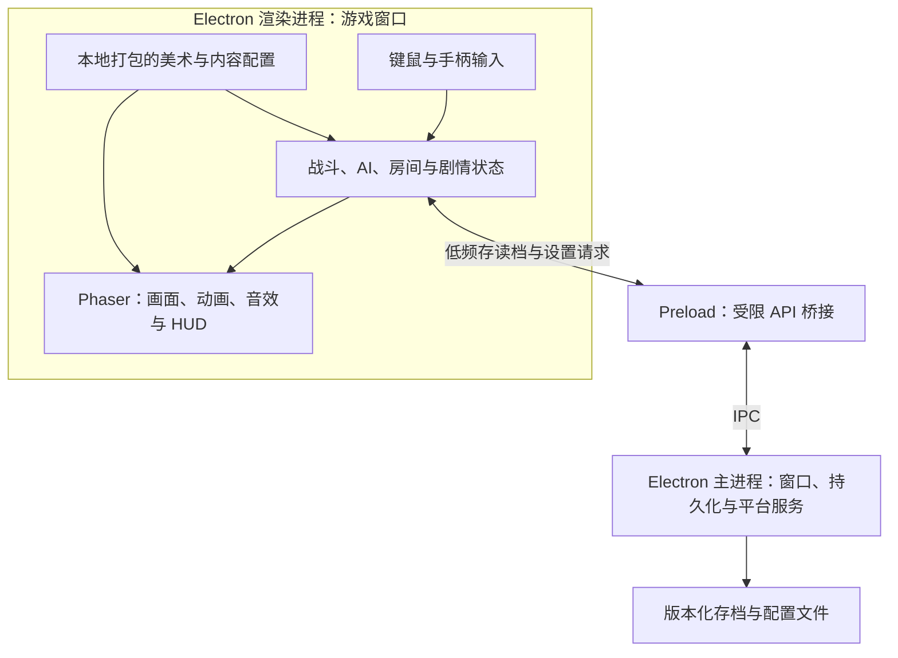

# 九鼎：技术架构与实现风险评估

历史评估说明（2026-10-20）：本文是2026-10-16的Electron／Phaser选型依据，下文“当前”指该评估时点。现役工程已迁移到Godot原生2D＋带类型GDScript，见 [当前架构结论](九鼎_架构选型结论.md)与 [ADR-0010](adr/0010-godot-migration-direction.md)；当前工程职责、迁移风险和验收以 [Godot方案](九鼎_Godot架构评估与迁移落地方案_2026-10-19.md)及 [候选验收记录](migration/Godot候选_验收记录.md)为准。本文旧工具链、进程图和ABI建议仅用于复现旧版参照，玩法、存档一致性及素材生产风险仍按各自已确认范围理解。

日期：2026-10-16。阶段：架构评估已收束，最小工程已初始化并通过 macOS 启动与打包检查；游戏玩法与性能尚未实测，见 [工程初始化记录](工程初始化记录.md)。

当前命名为主 IP「九鼎」、副 IP「十日」。故事依据更新为《世界观与故事框架 v1.2》，变化与冲突见 [故事基线与架构影响](九鼎_故事基线_v1.2与架构影响.md)。本文文件名暂保留以保持既有链接有效。

## 结论与前提

**技术验证基线已确认：Electron＋TypeScript＋Phaser WebGL＋Electron Forge／Webpack＋版本化 JSON 存档。采用固定等距镜头、二维战斗平面和分层渲染实现 2.5D 观感。** 当前有效结论与验证范围见 [架构选型结论](九鼎_架构选型结论.md)；已验证最小启动链路，尚未验证战斗、存档及实际游戏性能。

v1.2 需要额外区分玩家身份、附体之神与借眼视角，区分单局时限和跨局香火，并引入签署历史驱动的地区版本与镜像共血结算。Q17—Q19 已确认同一个孩子的身体连续性、香火解锁深层且保留低档挑战，以及签署造成的地图变化下一局生效。早先随机更换信徒的方向作废，已确认的渲染与桌面运行边界继续有效。

已确认：选择第二张的民俗皮影与第三张的像素质感；主玩法采用固定等距俯视、二维战斗平面，以分层、遮挡和光效实现 2.5D 观感；桌面框架采用 Electron。原大纲的第一人称与本轮主玩法镜头选择不同，架构评估以本轮确认的等距俯视为准，不修改原始大纲。

2026-10-16 访谈确认：首版面向 Windows／macOS，按单机离线设计，不包含联机合作、共享世界或排行榜竞争，不承诺低成本加入实时联机；移动和主机平台不属于首版目标。首版不要求自由旋转镜头或复杂立体地形战斗。一局等于一次神降，包含多个房间，阵亡、香尽或完成胜利结算后结束；换房间不会重新点香或更换附体之神。先交付小范围可玩验证，再扩展完整内容。

第二轮访谈确认：一局主攻一个地区；血量、临时强化与临时战利品局末重置，地区解锁、主线进度、传说与九鼎碎片跨局保留。一炷香的单局时限仅在可操作的冒险过程中计时，暂停、强制剧情对白、加载与失焦期间停止；中断后从最近完成的房间结算点续玩，保留当时剩余单局时间，未结算房间重开，中断本身不算阵亡。房间内部手工设计，顺序、敌人与奖励随机组合，必要剧情节点必须可达。后羿支持 WASD＋鼠标与双摇杆的独立移动瞄准。

Q20—Q24 进一步确认：Boss 击败后进入停时的战后结算并建立检查点；签署按地区独立统计，平票沿用当前版本；累计香火全档案共享，正式局末只增加一次，特殊档案额外来源仅首次发放，退出／恢复不增加。美术为皮影主导的像素质感混合画风，以 1080p 输出下的 60 FPS 为目标，允许特效和内部渲染分辨率降级。前述历史段落中的单局“香火”指一炷香的时限，不指累计数值。

Q25—Q28 已确认上述工具链、离线动画图集交付、鼎成进度重置边界及战斗／借眼／签署／恢复的最小验证闭环。早先的候选项已成为技术验证基线，具体版本仍在安装包验证后锁定。辅助瞄准、制作工具、发行渠道、最低配置、团队规模与预算仍待后续输入或实验。术语见 [GLOSSARY.md](../GLOSSARY.md)，完整确认记录见 [玩法与运行规则](十日_玩法与运行规则.md)，技术选择理由见 [ADR-0006](adr/0006-validation-toolchain.md) 与 [ADR-0007](adr/0007-offline-animation-atlases.md)。

初始化前没有旧引擎工程，因而无需迁移。当前已新增最小 Electron／Phaser 启动代码与锁定依赖；它只证明工程链路可启动，不提供实际战斗性能数据。

## 1. “2.5D”要先划清技术含义

| 路线 | 实现方式 | 与本项目的关系 | 代价 |
| --- | --- | --- | --- |
| A：二维实现纵深观感 | 角色和场景使用精灵图；等距投影、脚底深度排序、前后景、视差、接触阴影和少量光效形成空间感；碰撞发生在二维世界平面 | **已确认为首版基线**，最贴合固定镜头和皮影、像素表现 | 遮挡和美术拆层需要专门规范，不提供真实三维体积 |
| B：二维角色 + 真实三维场景 | Three.js 正交相机、低模场景、贴片角色、三维深度与选取 | 如果“2.5D”明确要求真实三维地形、相机转动或几何光影，应改选此路线 | 增加建模、材质、贴片朝向、透明排序、像素采样与关卡工具成本 |

第二、三张图证明的是目标气质，不证明采用了哪种引擎。选择等距俯视也不等于必须使用三维引擎。

Phaser 官方明确说明其核心是二维框架，并不内置三维渲染或三维物理。Three.js 提供正交相机，其 WebGLRenderer 当前要求 WebGL 2。不能把 Phaser 的二维纵深方案当作以后可零成本升级的真实三维方案。[Phaser 定位](https://docs.phaser.io/phaser/getting-started/what-is-phaser)、[Three.js 正交相机](https://threejs.org/docs/pages/OrthographicCamera.html)、[Three.js WebGLRenderer](https://threejs.org/docs/pages/WebGLRenderer)

## 2. 已确认的技术验证栈与实现建议

| 层次 | 基线或实现建议 | 选择理由与边界 |
| --- | --- | --- |
| 桌面容器 | 已确认 Electron，版本待实际验证后锁定 | 窗口、应用生命周期、文件存档、系统与发行集成 |
| 开发语言 | TypeScript | 战斗状态、内容配置和存档结构有明确约束 |
| 游戏框架 | Phaser + WebGL | 复用场景、相机、输入、动画、加载、音频和二维物理；技能、AI、剧情仍由项目实现 |
| 战斗模块 | TypeScript 模块 + 状态机 | 分离角色状态、命中规则和表现；先保持简单，不自建通用引擎或完整 ECS |
| 场景与内容 | 模块化房间与图集；内容配置采用 JSON 为实现建议 | 手工房间、随机组合和动画图集交付已确认；非存档内容配置的具体格式不在本轮固定 |
| 动画 | 已确认离线制作、序列帧与图集交付，运行时按需分层组合 | 制作端工具待选；首个版本不接入专用骨骼运行时，方向、独立瞄准和图集内存待实测 |
| 界面 | 战斗 HUD 使用游戏场景；复杂设置页按需使用 DOM | 游戏逐帧状态由游戏循环维护，避免高频 DOM 更新竞争主线程 |
| 音频与输入 | 先使用框架音频和标准键鼠、Gamepad API | 键鼠与双摇杆独立瞄准已确认；具体 API、辅助瞄准及设备映射仍需验证 |
| 存档 | 已确认带版本的 JSON；主进程持久化为实现建议 | 临时文件、替换、备份与迁移需验证；自动恢复不得撤销已完成的鼎成主动重置 |
| 开发与发行 | 已确认 Electron Forge + Webpack 插件 | 原 Vite 插件建议已作废；具体版本经实际打包验证后锁定 |

2026-10-16 官方文档核查：Phaser 支持等尺寸 spritesheet 与 JSON atlas，并可用帧名／帧号定义动画，无需因此引入 Spine 运行时。但动画资源不自动提供命中、无敌帧或打断规则；一次游戏帧可能跨越多个动画帧，战斗有效时间不能仅依赖最后显示的图片帧。[Phaser Loader](https://docs.phaser.io/api-documentation/class/loader-loaderplugin#atlas)、[动画](https://docs.phaser.io/phaser/concepts/animations)、[动画更新事件](https://docs.phaser.io/api-documentation/namespace/animations-events#animation_update)

早先建议的 Forge Vite 插件仍被官方标为 experimental，并明确未来 minor release 也可能包含不兼容变更，因此已改选 Forge Webpack。Webpack 插件文档没有相同的实验性声明；这不代表其零风险或无需打包验证。[Forge Vite](https://www.electronforge.io/config/plugins/vite)、[Forge Webpack](https://www.electronforge.io/config/plugins/webpack)

Phaser 的 Scene 已覆盖菜单、关卡、HUD 等生命周期与子系统组织。选它是为了减少游戏基础设施的自研工作，不意味着动作游戏的手感和工具链会自动具备。[Phaser Scenes](https://docs.phaser.io/phaser/concepts/scenes)

替代方案：PixiJS 更适合团队已有游戏循环、碰撞和内容工具，只需要灵活渲染层的情况。本项目尚无这些基础，不优先承担额外自研成本。PixiJS 当前文档仍推荐生产环境优先 WebGL，因此也不建议将 WebGPU 作为首版前提。[PixiJS 渲染器](https://pixijs.com/8.x/guides/components/renderers)

## 3. 运行架构与职责

战斗输入、碰撞、AI、动画调度都在游戏窗口内运行，**不逐帧通过 IPC 传输角色和子弹状态**。主进程不执行战斗计算；本地美术资源由渲染侧加载，避免用 IPC 搬运纹理。先使用单个游戏窗口，只有实际分析发现阻塞后，再考虑将房间预计算等任务放到 Worker 或 utility process。

Electron 采用 Chromium 多进程模型，主进程与渲染进程承担不同职责；preload 通过受限桥接连接系统能力。官方性能指南特别强调避免阻塞主进程与渲染进程，并以分析实测定位瓶颈。[Electron 进程模型](https://www.electronjs.org/docs/latest/tutorial/process-model)、[Electron 性能指南](https://www.electronjs.org/docs/latest/tutorial/performance)

建议项目边界保持为 desktop、game、content、assets 四部分即可，现阶段无需多服务、插件总线或通用编辑器平台。

## 4. 渲染与战斗的关键约束

1. **世界坐标与屏幕坐标分开。** 移动、射程和命中以世界平面计算，绘制时做等距投影；瞄准需做反变换，并考虑相机位移、缩放和震屏。不能直接用视觉压扁后的距离作为战斗距离。
2. **角色用脚底位置排序。** 建筑拆分底座、后景和前景；角色跳起或攻击时不让精灵图片边界改变遮挡顺序。高墙遮挡应有淡化或轮廓提示。
3. **命中区域与外观分离。** 按动作定义有效帧、攻击区域、受击区域和无敌帧；快速箭矢验证跨步穿透问题，需要时使用线段检测。骨骼动画或皮影长袖不能直接决定受击范围。
4. **统一模拟时间。** 以固定逻辑步长作为验证目标，复用或协调引擎物理步进，避免另开冲突的计时器；插值只影响表现。失焦、暂停、卡顿恢复时不无限补算历史帧。
5. **像素规则先统一。** 确定素材像素密度、参考分辨率与采样方式。皮影轮廓和像素场景需要共同遵守色板、光照方向和边缘规范；视觉像素对齐不应损害物理或瞄准精度。
6. **控制透明叠加。** 烟雾、皮影半透明、残影和全屏滤镜容易造成重复绘制与批次拆分。优先图集、预烘焙纹理、接触阴影和局部光效，逐项验证动态灯光价值。

有关图集、滤镜、混合模式、频繁文字更新的成本，GPU 精灵渲染框架已有明确性能建议；具体 Phaser 项目仍需独立测量，不能套用其他引擎的对象数量上限。[PixiJS 性能建议](https://pixijs.com/8.x/guides/concepts/performance-tips)

## 5. 实现风险

风险等级为本项目的工程判断，不是跑分结果。

| 风险 | 等级 | 具体影响 | 缓解与验收方式 |
| --- | --- | --- | --- |
| 皮影与像素规则冲突 | 高 | 模糊轮廓、骨骼平滑变形、相机缩放可能破坏像素质感 | 同一角色做原尺寸和不同窗口尺寸对比，先通过一间房的美术验收再批量生产 |
| 多方向动画与内容成本 | 高 | 等距移动、独立瞄准、攻击和受击让素材组合快速增长 | 先完成一个角色的完整动作集，验证四或八方向及镜像可用性；例如八方向×六动作×八帧就是 384 个帧位，仅为规模示例 |
| 遮挡、瞄准与命中不一致 | 高 | 看起来击中却未命中，或被建筑挡住无法读招 | 调试显示脚点、世界碰撞体、攻击区域和瞄准落点；测试柱子、墙角、台阶装饰和大体型 Boss |
| 密集战斗帧时间尖峰 | 高 | AI、碰撞、临时对象垃圾回收、纹理上传和透明特效引发瞬时卡顿 | 对对象生命周期、碰撞筛选、预加载和特效分级做针对性分析；只在确有瓶颈时加复杂优化 |
| 肉鸽内容和剧情状态组合 | 高 | 地区、奖励词条、请神深度与签署历史互相影响；随机地图可能无法到达剧情条件 | 手工房间随机组合；区分跨局身份、附体状态、证据与签署；后羿可看完关键剧情，不以掌握其他角色操作作为主线门槛 |
| Electron 运行与 GPU 差异 | 中高 | 不同驱动、高 DPI、多屏、失焦和恢复行为可能不同 | 在目标平台测试真实安装包；纹理或上下文异常时有恢复或回到最近安全检查点的流程 |
| 多窗口与高频跨进程通信 | 中 | 序列化和调度造成不必要延迟 | 单游戏窗口，主循环留在渲染侧；IPC 只做低频系统请求 |
| 存档损坏与叙事损失机制 | 高 | 重复结算香火、签署记录不一致、洛基记忆损失与结局重启可能破坏进度；后置盘古机制还涉及地图消失 | 明确房间结算、档案签署和局末结算边界；验证恢复时不漏发／重复发放；后置机制单独评估，不塞入首个战斗验证 |
| 桌面发行与原生依赖 | 中 | 原生扩展要匹配 Electron ABI、系统与 CPU 架构；开发环境可用不代表安装包可用 | 首个验证阶段就打包；需要 Steam 功能时单独验证绑定、成就、云存档路径和覆盖层，评估更新渠道 |
| 完整九图的范围膨胀 | 高 | Boss、房间、动画、音效与叙事的生产成本可能超过基础技术开发 | 先验证一关的完整闭环和单份内容生产成本，再估总工期 |

生成概念图不能直接作为可生产的角色动画、碰撞数据或场景图集。连续帧、方向一致性、部件拆分与像素清理需要正式资产管线。

Electron 的后台节流默认开启，页面进入后台时动画和计时可能受到影响。已确认一炷香的单局计时在暂停、强制剧情对白、加载与失焦时停止，不能直接按系统墙钟推进；技能等其他模拟时间仍应保持一致的暂停边界。原生 Node 模块通常需要按 Electron 重编译；macOS 对外发行还需纳入签名和公证流程。[BrowserWindow 后台节流](https://www.electronjs.org/docs/latest/api/browser-window)、[原生模块](https://www.electronjs.org/docs/latest/tutorial/using-native-node-modules/)、[代码签名](https://www.electronjs.org/docs/latest/tutorial/code-signing)

运行时边界采用 contextIsolation、sandbox、关闭 renderer 的 nodeIntegration，仅暴露存档和设置等白名单操作；这是 Electron 架构的一部分。[Electron 安全建议](https://www.electronjs.org/docs/latest/tutorial/security)

## 6. 已确认的最小验证范围

**已确认先交付战斗与叙事状态验证：后羿＋一段汤谷流程＋少量敌人＋索尔一个阶段＋死亡重开，一次借眼／跳过，一次签署到下一局地图变化，并验证中途退出恢复。** 使用最少且能代表目标画风的素材；不制作其他地区、完整角色与完整结局。具体工作量与排期尚未估算。

| 验证步骤 | 成功标准 |
| --- | --- |
| 视觉与空间 | 同屏显示皮影角色、像素场景、前后遮挡与预警区；常用窗口尺寸下画风一致；脚点与碰撞一致 |
| 战斗手感 | 移动、瞄准、射箭、闪避与受击构成闭环；30/60/高刷新率渲染条件下技能时长和无敌帧语义一致 |
| 压力与资源生命周期 | 在基准场景与压力场景记录帧时间分布、内存及纹理使用；循环进出房间后没有持续无界增长 |
| Electron 生命周期 | 失焦、最小化、睡眠恢复、关闭重开时，香火、输入和音频遵守既定暂停规则；模拟中断存档可回到有效版本 |
| 发行可用性 | 在目标机器运行已打包应用；验证键鼠、手柄重连、窗口缩放、存档路径和资源加载 |

性能测试先确定一台最低目标配置。已确认以 1080p 输出、60 FPS 为目标；验收建议关注约 16.7ms 的帧预算、P95/P99 帧时间和重复出现的长帧，不只看平均 FPS。敌人与投射物数量应以实际玩法峰值建立基准，再逐级增加；目前没有依据承诺“同屏多少个一定流畅”、安装包大小、最低内存或完整制作工期。

可使用 Vitest 验证伤害、无敌帧、随机种子下的房间可达性、剧情条件和存档迁移；图像风格、操作反馈与设备差异仍需实机检查。随机种子可用于复现房间与奖励生成，不自动保证整个游戏确定性或支持回放。

## 7. 验证任务与后续制作输入

- 二维分层纵深、Phaser WebGL、Forge Webpack 与版本化 JSON 已确认为验证基线；具体版本和制作工具在实际使用与打包验证后锁定。
- Windows／macOS 目标已确认；发行渠道、平台验证顺序及最低硬件配置仍待确定。
- 首版不要求真实立体地形战斗或旋转镜头；装饰性的高度表现仍需在美术和命中判定中保持一致。
- 一局主攻一个地区、暂停规则、基本跨局保留、房间及战后检查点续玩、玩家身体连续、低档重玩、香火累计来源、地区签署与平票、下一局生效的地图变化已确认；档位分期、中断重试与提交细节仍待确定。
- 皮影主导的像素质感混合画风、离线制作与图集交付已确认，不要求全画面严格像素网格；实际动作、方向数与素材内存需要实测。
- 1080p 输出／60 FPS 为已确认目标，最低硬件与帧时间验收方法仍待指定和实测。
- 团队是否有 TypeScript 游戏开发和动画资产制作经验。Electron 熟练度不能替代动作战斗、美术与关卡能力。

已确认先进行小范围战斗验证，再依据帧时间、操作反馈和素材生产效率决定是否进入九图多角色的完整制作。若未来增加真实三维要求，则应在生产大量素材前重开渲染路线决策，Electron 桌面容器仍可保留。
